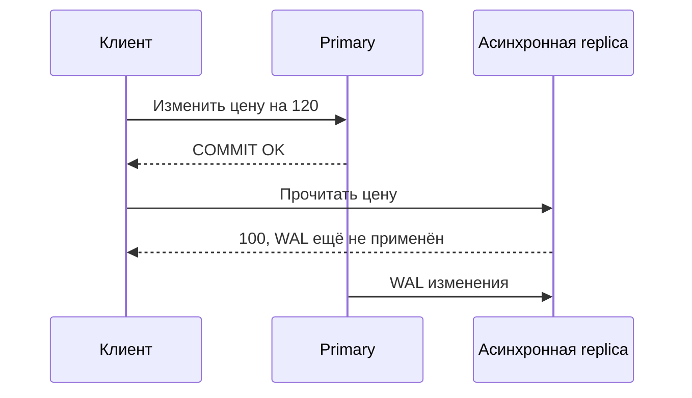

# Репликация PostgreSQL

Реплика получает изменения первичного сервера. Асинхронная копия может отставать, синхронная заставляет commit ждать выбранного подтверждения. Отдельно определяется, кто имеет право стать новым primary.

Replication повышает доступность и масштабирует некоторые чтения, но сама по себе не является backup и не определяет автоматический failover.

## Физическая потоковая репликация

Primary передаёт WAL, standby replay-ит те же физические изменения всего cluster. Версии major PostgreSQL у primary и standby должны соответствовать требованиям binary/physical compatibility; physical replica не выбирает отдельные tables.

По умолчанию streaming replication asynchronous: commit primary не ждёт standby, поэтому при аварийном promotion возможна потеря последних transactions. Synchronous replication заставляет commit ждать указанных synchronous standbys на выбранной стадии (`remote_write`, `on`/flush, `remote_apply`), повышая durability/visibility ценой latency и availability при недоступности required standbys.

Hot standby обслуживает read-only queries. Долгий query может конфликтовать с WAL replay и быть отменён; бесконечная задержка replay увеличивает lag. `hot_standby_feedback` уменьшает cleanup conflicts, но способен вызвать bloat на primary.

## Логическая репликация

Publisher передаёт логические row changes выбранных publications, subscriber применяет их к tables. Это удобно для subset replication, migrations и разных схем topology. DDL и sequence state не реплицируются как обычные table changes автоматически; schema и cutover требуют отдельного плана.

Logical replication обычно требует replica identity для `UPDATE`/`DELETE`. Initial table synchronization и последующий stream должны быть включены в capacity plan.

## Слоты, отставание и переключение

Replication slot удерживает нужный WAL/версии строк до подтверждения consumer. Он защищает от преждевременного удаления, но упавший consumer может заполнить disk; задавайте/наблюдайте retention limits и `pg_replication_slots`.

Измеряйте отдельно:

- send/write/flush/replay LSN lag;
- time lag и replay delay;
- replication slot retained bytes;
- conflicts/cancelled queries;
- способность standby реально promotion-нуться и принять traffic.

Failover manager, fencing старого primary, routing клиентов, data-loss policy и rejoin вынесены за пределы core streaming replication. Регулярный switchover test важнее наличия standby в dashboard.

## Read-after-write



Читайте с primary или ждите replay известного LSN выбранной replica. Случайная задержка 100 ms не гарантирует актуальность.

```sql
-- primary
SELECT application_name,state,sync_state,sent_lsn,flush_lsn,replay_lsn
FROM pg_stat_replication;
-- standby
SELECT pg_is_in_recovery(),pg_last_wal_replay_lsn();
```

write/flush/replay показывают разные этапы; replay_lag не постоянный ETA и при простое может быть NULL. remote_apply ждёт выбранную синхронную standby, не любую replica.

При promotion изолируйте прежний primary от записи (fencing), обновите routing и проверьте timeline. Два писателя создают несовместимые истории. Logical replication отдельно проверяет DDL, sequences и replica identity. Failover logical slots PostgreSQL 18 требуют конфигурации синхронизации: любой slot не становится готовым к promotion автоматически.

## Источники

- [High availability and load balancing](https://www.postgresql.org/docs/18/high-availability.html)
- [Warm standby and streaming replication](https://www.postgresql.org/docs/18/warm-standby.html)
- [Logical replication](https://www.postgresql.org/docs/18/logical-replication.html)

- [Дополнительная документация PostgreSQL 18](https://www.postgresql.org/docs/18/logical-replication-failover.html)

## Проверь себя

1. **Почему replica не backup?**

   <details>
   <summary>Ответ</summary>

   Ошибочное удаление реплицируется; нужна независимая история восстановления.

   </details>

2. **remote_apply гарантирует свежесть любой replica?**

   <details>
   <summary>Ответ</summary>

   Нет, гарантии относятся к ожидаемым синхронным участникам.

   </details>
