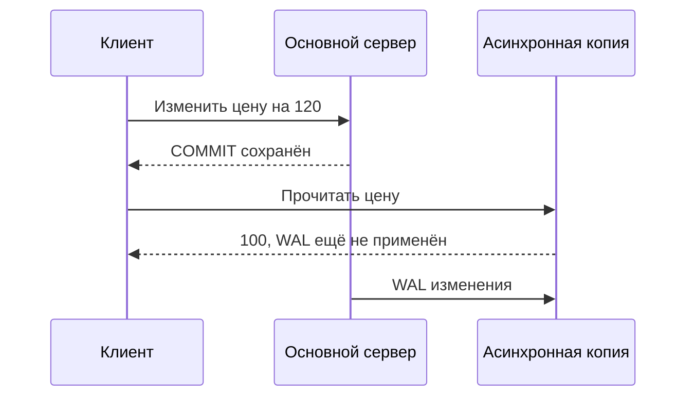

# Репликация PostgreSQL

Репликация передаёт изменения основного сервера на копию. Это помогает читать с нескольких серверов и продолжить работу после отказа. Копия может отставать, а переключение требует отдельного решения, кто теперь имеет право принимать запись.

## Физическая и логическая копия

Физическая реплика получает WAL и повторяет изменения всего экземпляра базы. Она не выбирает отдельные таблицы; основные версии серверов должны удовлетворять требованиям физической совместимости. Режим hot standby позволяет читать на реплике, но запрос может быть отменён, если мешает применению журнала.

Логическая реплика получает изменения строк выбранных таблиц. Это удобно для переноса части данных и миграций. Изменения схемы и состояние sequence не передаются автоматически как строки; для обновления и удаления нужна идентификация строки (replica identity).

## Когда COMMIT получает ответ

Асинхронный режим не задерживает `COMMIT` ради копии. Если основной сервер погибнет раньше передачи последних изменений, при переключении они могут потеряться.

Синхронный режим ждёт выбранные реплики: `remote_write` — запись на их стороне, обычный синхронный режим — надёжное сохранение, `remote_apply` — применение изменений. Ожидание добавляет задержку и может остановить запись при недоступности участников. Оно не делает любую реплику актуальной.

## Что удерживает журнал

Слот удерживает WAL, который получатель ещё не подтвердил. Если получатель исчез, накопление продолжается. Следите за байтами и ограничениями хранения. `hot_standby_feedback` уменьшает конфликты долгих чтений с очисткой, но может удерживать старые версии на основном сервере.

## Безопасное переключение

Старая основная база должна потерять возможность записи — это ограждение (fencing). Затем меняют маршрутизацию клиентов и проверяют новую историю журнала. Иначе два писателя создадут несовместимые данные. Менеджер переключения не появляется автоматически из протокола передачи WAL.

Реплика не заменяет резервную копию: ошибочное удаление тоже передаётся. Проверяйте восстановление и переключение, включая настройки слотов логической репликации.

## Read-after-write



Читайте с primary или ждите replay известного LSN выбранной replica. Случайная задержка 100 ms не гарантирует актуальность.

```sql
-- primary
SELECT application_name,state,sync_state,sent_lsn,flush_lsn,replay_lsn
FROM pg_stat_replication;
-- standby
SELECT pg_is_in_recovery(),pg_last_wal_replay_lsn();
```

Поля write, flush и replay относятся к получению, надёжному сохранению и применению WAL. `replay_lag` — наблюдаемая задержка, не прогноз времени догоняния; при простое он может быть `NULL`. `remote_apply` ждёт выбранную синхронную реплику, не любую доступную копию.

При повышении реплики до основной сначала отстраните прежний сервер от записи и измените маршрут клиентов. Проверьте новую ветвь истории WAL (timeline). Для логической репликации отдельно проверяют схему, sequence и идентификацию строк. Слоты с поддержкой переключения в PostgreSQL 18 требуют настройки синхронизации: обычный слот не становится автоматически готовым на новой основной базе.

## Источники

- [High availability and load balancing](https://www.postgresql.org/docs/18/high-availability.html)
- [Warm standby and streaming replication](https://www.postgresql.org/docs/18/warm-standby.html)
- [Logical replication](https://www.postgresql.org/docs/18/logical-replication.html)

- [Дополнительная документация PostgreSQL 18](https://www.postgresql.org/docs/18/logical-replication-failover.html)

## Проверь себя

1. **Почему реплика не заменяет резервную копию?**

   <details>
   <summary>Ответ</summary>

   Ошибочное удаление передаётся ей. Для восстановления прежнего состояния нужна независимая история.

   </details>

2. **Гарантирует ли remote_apply актуальность любой реплики?**

   <details>
   <summary>Ответ</summary>

   Нет. Он ждёт выбранных синхронных участников, а другие копии могут отставать.

   </details>
