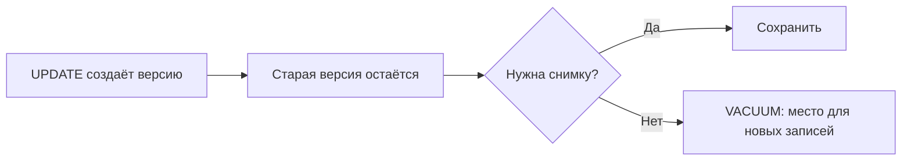

# VACUUM и autovacuum

После `UPDATE` и `DELETE` остаются старые версии строк: их ещё могут читать другие транзакции. Когда версии никому не нужны, `VACUUM` освобождает место внутри таблицы для новых записей. Это регулярное обслуживание многоверсионной базы.

## Три отдельные задачи

Очистка убирает ненужные версии и записи индексов. Заморозка (freeze) помечает старые идентификаторы транзакций так, чтобы безопасно пережить их циклическое переполнение. `ANALYZE` собирает статистику для планов. `VACUUM` без `ANALYZE` не заменяет сбор статистики.

Autovacuum запускает обслуживание по порогам количества изменений и размера таблицы. Большая часто изменяемая таблица может требовать отдельных порогов: стандартная доля от большого объёма иногда означает слишком долгое ожидание.

## Почему очистка не помогает

Если старый снимок видит строку, сервер обязан сохранить её версию. Долгая или подготовленная транзакция, слот репликации или обратная связь реплики могут удерживать границу очистки. Более частый VACUUM не отменяет эту необходимость: выясните, кто удерживает данные.

`n_dead_tup` — оценка числа мёртвых версий, не точный размер потерь. Сопоставьте её с размером таблицы, частотой изменений и журналом обслуживания. Возраст `datfrozenxid` и `relfrozenxid` показывает риск переполнения идентификаторов, `pg_stat_progress_vacuum` — фазу работы.

## Почему файл остался большим

Обычный VACUUM делает место пригодным для повторной записи внутри файла. Он может обрезать пустой конец, но не уплотняет все промежутки. `VACUUM FULL` переписывает таблицу: нужны дополнительное место и эксклюзивная блокировка, мешающая чтению и записи. Это отдельная тяжёлая операция, не замена autovacuum.

## Диагностика роста

```sql
SELECT relname,n_live_tup,n_dead_tup,last_autovacuum,last_autoanalyze
FROM pg_stat_user_tables ORDER BY n_dead_tup DESC LIMIT 10;
SELECT pid,now()-xact_start AS transaction_age,backend_xmin,state
FROM pg_stat_activity WHERE xact_start IS NOT NULL ORDER BY xact_start;
SELECT datname,age(datfrozenxid) FROM pg_database;
```

Числа живых и мёртвых версий — оценки. Сравнивайте их с размером таблицы, частотой изменений и журналом обслуживания. Если старая транзакция удерживает нужные версии, более частый VACUUM не удалит их: найдите удерживающий снимок или другой источник ограничения, например логический слот.



Обычный VACUUM может обрезать свободные страницы в конце файла, но не уплотняет промежутки посередине. Для большой часто изменяемой таблицы настройка порогов зависит от скорости изменений и возможностей диска. PostgreSQL 18 также поддерживает максимальный порог запуска и запуск по вставкам. Даже без мёртвых версий заморозка идентификаторов остаётся необходимой.

## Источники

- [Routine vacuuming](https://www.postgresql.org/docs/18/routine-vacuuming.html)
- [VACUUM](https://www.postgresql.org/docs/18/sql-vacuum.html)
- [Autovacuum settings](https://www.postgresql.org/docs/18/runtime-config-vacuum.html)

## Проверь себя

1. **Заменяет ли VACUUM сбор статистики ANALYZE?**

   <details>
   <summary>Ответ</summary>

   Нет. Очистка и статистика — разные задачи, хотя можно выполнить обе.

   </details>

2. **Почему файл не уменьшился после очистки?**

   <details>
   <summary>Ответ</summary>

   Место обычно освобождается внутри файла для новых записей. Полное уплотнение требует другой тяжёлой операции.

   </details>
