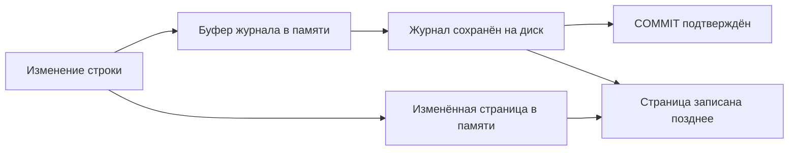

# Журнал изменений: WAL

Изменять каждый файл таблицы сразу дорого. PostgreSQL сначала сохраняет последовательный журнал изменений — **WAL**, Write-Ahead Log. Страницы данных могут попасть на диск позже: после аварии сервер прочитает журнал и восстановит изменения.

## Главное правило порядка

Описание изменения должно надёжно сохраниться в журнале раньше изменённой страницы. При обычном синхронном локальном `COMMIT` сервер ждёт сохранения записи о завершении транзакции в WAL, а не всех страниц таблицы. Несколько транзакций могут разделить одно сохранение журнала — групповое подтверждение (group commit).

При `synchronous_commit=off` ответ может прийти раньше сохранения WAL. Работающая база остаётся согласованной, но после аварии возможна потеря недавних подтверждённых транзакций. Отключение `fsync` опаснее: оно может повредить согласованность файлов.

## Контрольная точка и позиция

Контрольная точка (checkpoint) обеспечивает запись накопленных страниц и ограничивает, сколько журнала нужно повторить после аварии. Слишком частые точки добавляют запись, слишком редкие увеличивают восстановление. Полный образ первой изменённой страницы после точки помогает пережить частичную запись страницы на диск.

**LSN** — позиция в журнале, адрес в потоке байтов. Разность двух LSN показывает объём журнала, не задержку в секундах.

## Восстановление на выбранный момент

Для PITR нужна базовая резервная копия и непрерывная цепочка WAL после неё. Сервер восстанавливает копию и повторяет журнал до выбранного времени или позиции. Пропущенный необходимый сегмент прерывает цепочку.

Архивирование подтверждает успех только после надёжного сохранения сегмента. Слот репликации и неисправный архив могут удерживать WAL, пока диск не заполнится. Проверяйте свободное место и восстановление данных, а не только создание файлов.

## Путь подтверждения commit



Схема описывает локальное синхронное сохранение. WAL сначала находится в буферах памяти, затем надёжно записывается. Если настроено ожидание синхронной реплики, перед ответом COMMIT добавляется соответствующий этап подтверждения реплики.

```sql
SHOW fsync;
SHOW full_page_writes;
SHOW synchronous_commit;
SELECT pg_current_wal_lsn();
SELECT wal_records,wal_fpi,wal_bytes FROM pg_stat_wal;
```

`SHOW fsync` показывает, включена ли надёжная синхронизация файлов; `SHOW full_page_writes` — сохранение полных образов изменённых страниц для защиты от частичной записи; `SHOW synchronous_commit` — какое подтверждение ждёт транзакция. `pg_current_wal_lsn()` возвращает текущую позицию WAL, например `0/16B6C50`, не время. В `pg_stat_wal` `wal_records` — накопленное число записей, `wal_fpi` — полных образов страниц, `wal_bytes` — объём журнала. Сравните значения до и после нагрузки: рост байтов и образов показывает работу журнала, а не автоматически полезный размер данных.

После переключения на новую основную базу может появиться новая ветвь истории журнала — timeline. Для восстановления нужно выбрать правильную ветвь и точку остановки, а не просто самый новый файл. Проверка восстановления включает загрузку файлов, доступ к ключам шифрования при их использовании и чтение ожидаемых данных.

## Источники

- [PostgreSQL 18: статистика WAL и активных процессов](https://www.postgresql.org/docs/18/monitoring-stats.html)

- [Reliability and WAL](https://www.postgresql.org/docs/18/wal.html)
- [WAL configuration](https://www.postgresql.org/docs/18/runtime-config-wal.html)
- [Continuous archiving and PITR](https://www.postgresql.org/docs/18/continuous-archiving.html)

## Проверь себя

1. **Почему COMMIT не ждёт всех страниц таблицы?**

   <details>
   <summary>Ответ</summary>

   Надёжно сохранённый журнал позволяет восстановить изменения; WAL записывается раньше изменённых страниц.

   </details>

2. **Что помешает восстановлению при исправной базовой копии?**

   <details>
   <summary>Ответ</summary>

   Пропуск необходимого журнала, неверная ветвь истории или точка остановки, недоступные файлы и ключи.

   </details>
