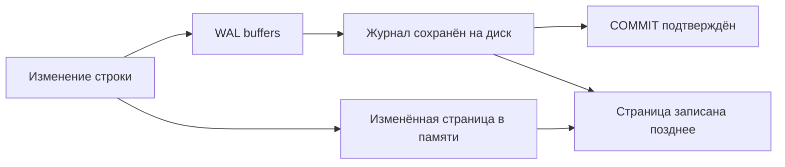

# Write-Ahead Log

WAL — журнал изменений для восстановления после аварии. Изменённую страницу можно записать позже, потому что сохранённый журнал позволяет восстановить её.

WAL реализует правило write-ahead: описание изменения должно попасть в durable log раньше изменённой data page. После crash PostgreSQL replay-ит WAL от последнего checkpoint и приводит data files к согласованному состоянию.

## Commit и durability

Backend формирует WAL records в WAL buffers. При обычном synchronous commit успешный `COMMIT` означает, что commit record flush-нут на local durable storage; страницы данных могут быть записаны позже. Group commit объединяет flush нескольких transactions.

`synchronous_commit = off` может уменьшить latency: transaction становится видна другим, но при аварии сервера или ОС возможна потеря недавних подтверждённых commits. Это ослабляет durability, а не atomicity/consistency работающего сервера. `fsync = off` и `full_page_writes = off` имеют существенно более опасные последствия и не являются обычной tuning-рекомендацией.

## Checkpoints и full-page images

Checkpoint фиксирует позицию, до которой dirty pages должны оказаться на диске, и ограничивает recovery time. Слишком частые checkpoints усиливают I/O и WAL из-за full-page images первой изменённой page после checkpoint. Слишком редкие увеличивают recovery time и storage pressure. Наблюдайте `pg_stat_checkpointer`, WAL volume и checkpoint causes.

LSN — позиция в WAL stream. Она позволяет измерять replication lag в bytes, задавать recovery target и координировать backup/restore.

## Archiving, backup и PITR

Continuous archiving сочетает base backup и непрерывный архив WAL. Для point-in-time recovery сервер восстанавливает base backup и replay-ит WAL до timestamp, transaction ID, named restore point или LSN.

Archive command должен возвращать success только после надёжного сохранения segment. Незаполняемый архив или replication slot способен удерживать WAL до исчерпания диска; мониторьте `pg_stat_archiver`, `pg_replication_slots`, `restart_lsn` и filesystem.

WAL — не замена backup: он зависит от подходящего base backup и политики retention. Регулярно проверяйте восстановление, а не только факт создания файлов.

## Путь подтверждения commit



Схема для локального synchronous commit; синхронная репликация может добавить ожидание standby.

```sql
SHOW fsync;
SHOW full_page_writes;
SHOW synchronous_commit;
SELECT pg_current_wal_lsn();
SELECT wal_records,wal_fpi,wal_bytes FROM pg_stat_wal;
```

LSN — позиция байта журнала, например 0/16B6C50; конкретное значение различается. Разность позиций показывает байты, а не секунды. Full-page image после checkpoint помогает пережить частичную запись страницы. fsync=off способен повредить согласованность файлов; synchronous_commit=off при исправном storage сохраняет crash-consistency, но допускает потерю недавних подтверждённых транзакций при аварии сервера, не только ОС.

PITR требует непрерывной цепочки WAL начиная с base backup; один пропущенный сегмент останавливает восстановление. Проверяйте target, timeline после promotion, сохранность файлов и чтение восстановленных данных.

## Источники

- [Reliability and WAL](https://www.postgresql.org/docs/18/wal.html)
- [WAL configuration](https://www.postgresql.org/docs/18/runtime-config-wal.html)
- [Continuous archiving and PITR](https://www.postgresql.org/docs/18/continuous-archiving.html)

## Проверь себя

1. **Почему COMMIT не ждёт записи всех heap pages?**

   <details>
   <summary>Ответ</summary>

   Надёжный WAL позволяет восстановить изменения; соблюдается порядок write-ahead.

   </details>

2. **Что ломает PITR при исправном base backup?**

   <details>
   <summary>Ответ</summary>

   Пропуск необходимого WAL, неверные timeline/target либо недоступные файлы/ключи.

   </details>
