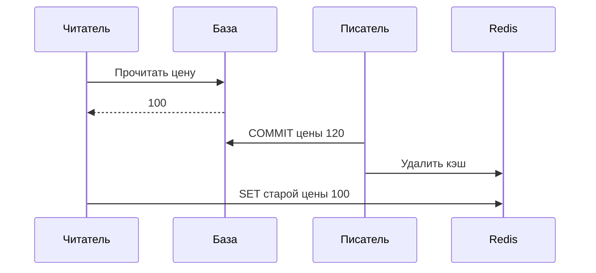

# Кэширование с Redis

Кэш хранит результат, который можно получить из основного источника повторно. Если объявление есть в Redis, сервис отвечает быстро. Если его нет, читает PostgreSQL и запоминает результат. Этот порядок называется **cache-aside**.

## Как обновлять данные

Основная база отвечает за правильность. После записи сервис обычно удаляет старое значение из кэша, чтобы следующее чтение загрузило новое. Но удаление и загрузка могут пересечься: пример ниже показывает, почему простая схема всё ещё допускает устаревшее значение.

TTL ограничивает обычное время хранения, но не доказывает строгую актуальность при гонках. Если нужны свежие права доступа или баланс, не полагайтесь на кэш без отдельного протокола версий и проверки основного источника.

## Когда кэш создаёт нагрузку

Если популярный ключ истёк, сотни запросов одновременно идут в базу. Это **лавина промахов**, cache stampede. Объединяйте одинаковые загрузки (`singleflight`), допускайте старое значение на время обновления, если это разрешено, и разносите сроки истечения случайной добавкой.

Запросы несуществующих id всегда промахиваются. Короткое хранение результата «не найдено» уменьшает нагрузку, но задерживает появление новой записи и требует учёта прав доступа. Ограничение числа запросов всё равно нужно.

## Что будет при отказе Redis

Переход всех запросов в базу безопасен только если она выдержит поток. Ограничивайте одновременные загрузки и очереди. Выберите явно: вернуть ошибку, старые данные или обратиться к базе с ограничением нагрузки. Ключ должен включать влияющие на результат параметры, например язык, фильтры и область доступа.

## Гонка загрузки и удаления



На схеме читатель получил 100 до изменения цены, но сохранил его в кэш после удаления. TTL отсчитывается с этой поздней записи. Если загрузчик завис на час, старые данные получат новый срок. Ограничьте время загрузки или проверяйте возрастающую версию при заполнении. После удаления ключа версия в нём уже отсутствует: условной записи нужен другой достоверный источник версии, иначе сравнивать не с чем.

```text
SET ad:42 '{"version":7,"price":120}' EX 30
GET ad:42
```

`GET` вернёт сохранённый JSON, пока ключ существует. Поле версии помогает сравнить актуальность, но обычный `SET` само сравнение не выполняет: условную запись нужно реализовать отдельно. `singleflight` объединяет загрузки одного процесса; у 30 экземпляров приложения всё ещё может быть 30 загрузчиков. При отказе кэша ограничивайте обращения к основной базе.

## Источники

- [Redis cache-aside](https://redis.io/docs/latest/develop/use-cases/cache-aside/)
- [Client-side caching](https://redis.io/docs/latest/develop/clients/client-side-caching/)

## Проверь себя

1. **Почему удаление кэша после записи не гарантирует свежесть?**

   <details>
   <summary>Ответ</summary>

   Читатель мог получить прежнее значение до записи и заполнить кэш им уже после удаления.

   </details>

2. **Почему TTL 30 секунд не ограничивает возраст данных ровно 30 секундами?**

   <details>
   <summary>Ответ</summary>

   Загрузка могла прочитать старое состояние задолго до SET. Новый срок начинается при заполнении кэша.

   </details>
