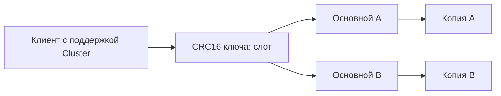

# Redis Cluster

Redis Cluster распределяет ключи между серверами. Это помогает хранить и обрабатывать больше данных, чем на одном узле. Для каждого ключа определяется **слот** — число от 0 до 16383; у слота есть текущий владелец.

## Как клиент находит сервер

Клиент с поддержкой Cluster знает соответствие «слот → узел». Слот вычисляется как `CRC16(key) mod 16384`. Если ключ переехал, ответ `MOVED` сообщает постоянного владельца. Во время переноса `ASK` временно направляет на другой узел: перед командой там нужно отправить `ASKING`, не считая маршрут постоянным.

Связанная операция над несколькими ключами обычно требует одного слота. Часть внутри фигурных скобок — hash tag — позволяет совместить ключи: `cart:{42}` и `items:{42}` используют одинаковый фрагмент `42`. Это удобство собирает нагрузку связанных ключей на одном узле.

## Что происходит при отказе

У владельца могут быть реплики, но изменения передаются асинхронно. Реплика, выбранная новым владельцем, способна не иметь последней подтверждённой записи. `WAIT` уменьшает риск, но не превращает Cluster в строго согласованное хранилище.

Возможность переключения зависит от доступности большинства основных узлов; обслуживание неполных слотов — также от настройки полного покрытия. Чтение с реплик включается явно и допускает устаревшие данные. Планируйте независимые зоны отказа, резервирование и проверку переключений.

## Почему одинаковое число слотов не означает одинаковую нагрузку

Один слот может содержать большой или очень популярный ключ. Следите за байтами, командами и процессором, а не только количеством слотов. Перенос большого ключа создаёт сетевую и вычислительную нагрузку. Cluster использует только database 0; разделение областей задаётся именами ключей и правами доступа.

## Два ключа одной операции

```text
CLUSTER KEYSLOT cart:{42}
CLUSTER KEYSLOT items:{42}
MSET cart:{42} ready items:{42} 3
MGET cart:{42} items:{42}
```

Оба KEYSLOT возвращают одинаковое число; MGET возвращает ready и 3. Без общего hash tag операция может получить CROSSSLOT. Это уменьшает сложность атомарности, но собирает нагрузку одного пользователя в один слот.



После `MOVED` обновите постоянный маршрут; после `ASK` выполните `ASKING` и команду на указанном узле только для этой попытки. Если ответ на `INCR` потерялся, повтор может увеличить число второй раз. Правильная маршрутизация не делает бизнес-повтор безопасным. Равное число слотов также не означает равные объём и загрузку: один горячий ключ остаётся на одном владельце.

## Источники

- [Scale with Redis Cluster](https://redis.io/docs/latest/operate/oss_and_stack/management/scaling/)
- [Redis Cluster specification](https://redis.io/docs/latest/operate/oss_and_stack/reference/cluster-spec/)

## Проверь себя

1. **Зачем часть ключа помещают в фигурные скобки?**

   <details>
   <summary>Ответ</summary>

   Общий hash tag помещает связанные ключи в один слот, где поддерживаются связанные атомарные операции.

   </details>

2. **Разделит ли добавление узлов нагрузку одного горячего ключа?**

   <details>
   <summary>Ответ</summary>

   Нет. Он остаётся у одного владельца. Помогают локальный кэш, объединение обращений или изменение модели данных.

   </details>
