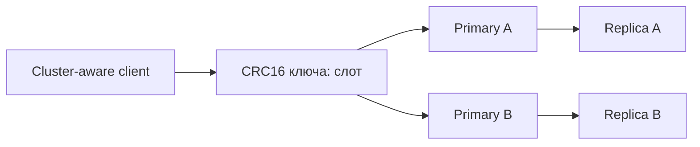

# Redis Cluster

Redis Cluster распределяет ключи по узлам. Клиент вычисляет слот ключа и отправляет команду владельцу; реплики помогают восстановить отдельный узел, но не делают записи синхронными.

Redis Cluster распределяет keyspace между primary nodes и выполняет failover их replicas. Он использует 16 384 hash slots: `CRC16(key) mod 16384`. Cluster-aware client хранит mapping slot → node и обрабатывает redirects.

## Routing и hash tags

`MOVED` сообщает постоянного владельца slot и обычно служит поводом обновить topology. `ASK` временно направляет command во время migration и требует сначала послать `ASKING` target node.

Multi-key command, transaction или Lua script обычно требует, чтобы все keys находились в одном slot. Hash tag заставляет хэшировать только содержимое `{...}`:

```text
cart:{user-42}
cart-items:{user-42}
```

Tags возвращают atomic multi-key operations, но чрезмерное объединение создаёт hot slot и мешает равномерному sharding.

## Availability и consistency

Replicas получают данные asynchronously. При failover возможно потерять acknowledged writes; в minority partition окно риска больше. Cluster прекращает обслуживание, если недоступно достаточно primary slots/majority для failover согласно configuration — это осознанный trade-off, а не linearizable consensus database.

Чтение с replicas требует явного opt-in клиента и допускает staleness. `WAIT` уменьшает риск, но не делает Cluster strongly consistent.

## Resharding

Slots можно переносить online между nodes. Во время migration clients должны корректно обрабатывать `ASK`/`MOVED`, а network и обе стороны — выдерживать traffic копирования. Большой key делает миграцию одного slot долгой и увеличивает pause/timeout risk.

Планируйте:

- минимум три primary для осмысленного sharding/majority и replicas в независимых zones;
- cluster bus connectivity и корректные announced addresses;
- равномерность slots, bytes, commands и hot keys — count slots сам по себе не отражает load;
- backup/restore, failover и rolling upgrade отдельно.

Cluster поддерживает только database 0; namespace задавайте prefixes/ACL, а не `SELECT` databases.

## Два ключа одной операции

```text
CLUSTER KEYSLOT cart:{42}
CLUSTER KEYSLOT items:{42}
MSET cart:{42} ready items:{42} 3
MGET cart:{42} items:{42}
```

Оба KEYSLOT возвращают одинаковое число; MGET возвращает ready и 3. Без общего hash tag операция может получить CROSSSLOT. Это уменьшает сложность атомарности, но собирает нагрузку одного пользователя в один слот.



При MOVED обновите знание постоянного владельца. При ASK в migration отправляйте ASKING на целевой узел и только затем исходную команду; не меняйте permanent mapping только из-за ASK. Повтор после сетевого timeout может исполнить неидемпотентный INCR дважды: routing retry не равен безопасному business retry. Равное число слотов не гарантирует равные bytes/CPU; один hot key всё ещё обслуживается одним shard.

## Источники

- [Scale with Redis Cluster](https://redis.io/docs/latest/operate/oss_and_stack/management/scaling/)
- [Redis Cluster specification](https://redis.io/docs/latest/operate/oss_and_stack/reference/cluster-spec/)

## Проверь себя

1. **Зачем hash tag?**

   <details>
   <summary>Ответ</summary>

   Для размещения связанных ключей в одном слоте и поддерживаемой multi-key атомарности.

   </details>

2. **Можно ли масштабировать один горячий key добавлением shards?**

   <details>
   <summary>Ответ</summary>

   Сам key остаётся на одном владельце; нужен local cache, batching или изменение модели.

   </details>
