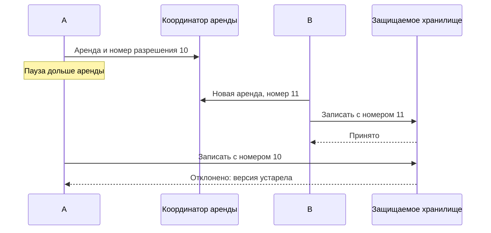

# Распределённые блокировки Redis

Блокировка Redis обычно выдаёт право работать на ограниченное время — **аренду**, lease. Команда `SET lock:key token NX PX 10000` создаёт ключ только при отсутствии и на 10 секунд. Получивший его клиент должен закончить или продлить аренду до истечения.

## Почему время не доказывает исключительность

Процесс может остановиться на 15 секунд из-за паузы среды. Аренда истечёт, другой клиент начнёт работу, затем первый проснётся. Если защищаемая база принимает обе записи, наличие ключа Redis не предотвратило двойной эффект.

Случайный token нужен, чтобы удалить только свою аренду: за время паузы ключ мог получить другой клиент. В Redis 8.4+ есть `DELEX ... IFEQ`; для старых версий ниже показан атомарный скрипт сравнения и удаления. Обычный `DEL` опасен. Продление тоже проверяет владельца и имеет ограниченный срок.

## Как отклонить устаревшего работника

Защищаемое хранилище может принимать возрастающий номер разрешения — **fencing token**. После принятия номера 11 оно отклоняет 10. Проверка и запись номера должны быть атомарными в самом хранилище. Случайный token аренды отвечает «мой ли ключ», возрастающий — «не устарела ли работа».

## Какие отказы надо учитывать

При асинхронном переключении Redis новый основной узел может не знать о выданной аренде и выдать вторую. Redlock пытается получить одинаковую аренду на большинстве независимых узлов; его гарантии зависят от ограничений времени, часов и отказов. Он не заменяет защиту внешнего ресурса от старого процесса.

Для критической правильности рассмотрите блокировку в самой основной базе или согласованный координатор с доказанными гарантиями. Для уменьшения лишних загрузок кэша аренды может хватить, если два выполнения безопасны. Для платежа отдельно нужны защита от повтора и гарантия внешнего эффекта.

## Проснувшийся старый владелец



Само защищаемое хранилище атомарно сравнивает номер разрешения с максимальным принятым и сохраняет новый номер вместе с изменением. Проверка в приложении до записи оставляет гонку. `INCR` на асинхронно реплицируемом Redis может потерять новый счётчик при переключении: без дополнительных гарантий он не является надёжным источником всегда возрастающих разрешений.

Для безопасного освобождения на старых Redis:

```lua
if redis.call('GET', KEYS[1]) == ARGV[1] then
    return redis.call('DEL', KEYS[1])
end
return 0
```

Скрипт возвращает 1, если удалил ключ со своим значением, иначе 0. `DELEX ... IFEQ` в Redis 8.4+ сокращает тот же сценарий. Случайный token защищает удаление чужой аренды; возрастающий fencing token позволяет внешнему ресурсу отклонить старую работу. Для платежа без такой проверки или идемпотентности аренда не предотвращает двойной эффект.

## Источники

- [Distributed locks with Redis](https://redis.io/docs/latest/develop/clients/patterns/distributed-locks/)
- [SET](https://redis.io/docs/latest/commands/set/)
- [DELEX](https://redis.io/docs/latest/commands/delex/)

## Проверь себя

1. **Чем случайный token отличается от возрастающего fencing token?**

   <details>
   <summary>Ответ</summary>

   Случайный защищает удаление своей аренды. Возрастающий позволяет хранилищу отклонить устаревшую работу.

   </details>

2. **Почему INCR не всегда выдаёт надёжно возрастающие разрешения?**

   <details>
   <summary>Ответ</summary>

   Асинхронное переключение может потерять последнее увеличение. Для ограждения нужна доказанная сохранность и монотонность.

   </details>
