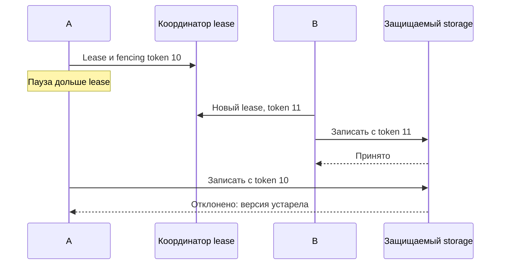

# Распределённые блокировки Redis

Распределённая блокировка Redis обычно является арендой: после TTL право работы истекает. Процесс, который был остановлен системой, может проснуться и продолжить старую работу — поэтому lease сам не защищает внешний ресурс.

Redis lock — lease с ограниченным временем действия, а не доказательство вечного mutual exclusion. Перед применением решите, что произойдёт при pause процесса, network partition, clock anomaly, failover и работе дольше TTL.

## Один Redis instance

Захватите key атомарно с уникальным случайным token и TTL:

```text
SET lock:invoice:42 <random-token> NX PX 10000
```

Освобождайте только собственный token. В Redis 8.4+ это можно сделать `DELEX lock:invoice:42 IFEQ <random-token>`; для старых версий используйте атомарный Lua compare-and-delete. Обычный `DEL` небезопасен: истёкший lock мог уже получить другой client.

Client обязан считать lock потерянным после истечения lease и прекратить защищаемую работу. Продление тоже должно compare-ить token и иметь bounded policy. GC pause или scheduler stall может пережить TTL, даже если process «не падал».

Primary + asynchronous replica failover не сохраняет mutual exclusion: primary может подтвердить lock и упасть до replication, после чего новый primary выдаст тот же lock другому client.

## Fencing tokens

Если защищаемый storage поддерживает монотонную версию, передавайте fencing token с каждой операцией и отклоняйте token меньше уже принятого. Это защищает от «ожившего» старого holder лучше, чем одна надежда на TTL. Случайный ownership token для release и монотонный fencing token решают разные задачи.

## Redlock

Redlock пытается взять одинаковый token на большинстве из N независимых Redis masters быстрее срока lease и вычитает elapsed time/clock drift из validity. Его safety зависит от bounded clock drift, независимых failures и завершения работы в validity window.

Это не universal solution. Долгие pauses, partitions, clock behavior и невозможность fence-ить downstream resource делают доказательство сложным; вокруг модели Redlock есть публичная техническая дискуссия. Для correctness-critical coordination выбирайте систему с consensus/linearizable primitives или блокировку в самой authoritative database. Для best-effort duplicate suppression Redis lease может быть достаточен, если последствия двойного выполнения безопасны и операции idempotent.

## Проснувшийся старый владелец



Storage должен атомарно сравнить token с максимальным принятым и сохранить новый token вместе с записью. Простая проверка в приложении до записи оставляет гонку. Redis INCR на асинхронно реплицируемом primary может потерять счётчик при failover: нельзя объявлять его надёжным монотонным fencing generator без модели сохранности.

Для безопасного освобождения на старых Redis:

```lua
if redis.call('GET', KEYS[1]) == ARGV[1] then
    return redis.call('DEL', KEYS[1])
end
return 0
```

Скрипт возвращает 1 только если удалил собственный token, иначе 0. В Redis 8.4+ DELEX с IFEQ сокращает этот сценарий. Случайный token отвечает «мой ли lock», fencing token — «новее ли моя операция». Для платежа без downstream fencing/idempotency lease не доказывает отсутствие двойного эффекта.

## Источники

- [Distributed locks with Redis](https://redis.io/docs/latest/develop/clients/patterns/distributed-locks/)
- [SET](https://redis.io/docs/latest/commands/set/)
- [DELEX](https://redis.io/docs/latest/commands/delex/)

## Проверь себя

1. **Чем ownership token отличается от fencing token?**

   <details>
   <summary>Ответ</summary>

   Случайный ownership защищает release; монотонный fencing позволяет resource отклонять старую работу.

   </details>

2. **Почему INCR не всегда годится генератором fencing?**

   <details>
   <summary>Ответ</summary>

   Failover асинхронной replica может откатить счётчик; нужна доказанная монотонность.

   </details>
