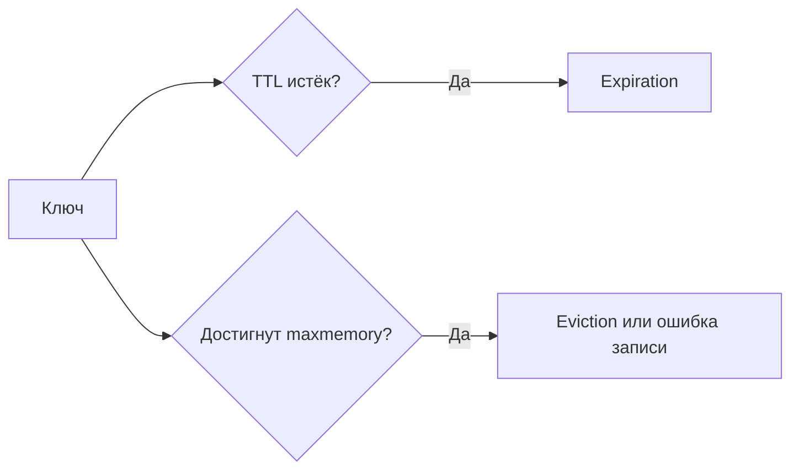

# Expiration и eviction

Expiration удаляет ключ по времени, eviction — для освобождения памяти. TTL не гарантирует хранение до истечения: политика вытеснения может убрать ключ раньше.

Expiration удаляет key по заданному времени жизни. Eviction освобождает память при превышении `maxmemory`. Это независимые механизмы: key без TTL может быть evicted политикой `allkeys-*`, а expired key может исчезнуть до достижения memory limit.

## Поведение TTL

```text
SET session:42 payload EX 1800
TTL session:42
```

Timeout хранится как абсолютное время. Redis удаляет expired keys пассивно при обращении и активно через периодическую выборку. Поэтому физическое освобождение памяти может не совпасть с точной миллисекундой, хотя логически expired key недоступен.

Команда, полностью заменяющая value (`SET`), обычно снимает прежний TTL, если явно не сохранить/задать его. Изменение содержимого без замены key, например `HSET` или `INCR`, сохраняет TTL. Проверяйте semantics конкретной команды; `EXPIRE` поддерживает условия `NX`, `XX`, `GT`, `LT`.

## Политики ограничения памяти

- `noeviction` отклоняет новые memory-growing writes;
- `allkeys-lru`, `allkeys-lfu`, `allkeys-lrm`, `allkeys-random` выбирают среди всех keys;
- `volatile-lru`, `volatile-lfu`, `volatile-lrm`, `volatile-random`, `volatile-ttl` — только среди keys с TTL.

`volatile-*` фактически ведёт себя как `noeviction`, если подходящих expiring keys нет. LRU/LFU/LRM реализованы приближённо, поэтому выбор не является строгим глобальным минимумом.

## Расчёт ресурсов

Не ставьте `maxmemory` равным всей RAM. Оставьте headroom для процесса, allocator fragmentation, client/output buffers, replication/AOF buffers и copy-on-write во время fork. Часть buffer memory не учитывается в eviction threshold; ориентируйтесь на `used_memory`, `used_memory_rss`, fragmentation и `mem_not_counted_for_evict`.

Eviction в system-of-record deployment означает потерю данных. Не смешивайте volatile cache и non-evictable state в одном instance, если единая policy не выражает требования обоих workloads.

## Проверить TTL после записи

```text
SET demo:session hello EX 60
TTL demo:session
# число от 0 до 60
SET demo:session changed
TTL demo:session
# -1: ключ есть, TTL нет
EXPIRE demo:session 60
SET demo:session newer KEEPTTL
TTL demo:session
# оставшийся TTL сохраняется
DEL demo:session
TTL demo:session
# -2: ключ отсутствует
```

Это последовательный сценарий без конкуренции. Hash field expiration в современных Redis — отдельная возможность с собственными командами, не автоматическое правило для всех полей HSET.



LRU ориентируется на последнее обращение, LFU на оценку частоты, LRM — на последнее изменение. Выбор зависит от смысла кэша; LRM не является доступной политикой во всех старых версиях Redis. TTL не заменяет lease корректности для внешнего ресурса. Не храните обязательный dedup marker в instance, где allkeys eviction может удалить его до replay.

## Источники

- [EXPIRE](https://redis.io/docs/latest/commands/expire/)
- [Key eviction](https://redis.io/docs/latest/develop/reference/eviction/)
- [Memory optimization](https://redis.io/docs/latest/operate/oss_and_stack/management/optimization/memory-optimization/)

## Проверь себя

1. **Чем -1 отличается от -2 в TTL?**

   <details>
   <summary>Ответ</summary>

   -1: ключ без срока; -2: ключ отсутствует.

   </details>

2. **Можно ли использовать TTL как минимальный срок dedup?**

   <details>
   <summary>Ответ</summary>

   Нет при возможном eviction/потере state; сохранность и retention надо обеспечить отдельно.

   </details>
