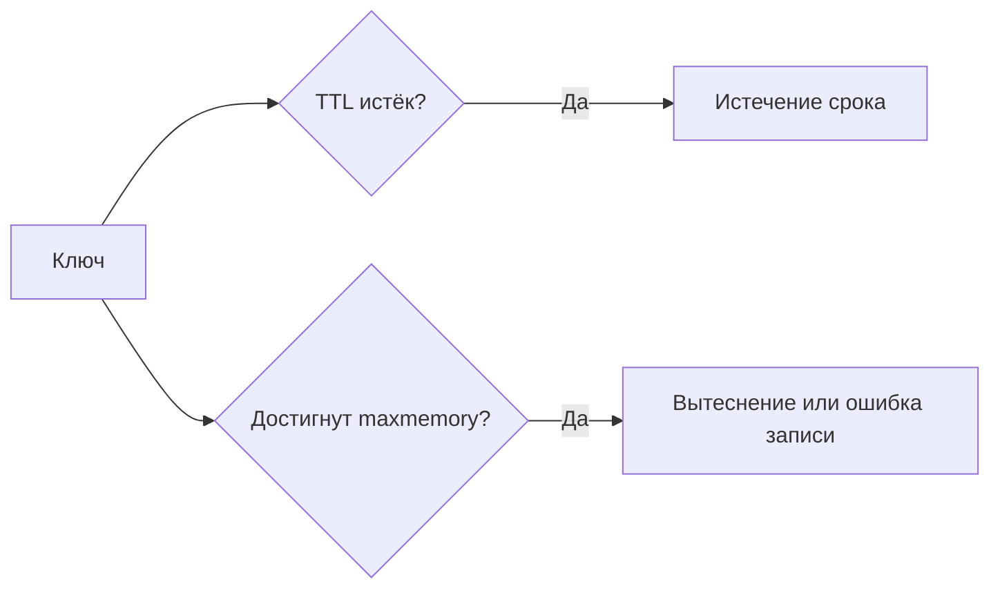

# Истечение срока и вытеснение ключей

Redis может убрать ключ по двум разным причинам. **Истечение срока** означает, что закончился TTL ключа. **Вытеснение** означает, что серверу не хватает выделенной памяти и он выбирает данные для удаления. TTL на час не гарантирует, что ключ проживёт час.

## Что происходит со сроком

`EXPIRE key 60` задаёт срок. `TTL` показывает оставшиеся секунды: `-1` означает отсутствие срока, `-2` — отсутствие ключа. Обычный `SET` заменяет значение и сбрасывает прежний TTL; `KEEPTTL` сохраняет его. Команды изменения существующей структуры, например `INCR`, обычно сохраняют срок.

Истёкшие ключи удаляются при обращении и фоновом поиске. Уведомление об удалении не является точным планировщиком задач на выбранную миллисекунду. Для обязательной обработки по времени нужна очередь или другой устойчивый механизм.

## Что происходит при заполнении памяти

`maxmemory` задаёт предел для механизма вытеснения, но не всего потребления процесса. При `noeviction` некоторые записи получают ошибку. Политики `allkeys-*` могут вытеснять любые ключи, `volatile-*` — только ключи со сроком. LRU приблизительно выбирает давно неиспользуемые, LFU — редко используемые. Это приближённые алгоритмы, не точный порядок всех ключей.

Не смешивайте незаменимые данные и расходный кэш под политикой удаления. Оставляйте память для служебных буферов, фрагментации и фонового сохранения. Следите отдельно за `expired_keys`, `evicted_keys`, ошибками записи и памятью.

## Проверить TTL после записи

```text
SET demo:session hello EX 60
TTL demo:session
# число от 0 до 60
SET demo:session changed
TTL demo:session
# -1: ключ есть, TTL нет
EXPIRE demo:session 60
SET demo:session newer KEEPTTL
TTL demo:session
# оставшийся TTL сохраняется
DEL demo:session
TTL demo:session
# -2: ключ отсутствует
```

Команды выполняются последовательно без других клиентов. Первый SET создаёт значение на 60 секунд, следующий обычный SET убирает срок. После EXPIRE запись с KEEPTTL сохраняет оставшееся время; после DEL ключ отсутствует. Срок отдельного поля Hash — отдельная возможность современных Redis с собственными командами, а не автоматический эффект HSET.



LRU оценивает давность обращения, LFU — частоту, LRM — давность изменения. LRM отсутствует в некоторых старых версиях; политику выбирают по поведению данных. Не храните обязательный маркер защиты от повтора в Redis с удалением любых ключей при заполнении: он может исчезнуть до возвращения старого события.

## Источники

- [EXPIRE](https://redis.io/docs/latest/commands/expire/)
- [Key eviction](https://redis.io/docs/latest/develop/reference/eviction/)
- [Memory optimization](https://redis.io/docs/latest/operate/oss_and_stack/management/optimization/memory-optimization/)

## Проверь себя

1. **Чем -1 отличается от -2 в TTL?**

   <details>
   <summary>Ответ</summary>

   -1 — существующий ключ без срока; -2 — ключ отсутствует.

   </details>

2. **Гарантирует ли TTL минимальный срок защиты от повтора?**

   <details>
   <summary>Ответ</summary>

   Нет. Ключ может быть вытеснен или потерян при отказе. Надёжность маркера и период хранения обеспечиваются отдельно.

   </details>
