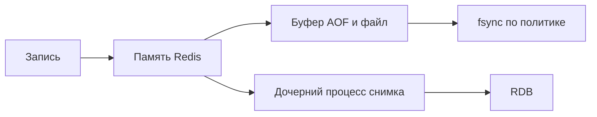

# Сохранение Redis на диск

Redis прежде всего работает с памятью. Сохранение на диск (persistence) позволяет восстановить данные после перезапуска. Выбор начинается с вопроса: сколько последних записей можно потерять и как быстро нужно загрузить состояние.

## Снимок RDB

RDB сохраняет состояние на выбранный момент. Файл компактный и удобен для резервной копии. Если авария случилась после снимка, последующие изменения отсутствуют. `BGSAVE` создаёт дочерний процесс: он видит старое состояние, а изменяемые страницы копируются. При активной записи нужен запас памяти на эти копии.

## Журнал AOF

AOF сохраняет команды изменения, которые можно повторить при загрузке. `fsync` требует надёжного сохранения файла. При `always` сохранение выполняется для каждой записи и увеличивает задержку. При `everysec` оно обычно происходит раз в секунду, но задержки ввода-вывода не дают жёсткой границы потери в одну секунду. При `no` решение оставляется ОС.

С Redis 7 журнал состоит из базовых и добавочных файлов с manifest. Фоновая перепись сокращает накопленную историю, но требует ресурсов. Если включены AOF и RDB, при обычном перезапуске используется более полный AOF.

## От каких проблем локальный файл не защищает

Потеря хоста или тома уничтожает локальное сохранение. Ошибочный `DEL` корректно попадает и в журнал, и на реплики. Асинхронное переключение всё ещё может выбрать отставшую копию. Поэтому нужны независимая история резервирования и проверка загрузки данных.

Для воспроизводимого кэша сохранение может быть не нужно, но после перезапуска все промахи пойдут в основную базу. Проверьте, выдерживает ли она холодный кэш. Наблюдайте ошибки сохранения, время фоновых операций, свободное место и фактическое восстановление.

## Окно потери и память



```text
INFO persistence
# rdb_last_bgsave_status, aof_last_write_status,
# aof_last_bgrewrite_status, текущие фоновые операции
```

При RDB раз в 5 минут crash может потерять изменения после последнего успешного снимка, а не обязательно ровно 5 минут: предыдущий save мог не пройти. everysec обычно имеет окно примерно секунды, но I/O задержки и настройки rewrite могут увеличить его; не продавайте это как жёсткий SLA 1s. Реплика, получившая write, ещё не обязательно fsync-нула его.

При создании дочернего процесса снимка используется копирование изменяемых страниц (copy-on-write): ребёнок видит старое состояние, родитель продолжает запись. Большой объём и частые изменения требуют запаса памяти. Команда `BACKUP` Redis 8.10 работает с многофайловым AOF; её наличие не отменяет независимые копии и проверку восстановления.

## Источники

- [Redis persistence](https://redis.io/docs/latest/operate/oss_and_stack/management/persistence/)
- [Latency caused by fork](https://redis.io/docs/latest/operate/oss_and_stack/management/optimization/latency/)

## Проверь себя

1. **Почему everysec не гарантирует потерю максимум одной секунды?**

   <details>
   <summary>Ответ</summary>

   Сохранение может задержаться из-за диска, планировщика и настроек фоновой переписи.

   </details>

2. **Защищает ли реплика от ошибочного DEL?**

   <details>
   <summary>Ответ</summary>

   Нет. Удаление передаётся копии и журналу; нужна независимая возможность восстановить прежнее состояние.

   </details>
