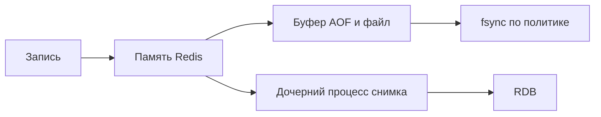

# Persistence Redis

Persistence сохраняет состояние Redis для перезапуска. RDB делает снимок, AOF сохраняет историю записей. Сохранённый файл на одном хосте не защищает от потери самого хоста.

Redis Open Source поддерживает RDB snapshots, AOF, их комбинацию или работу без persistence. Выбор начинается с допустимой потери данных и recovery time, а не с default configuration.

## RDB

RDB — point-in-time snapshot. Он компактен, удобен для backup и обычно быстро загружается, но crash между snapshots теряет изменения после последнего снимка. `BGSAVE` fork-ает child; при большом dataset и активной записи copy-on-write увеличивает RSS и может вызвать latency spike.

## AOF

AOF записывает write commands и восстанавливает dataset replay-ем. Политики fsync:

- `always` — fsync каждого write, максимальная latency и более сильная local durability;
- `everysec` — типичный компромисс, возможна потеря примерно последних секунд при аварии;
- `no` — решение о flush оставлено ОС.

С Redis 7 AOF состоит из base и incremental files, управляемых manifest. Rewrite компактизирует history, но тоже использует background child и ресурсы. Если включены AOF и RDB, restart использует более полный AOF dataset.

## Что persistence не решает

- asynchronous replica failover всё ещё может потерять acknowledged write;
- ошибочный `DEL` корректно попадёт в AOF/replicas;
- локальный файл не защищает от потери host/volume;
- corrupted или непроверенный backup не даёт гарантированного recovery.

Архивируйте snapshots/AOF согласно threat model, шифруйте и ограничивайте доступ, регулярно выполняйте restore test. Наблюдайте последний успешный save, AOF rewrite/fsync status, fork time, disk space и loading time.

Cache с воспроизводимыми данными часто может работать без persistence, но restart тогда создаёт cold-cache surge — capacity primary storage должна его выдержать.

## Окно потери и память



```text
INFO persistence
# rdb_last_bgsave_status, aof_last_write_status,
# aof_last_bgrewrite_status, текущие фоновые операции
```

При RDB раз в 5 минут crash может потерять изменения после последнего успешного снимка, а не обязательно ровно 5 минут: предыдущий save мог не пройти. everysec обычно имеет окно примерно секунды, но I/O задержки и настройки rewrite могут увеличить его; не продавайте это как жёсткий SLA 1s. Реплика, получившая write, ещё не обязательно fsync-нула его.

Fork использует copy-on-write: ребёнок видит старый снимок, а изменения parent копируют страницы. При большом dataset и churn оставляйте RAM headroom. В Redis 8.10 есть BACKUP для MP-AOF; новую команду не следует применять как универсальную замену независимой истории и restore drill без проверки конфигурации.

## Источники

- [Redis persistence](https://redis.io/docs/latest/operate/oss_and_stack/management/persistence/)
- [Latency caused by fork](https://redis.io/docs/latest/operate/oss_and_stack/management/optimization/latency/)

## Проверь себя

1. **Почему everysec не означает гарантированную потерю не более 1s?**

   <details>
   <summary>Ответ</summary>

   Планировщик, I/O и настройки могут задержать fsync; это обычное поведение, не абсолютная граница.

   </details>

2. **Что replication не исправляет в ошибочном DEL?**

   <details>
   <summary>Ответ</summary>

   Удаление передаётся replica и журналу; требуется независимое восстановление.

   </details>
