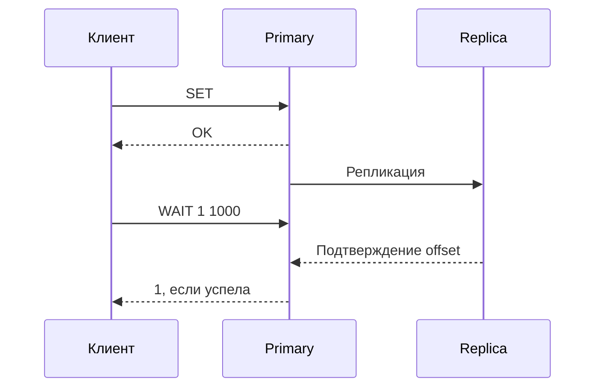

# Репликация Redis

Primary обычно подтверждает команду до получения replica. Поэтому подтверждённый SET может исчезнуть после выбора отставшей replica новым primary.

Redis replication обычно asynchronous: primary подтверждает write, не ожидая replicas. Реплики помогают чтению, recovery и HA, но между acknowledgement и replication остаётся окно потери данных при failover.

## Синхронизация

Primary хранит replication ID, offset и backlog последних изменений. После короткого disconnect replica просит partial resynchronization (`PSYNC`) и получает недостающий suffix, если нужный offset ещё в backlog. Иначе требуется full resync: snapshot dataset плюс накопившийся stream изменений.

Размер backlog должен покрывать типичное окно disconnect × write throughput с запасом. Full resync больших datasets нагружает CPU, memory, disk/network и способен вызвать каскадный latency incident.

## Чтение и подтверждённые копии

Replica read может быть stale: учитывайте replication lag и read-after-write. По умолчанию replica остаётся read-only для clients, но это не превращает её в immutable storage.

`WAIT replicas timeout` ждёт подтверждения предыдущих writes указанным числом replicas и уменьшает вероятность потери, но официальная документация прямо отмечает: это не превращает Redis в strongly consistent CP system. Failover и persistence configuration всё ещё влияют на сохранность. В актуальных версиях также есть `WAITAOF` для ожидания fsync на local/replica instances; он улучшает durability конкретной записи, но не заменяет полный consistency design.

`min-replicas-to-write` и `min-replicas-max-lag` могут остановить writes при недостатке достаточно свежих replicas. Это ограничивает риск, но снижает availability и основано на наблюдаемом lag, а не на consensus commit.

## Эксплуатация

Наблюдайте `INFO replication`: role, connected replicas, offsets, lag, backlog и sync state. Проверяйте network bandwidth, full-sync frequency, diskless/disk-based sync choice и время promotion. Replica и persistence не заменяют независимый backup: логическая ошибка реплицируется.

## WAIT и соединение

```text
SET demo:invoice processed
WAIT 1 1000
```

Выполните обе команды через **одно соединение**: WAIT относится к предыдущим записям этого клиента. Результат 1 означает подтверждение минимум одной replica; 0 — срок ожидания истёк без нужного числа. Timeout не отменяет SET. Следовательно, retry всего блока способен повторить неидемпотентную операцию.



WAIT не обязательно означает сохранение на диск и не связывает election с записью как consensus commit. WAITAOF отдельно ждёт local/replica fsync при включённом AOF и тоже требует проверки возвращённых количеств. Backlog при 20MB/s и 30s разрыве нужен хотя бы около 600MB плюс запас; это оценка, не гарантия при всплеске. Недостаток backlog переводит recovery в full sync.

## Источники

- [Redis replication](https://redis.io/docs/latest/operate/oss_and_stack/management/replication/)
- [WAIT](https://redis.io/docs/latest/commands/wait/)
- [WAITAOF](https://redis.io/docs/latest/commands/waitaof/)

## Проверь себя

1. **WAIT timeout отменяет предыдущую запись?**

   <details>
   <summary>Ответ</summary>

   Нет, исходная команда уже могла выполниться.

   </details>

2. **Почему два вызова через разные pool connections нарушают ожидание?**

   <details>
   <summary>Ответ</summary>

   WAIT следит за предыдущими writes данного соединения.

   </details>
