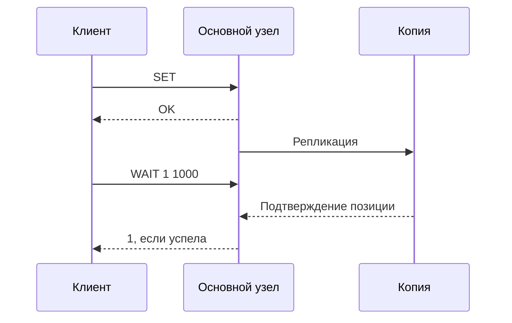

# Репликация Redis

Основной узел Redis передаёт изменения репликам. Обычно он отвечает клиенту раньше подтверждения копии. Поэтому успешный `SET` может отсутствовать на реплике, выбранной новой основной после аварии.

## Как догоняет отставшая копия

Основной узел хранит идентификатор истории, позицию и ограниченный буфер последних изменений — backlog. После короткого разрыва реплика запрашивает недостающий хвост через `PSYNC`. Если нужные изменения уже выпали из буфера, требуется полный снимок и передача накопившихся изменений. Для больших данных это серьёзная нагрузка.

Начальная оценка буфера: скорость записи × ожидаемая длительность разрыва, плюс запас на всплески. Она не заменяет проверку частоты полных пересинхронизаций и пропускной способности.

## Что дают WAIT и WAITAOF

`WAIT` ждёт, что заданное число реплик подтвердит предыдущие записи **этого соединения**. Он уменьшает риск потери, но не обязательно ждёт сохранения на диск и не меняет алгоритм выбора нового основного узла. `WAITAOF` отдельно ждёт сохранения AOF на выбранном числе участников, когда AOF включён. Проверяйте возвращённые количества, а не только отсутствие ошибки.

Таймаут ожидания не отменяет уже сделанный `SET`. Это особенно важно для повторов неидемпотентных команд вроде `INCR`.

## Чтение и отказ

Чтение с реплики может вернуть прежнее значение после успешной записи. `min-replicas-to-write` и `min-replicas-max-lag` ограничивают запись при недостатке свежих реплик, но снижают доступность и не делают систему строго согласованной. В `INFO replication` смотрите роли, позиции, отставание, буфер и пересинхронизации.

## WAIT и соединение

```text
SET demo:invoice processed
WAIT 1 1000
```

Выполните обе команды через **одно соединение**: WAIT относится к предыдущим записям этого клиента. Результат 1 означает подтверждение минимум одной replica; 0 — срок ожидания истёк без нужного числа. Timeout не отменяет SET. Следовательно, retry всего блока способен повторить неидемпотентную операцию.



`WAIT` не обязательно подтверждает диск. `WAITAOF` отдельно ждёт сохранения AOF, а приложение проверяет число подтверждений. Для разрыва 30 секунд при записи 20 МБ/с буфер последних изменений нужен хотя бы около 600 МБ плюс запас. Это оценка средней нагрузки: всплеск может всё равно потребовать полного снимка.

## Источники

- [Redis replication](https://redis.io/docs/latest/operate/oss_and_stack/management/replication/)
- [WAIT](https://redis.io/docs/latest/commands/wait/)
- [WAITAOF](https://redis.io/docs/latest/commands/waitaof/)

## Проверь себя

1. **Отменяет ли таймаут WAIT прежнюю запись?**

   <details>
   <summary>Ответ</summary>

   Нет. Она уже могла выполниться; закончился только срок ожидания подтверждений.

   </details>

2. **Почему SET и WAIT нужно выполнять через одно соединение?**

   <details>
   <summary>Ответ</summary>

   WAIT относится к предыдущим записям именно этого клиента, а не всех клиентов пула.

   </details>
