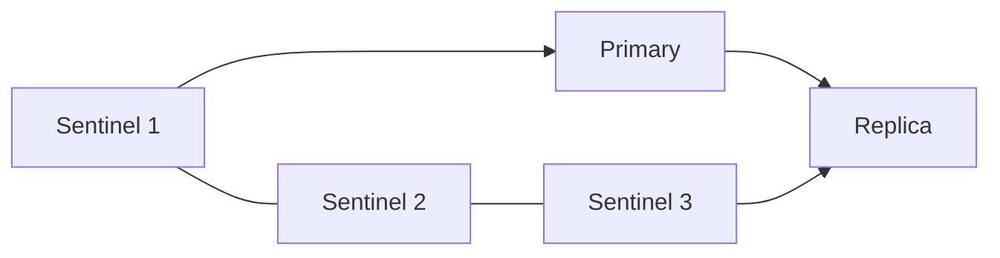

# Redis Sentinel

Sentinel следит за primary и выбирает замену при отказе. Решение об отказе и разрешение failover требуют разных условий; данные по-прежнему реплицируются асинхронно.

Sentinel добавляет monitoring, notifications, service discovery и automatic failover для primary с replicas, когда не используется Redis Cluster. Он не sharding layer и не обеспечивает synchronous replication.

## Как принимается решение

Отдельный Sentinel может признать primary субъективно недоступным (`SDOWN`). Для objective down (`ODOWN`) нужно число голосов, заданное `quorum`. Чтобы реально выполнить failover, Sentinel leader дополнительно должен получить authorization большинства известных Sentinel processes; `quorum` и majority — разные условия.

Leader выбирает подходящую replica, повышает её до primary, перенастраивает остальные replicas и публикует новую configuration. Клиенты должны получать актуальный primary через Sentinel-aware library и уметь переподключаться: старые connections/addresses не обновляются магически.

## Поведение при отказе

Поскольку data replication asynchronous, promoted replica может не содержать последние acknowledged writes. Старый primary в network partition может некоторое время принимать writes; после rejoin он станет replica и его divergent writes будут потеряны. Fencing внешних side effects и idempotency остаются задачей системы.

Рекомендуемый минимум — три Sentinel в независимых failure domains. Размещение Sentinel только рядом с одним Redis host не даёт осмысленного quorum при отказе зоны. NAT/port remapping и неверно объявленные addresses могут сломать discovery.

## Эксплуатация

Настройте уникальное имя monitored primary, quorum, `down-after-milliseconds`, failover timeout и parallel syncs под SLO. Проверяйте:

- доступность Sentinel quorum/majority;
- replica lag и suitability for promotion;
- события `+sdown`, `+odown`, `+switch-master`;
- поведение clients и DNS/service discovery;
- controlled failover и возврат старого primary.

Config file Sentinel изменяет сам и использует после restart; он должен быть writable и сохранён корректно.

## Quorum и majority на числах

Для трёх Sentinel с quorum=2 два процесса должны согласиться на ODOWN и два должны разрешить failover. При quorum=1 один может объявить ODOWN, но для реального failover всё равно нужна majority 2 из 3. Пять Sentinel с quorum=2 требуют минимум 3 для авторизации failover.

```text
SENTINEL get-master-addr-by-name mymaster
SENTINEL ckquorum mymaster
```

Первая команда на Sentinel возвращает адрес текущего primary, вторая проверяет достижимость достаточных участников; это диагностические команды, не переключение. Подключение к прежнему адресу в приложении само не переносится: нужна Sentinel-aware library и повторное discovery.



Схема не показывает все связи, только роли. Разделяйте failure domains: три процесса на одном host не переживут его отказ. Если старый primary остаётся доступен части клиентов, divergent writes могут быть потеряны после rejoin. Ограничение min-replicas-to-write уменьшает окно, но не доказывает линейризуемость.

## Источники

- [High availability with Sentinel](https://redis.io/docs/latest/operate/oss_and_stack/management/sentinel/)

## Проверь себя

1. **quorum=1 разрешает одиночный failover в группе из трёх?**

   <details>
   <summary>Ответ</summary>

   Нет, нужна majority авторизации 2 из 3.

   </details>

2. **Почему три Sentinel на одном host слабая защита?**

   <details>
   <summary>Ответ</summary>

   Один общий отказ уничтожает все голоса.

   </details>
