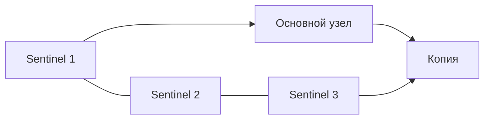

# Redis Sentinel

Sentinel — отдельные процессы, которые наблюдают основной Redis и его реплики. Если основной недоступен, они выбирают замену и сообщают её адрес клиентам. Sentinel не делит ключи между узлами и не делает передачу данных синхронной.

## Два условия решения

Один наблюдатель может признать основной узел недоступным для себя — `SDOWN`. Для общего признания `ODOWN` требуется заданное число согласных наблюдателей, **quorum**. Чтобы действительно выполнить переключение, выбранному руководителю дополнительно нужно разрешение большинства известных Sentinel. Это разные пороги; ниже есть числовой пример.

Руководитель выбирает подходящую реплику, делает её основной и перенастраивает остальных. Клиент должен поддерживать обнаружение адреса через Sentinel и переподключение. Уже открытое соединение со старым сервером само не переезжает.

## Что не гарантирует переключение

Реплика может не иметь последней подтверждённой записи. Во время разделения сети старый основной узел может оставаться доступным части клиентов и принимать изменения, которые затем потеряются при возвращении. Ограничения числа реплик уменьшают окно риска, но не доказывают единственный порядок всех операций.

## Как пережить общий отказ

Три наблюдателя на одном хосте теряются вместе. Размещайте их в независимых областях отказа и проверяйте доступность большинства, адреса за NAT, отставание реплик и действия клиентов. Sentinel сам изменяет свою конфигурацию; файл должен быть доступен для записи и сохраняться после перезапуска. Проверяйте контролируемое переключение и возвращение прежнего узла.

## Quorum и majority на числах

Для трёх Sentinel с quorum=2 два процесса должны согласиться на ODOWN и два должны разрешить failover. При quorum=1 один может объявить ODOWN, но для реального failover всё равно нужна majority 2 из 3. Пять Sentinel с quorum=2 требуют минимум 3 для авторизации failover.

```text
SENTINEL get-master-addr-by-name mymaster
SENTINEL ckquorum mymaster
```

Первая команда на Sentinel возвращает адрес текущего primary, вторая проверяет достижимость достаточных участников; это диагностические команды, не переключение. Подключение к прежнему адресу в приложении само не переносится: нужна Sentinel-aware library и повторное discovery.



Схема показывает роли, не все сетевые связи. Три наблюдателя на одном хосте теряются от одного отказа. Если прежняя основная база остаётся доступной части клиентов, их новые изменения могут исчезнуть при её возвращении репликой. `min-replicas-to-write` уменьшает окно, но не доказывает строгую согласованность.

## Источники

- [High availability with Sentinel](https://redis.io/docs/latest/operate/oss_and_stack/management/sentinel/)

## Проверь себя

1. **Позволяет ли quorum=1 одиночное переключение при трёх Sentinel?**

   <details>
   <summary>Ответ</summary>

   Нет. Для разрешения переключения всё равно нужно большинство — два из трёх.

   </details>

2. **Почему три Sentinel на одном хосте не защищают от его отказа?**

   <details>
   <summary>Ответ</summary>

   Один общий отказ уничтожит всех наблюдателей и их голоса.

   </details>
