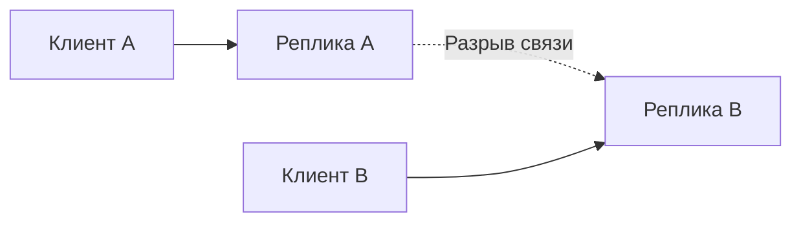

# CAP и PACELC: что делать при разрыве связи

Если копии данных перестали общаться, каждая видит только часть событий. CAP описывает ограничение: нельзя одновременно обещать единое актуальное состояние и успешный ответ каждой исправной стороне при таком разрыве.

## Как это работает

Представьте два узла с копиями баланса. Если оба независимо разрешат потратить одни и те же деньги, получится неверный результат. Чтобы сохранить единственное состояние, сторона без достаточного подтверждения от других узлов должна остановить такую запись. Для чтения старого описания товара можно выбрать другую политику.

В CAP согласованность означает линейризуемое поведение: будто операции выполняет одна актуальная копия. Доступность означает ответ каждой исправной стороне в формальной модели, а не процент успешных запросов за месяц. Выбор относится к операции и условиям сбоя.

PACELC добавляет обычный случай без разрыва: ожидание удалённых копий увеличивает задержку, а ответ только локальной копии может показать старые данные. Эта формулировка помогает обсудить цену гарантий, но не заменяет точный контракт чтения и записи.

## Разобранный пример

На двух узлах баланс 100. Связь между ними пропала, а каждый получил запрос потратить 80. Если оба подтвердят независимое списание, общее правило нарушится. Для такой записи сторона без достаточной власти должна отказать. Чтение старого описания профиля можно оставить доступным.

Хороший месячный SLO не противоречит сознательному отказу меньшинству при разделении сети. Даже при исправной сети подтверждение из другого региона добавляет время передачи: именно этот обычный компромисс напоминает PACELC.

## Проверь себя

1. Равна ли доступность CAP месячному проценту успеха?
2. Почему выбор нельзя сделать один раз для всей БД?

Ответы

1. Нет. Это разные определения и модели.
2. Операции имеют разные требования: старое описание допустимо, двойное списание нет.

## Источники

- [Brewer: CAP twelve years later](https://www.infoq.com/articles/cap-twelve-years-later-how-the-rules-have-changed/)
- [Abadi: Consistency tradeoffs in modern distributed database design](https://www.cs.umd.edu/~abadi/papers/abadi-pacelc.pdf)
