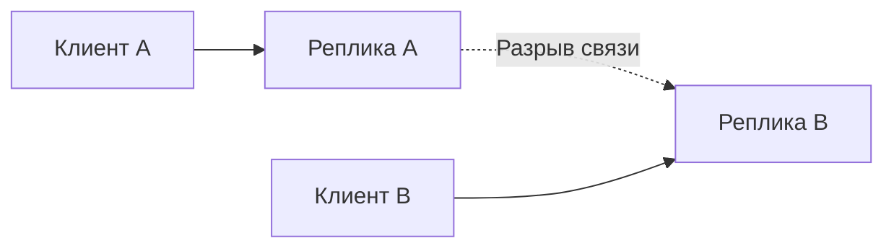

# CAP и PACELC

CAP описывает несовместимость строгой согласованности и ответа каждой исправной стороне при разрыве связи; PACELC также учитывает цену согласования в обычной работе.

CAP не означает «всегда выбери любые две буквы из трёх». Если сеть разделила узлы, система не может одновременно гарантировать linearizable consistency (согласованность наблюдаемых значений и порядка) и availability (доступность заявленной операции) для каждого запроса на обеих сторонах partition (раздел журнала или данных; при network partition — разрыв связи).

## Термины

- C — linearizable view единой копии, а не любое значение слова consistency.
- A — каждый запрос к non-failing node получает non-error response, хотя ответ может быть stale; это формальное свойство, не процент uptime.
- P — система продолжает удовлетворять выбранному контракту несмотря на потерю/задержку части сообщений.

Partition tolerance не обычная feature, которую production cluster может «не выбрать»: network partition возможен. Во время него CP-система отказывает/останавливает часть операций, чтобы не нарушить consistency; AP-система отвечает на обеих сторонах и затем должна разрешить divergence.

Система может выбирать по-разному для разных operations. Например, stale read остаётся available, а write определённого key блокируется без quorum (достаточный набор участников для решения). После partition recovery также важны merge rules и client retries.

## PACELC

PACELC добавляет normal case: если Partition (P), trade-off Availability/Consistency (A/C); Else (E), trade-off Latency/Consistency (L/C). Даже при исправной сети synchronous cross-region quorum улучшает consistency/durability, но добавляет latency (срок ответа); local response быстрее, но допускает lag.

CAP/PACELC — frame для вопросов, не таблица выбора базы. Зафиксируйте operations, consistency model, topology, latency SLO (цель качества сервиса за заданное окно), failure domain, RPO/RTO и поведение клиента при timeout.

## Источники

- [Brewer: CAP twelve years later](https://www.infoq.com/articles/cap-twelve-years-later-how-the-rules-have-changed/)
- [Abadi: Consistency tradeoffs in modern distributed database design](https://www.cs.umd.edu/~abadi/papers/abadi-pacelc.pdf)

## Механизм на примере

Пример: на A баланс 100, A и B больше не обмениваются сообщениями. Обе стороны получают запрос потратить 80. Если обе подтверждают, общий инвариант нарушен. Если только сторона с достаточной властью/кворумом принимает запись, другая не даёт успешный ответ. Локальное чтение старого профиля может оставаться доступным — выбор делается по операции, а не одной буквой для всей базы.

CAP availability — формальное свойство ответа каждой исправной реплики, не SLO 99,9%. Quorum-система может иметь хороший месячный SLO и всё равно сознательно отказать меньшинству во время partition. PACELC напоминает: межрегиональное подтверждение добавляет RTT и при исправной сети.

## Проверь себя

1. Почему нельзя назвать CAP-A процентом uptime?
2. Может ли одна система иметь разные выборы?

Ориентиры для ответа

1. У определения другая граница: запросы к исправным узлам при разделении сети.
2. Да, денежная запись и чтение публичного профиля требуют разных гарантий.

