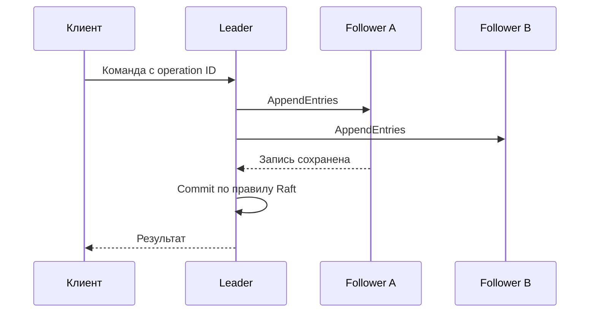

# Consensus

Consensus согласует один журнал решений; отказ узла или повтор клиента не должен создать два разных committed решения в одной позиции.

Consensus позволяет участникам согласовать ordered decisions несмотря на crashes и задержки: кто leader (узел, координирующий запись), какая запись следующая, какая configuration актуальна. Он нужен для replicated state machine (копии одной машины состояний, применяющие одинаковый журнал команд), metadata/control plane и linearizable coordination.

## Требования

- Safety: два корректных участника не решают конфликтующие значения/log entries.
- Liveness (способность продолжать продвижение; у probe — жив ли процесс): при достаточной связи и доступном quorum (достаточный набор участников для решения) система со временем продвигается.

В полностью asynchronous network невозможно гарантированно различить delay и failure; практические protocols получают liveness при периодах достаточной synchrony и timeouts, сохраняя safety при задержках.

## Raft conceptual model

Nodes переходят между follower (реплика, следующая журналу лидера), candidate (кандидат на лидерство) и leader; term (поколение лидерства) монотонно обозначает election epoch (номер поколения). Candidate собирает majority (большинство участников) голосов, причём freshness log участвует в правиле голосования. Leader назначает log index/term, реплицирует entries followers и commit-ит, когда выполнено quorum rule; state machine применяет только committed prefix.

Term/epoch fence-ит сообщения старого leader. Majority intersection не позволяет commit (фиксация результата, который считается подтверждённым) двух разных entries на одном index при корректном protocol. Snapshot/log compaction сокращает history, но snapshot installation тоже часть protocol.

## Что consensus не делает

- не делает медленный storage быстрым;
- не выдерживает потерю majority;
- обычный Raft не защищает от Byzantine nodes;
- не делает произвольный external side effect частью log;
- не заменяет client idempotency: response может потеряться после commit;
- не равен distributed transaction protocol.

## Эксплуатация

Расположите voters (голосующие участники) в независимых failure domains и оцените latency (срок ответа) majority path. Наблюдайте leader changes, term, commit/apply lag, snapshot/recovery и quorum health. Отделяйте data replicas/learners от voting members: больше voters может снизить availability (доступность заявленной операции) и увеличить latency.

## Источники

- [In Search of an Understandable Consensus Algorithm](https://raft.github.io/raft.pdf)
- [The Part-Time Parliament (Paxos)](https://lamport.azurewebsites.net/pubs/lamport-paxos.pdf)

## Механизм на примере

Для трёх voters большинство — два. Leader записал entry себе и одному follower: ещё требуется правильное правило commit протокола, а не просто число двух копий. В Raft leader продвигает commit по большинству для entry своего текущего term; старые entries подтверждаются через committed entry текущего term. Это существенная деталь безопасности.

Потеря ответа после commit не отменяет решение: replicated state machine хранит ID команды/результат для повторного клиента. Лидерство само по себе не разрешает читать из локальной памяти линейризуемо: лидер должен подтвердить актуальную власть (например, ReadIndex (подтверждение лидерства и позиции, до которой чтение ждёт применения журнала)) и дождаться применения нужной позиции. Сетевой старый leader не должен выдавать новые строгие ответы.

## Проверь себя

1. Почему большинство необходимо, но не достаточно?
2. Зачем client ID поверх consensus?

Ориентиры для ответа

1. Нужны правила term, свежести журнала и commit.
2. Повтор после потерянного ответа иначе станет второй командой.

