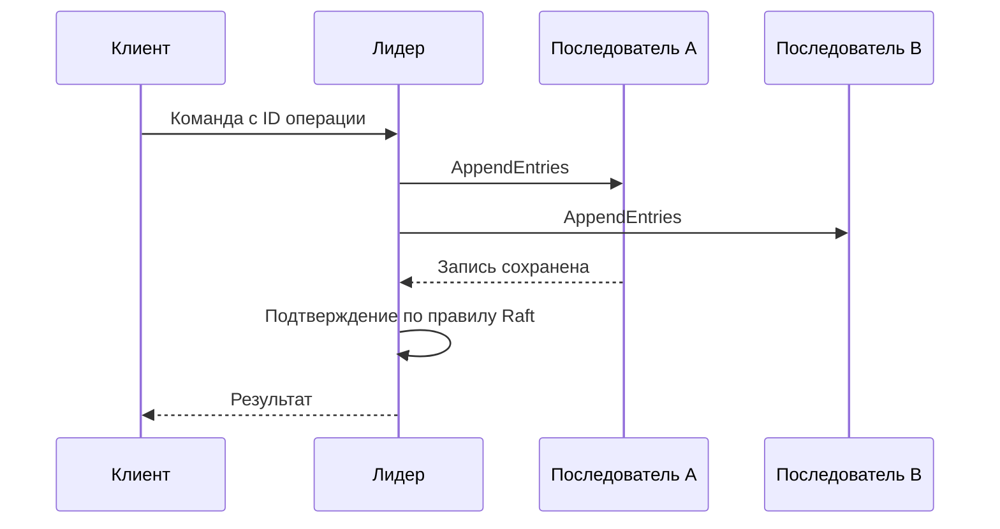

# Консенсус: как узлы выбирают одну историю

Консенсус позволяет нескольким узлам согласовать одно решение или порядок изменений, даже если некоторые узлы перестали отвечать. Это основа согласованного журнала, а не просто выбор самого быстрого ответа.

## Как это работает

В Raft лидер предлагает новую запись в журнал. Она становится подтверждённой по правилам протокола после сохранения достаточным числом участников. Другие узлы применяют подтверждённые записи в одном порядке. Номер срока лидера помогает отличить старую власть от новой.

Большинство из пяти узлов — три. Два разных большинства пересекаются, поэтому история нового лидера должна учитывать уже подтверждённые решения. Одного пересечения всё же недостаточно: безопасность обеспечивают правила выбора лидера и подтверждения журнала.

При потере большинства система прекращает подтверждать новые изменения, сохраняя правильность. Чтобы безопасно читать актуальное состояние, недостаточно спросить узел, который когда-то был лидером: нужны предусмотренные протоколом проверки текущей власти. Консенсус не согласует автоматически внешние платежи или произвольные действия сервисов.

## Разобранный пример

У трёх голосующих узлов большинство — два. В Raft лидер подтверждает по большинству записи своего текущего срока; записи прежних сроков подтверждаются через запись текущего. Просто найти две копии любой записи недостаточно для правила безопасности.

Потерянный ответ после подтверждения не отменяет решение. Чтобы повтор клиента не стал новой командой, машина состояний хранит её ID и результат. Актуальное чтение требует подтвердить текущую власть лидера и дождаться применения нужной позиции журнала, например по процедуре ReadIndex. Старый лидер, отрезанный сетью, не должен выдавать новые строгие ответы.

## Проверь себя

1. Почему большинство необходимо, но недостаточно?
2. Зачем ID команды при наличии консенсуса?

Ответы

1. Нужны правила срока лидера, свежести журнала и подтверждения записей.
2. Консенсус упорядочивает команды, но без ID повтор клиента может стать второй командой.

## Источники

- [In Search of an Understandable Consensus Algorithm](https://raft.github.io/raft.pdf)
- [The Part-Time Parliament (Paxos)](https://lamport.azurewebsites.net/pubs/lamport-paxos.pdf)
