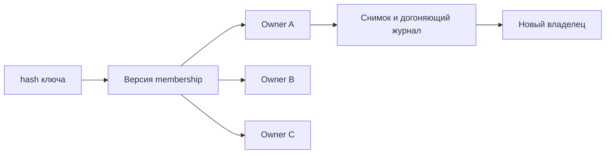

# Consistent hashing

Consistent hashing уменьшает число перемещаемых ключей при смене состава узлов; это маршрутизация, не перенос самих данных.

Обычный `hash(key) mod N` перемещает почти все keys при изменении N. Consistent hashing стремится переместить только долю keyspace, связанную с добавленным/удалённым node.

## Hash ring

Keys и node positions отображаются на кольцо. Key принадлежит следующему node clockwise. Один physical node получает много virtual nodes (tokens), что сглаживает distribution и позволяет weight по capacity.

При добавлении node ему переходят intervals соседей; при удалении — следующему owner. Replication выбирает несколько distinct owners дальше по ring с учётом failure domains.

Virtual nodes не гарантируют баланс workload: hash может распределять keys равномерно, но один key имеет половину QPS/bytes. Больше tokens улучшает статистический balance, но увеличивает routing metadata и migration fragments.

## Rendezvous hashing

Highest Random Weight вычисляет score для пары `(key, node)` и выбирает node с максимальным score. Он прост для clients, хорошо поддерживает weights и top-K replicas, но naive routing вычисляет score для каждого node; оптимизации нужны при большом membership.

## Эксплуатационные требования

- membership должен иметь version/epoch и согласованно распространяться;
- old/new clients во время change могут отправлять key разным owners;
- ownership (владение данными или ответственность за ресурс) transfer требует copy/catch-up protocol, сам hashing данные не переносит;
- replication обязана выбирать разные zones, а не только соседние tokens одного host;
- hot key (ключ с непропорционально высокой нагрузкой) требует split/replication/cache, не новой hash function.

Consistent hashing полезен для caches, object placement и sharded stores, но не заменяет consensus для authoritative (владеющий достоверным состоянием) membership и не сохраняет cross-key transactions.

## Источники

- [Consistent Hashing and Random Trees](https://www.cs.princeton.edu/courses/archive/fall09/cos518/papers/chash.pdf)
- [Rendezvous hashing](https://www.eecs.umich.edu/techreports/cse/96/CSE-TR-316-96.pdf)

## Механизм на примере

Четыре равных узла стали пятью: в идеальной модели новый узел получит около 1/5 ключей. Это ожидаемая доля при равномерном hash, а не гарантия нагрузки. Один key с 50% запросов всё равно остаётся горячим.

Во время смены membership старый клиент отправляет запись A, новый — B. Для authoritative storage нужен epoch (номер поколения), redirect и fencing (отклонение действий старого владельца самим ресурсом) старого владельца после cutover. Для кэша допускается временный miss/дубль; разные требования нельзя скрыть одной hash-функцией. Virtual nodes балансируют размещение, но реплики должны находиться на разных физических узлах/зонах.

## Проверь себя

1. Что hashing не переносит?
2. Почему больше virtual nodes не решает hot key?

Ориентиры для ответа

1. Строки, журнал изменений и право принимать записи.
2. Все запросы одного ключа всё равно попадают к его владельцам.

