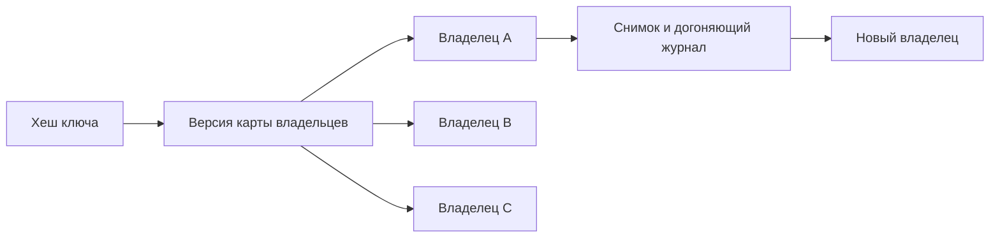

# Согласованное хеширование: куда отправлять ключ

Когда данные распределены по узлам, нужно по ключу определить владельца. Обычное деление хеша на число узлов перераспределяет много ключей при изменении этого числа. Согласованное хеширование уменьшает такой перенос.

## Как это работает

Ключи и узлы размещают на условном кольце хешей. Ключ принадлежит следующему узлу по кругу. При добавлении узла к нему переходят ближайшие ключи, остальные сохраняют владельца. Несколько виртуальных точек для узла помогают распределить объём ровнее.

Это правило размещения, а не гарантия сохранности или согласованности. Для копий назначают несколько разных владельцев, учитывают зоны отказа и договариваются о миграции данных. Удаление узла из кольца не переносит его данные само по себе.

Равномерные ключи не означают равномерную нагрузку: одно популярное объявление способно перегрузить единственного владельца. Поэтому отдельно измеряют запросы и размер данных, а изменение карты владельцев версионируют, чтобы клиенты не выбирали разные места.

## Разобранный пример

Четыре одинаковых узла стали пятью. При равномерном хеше новый узел в идеальной модели получает около одной пятой ключей. Это оценка размещения, а не нагрузки: один ключ всё ещё может давать половину запросов.

При смене карты старый клиент отправляет запись A, новый — B. Для основного хранилища нужен номер поколения карты, перенаправление и запрет записей прежнего владельца после переключения. Кэш может допустить временные промахи, но источник достоверных данных требует более строгого протокола. Виртуальные узлы помогают распределению; копии всё равно размещают на разных физических узлах и в разных зонах.

## Проверь себя

1. Что не гарантирует равномерное распределение ключей?
2. Почему недостаточно поменять хеш-функцию?

Ответы

1. Равномерное распределение запросов и размеров данных.
2. Данные и изменения нужно безопасно перенести, а старых владельцев остановить или перенаправить.

## Источники

- [Consistent Hashing and Random Trees](https://www.cs.princeton.edu/courses/archive/fall09/cos518/papers/chash.pdf)
- [Rendezvous hashing](https://www.eecs.umich.edu/techreports/cse/96/CSE-TR-316-96.pdf)
