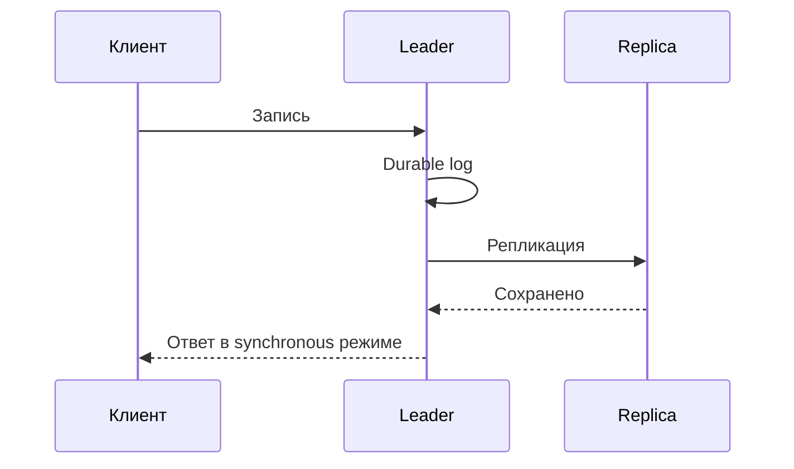

# Репликация

Репликация копирует изменения; подтверждение записи задаёт, какие копии уже обязаны её хранить.

Replication копирует данные между failure domains ради availability (доступность заявленной операции), read scale и recovery. Она не заменяет backup: corruption, operator error и delete тоже реплицируются.

## Single leader

Writes идут leader (узел, координирующий запись), followers применяют ordered log. Synchronous acknowledgement нескольких replicas уменьшает RPO (допустимая потеря подтверждённых данных), но повышает latency (срок ответа) и может снизить write availability; asynchronous replication быстрее, но при failover теряет acknowledged tail.

Failover требует выбрать достаточно свежий follower (реплика, следующая журналу лидера), fence-ить старого leader, переключить clients и восстановить replicas. Без epoch/term старый leader после partition (раздел журнала или данных; при network partition — разрыв связи) создаёт split brain.

Read replica (копия данных на другом узле) может быть stale. Read-your-writes достигают routing на leader, ожиданием version/LSN или session token; «подождать 100 ms» не является гарантией.

## Multi-leader

Несколько leaders принимают writes, что удобно для disconnected/multi-region operation, но concurrent changes конфликтуют. Last-write-wins зависит от clocks и теряет одно значение; merge CRDT/application rule должен соответствовать бизнес-инварианту. Уникальность и cross-object constraints особенно сложны.

## Leaderless

Client/coordinator пишет/читает несколько replicas и объединяет versions. Quorum (достаточный набор участников для решения) intersection помогает увидеть новую запись, но hinted handoff, sloppy quorums, concurrent versions, clock-based LWW и failed repair ослабляют простую формулу. Нужны versioning, read repair и anti-entropy.

## Lag и repair

Измеряйте не только replica count, но применённую position/version, time/byte lag, queue growth и oldest unreplicated change. Recovery traffic конкурирует с production. Anti-entropy должен обнаруживать silent divergence, а checksum/scrub — corruption.

Выбор topology начинается с consistency (согласованность наблюдаемых значений и порядка) model и допустимых RPO/RTO, затем учитывает latency, write conflicts, read routing, capacity при отказе и operational complexity.

## Источники

- [Amazon Dynamo paper](https://www.allthingsdistributed.com/files/amazon-dynamo-sosp2007.pdf)
- [Google Spanner paper](https://research.google/pubs/spanner-googles-globally-distributed-database/)

## Механизм на примере

A принял запись и ответил до отправки B. A потерян, B выбран новым leader: подтверждённая запись исчезла. RPO asynchronous replication не ноль. Если ответ выдан после durable сохранения на A и B, потеря одного узла не должна потерять эту запись в заявленной модели; promotion всё равно выбирает узел с нужным префиксом и fence старого.

Read-your-writes на replica требует applied position не ниже позиции своей записи. Receive/write/flush/replay позиции различаются: байты доставлены, сохранены и применены — три этапа. Восстанавливающийся узел конкурирует за I/O с клиентами, поэтому capacity после отказа проверяем вместе с catch-up, а не только steady-state.

## Проверь себя

1. Почему replication не backup?
2. Когда replica годится для read-your-writes?

Ориентиры для ответа

1. Ошибочные изменения и удаления тоже копируются.
2. После применения как минимум позиции подтверждённой записи клиента.

