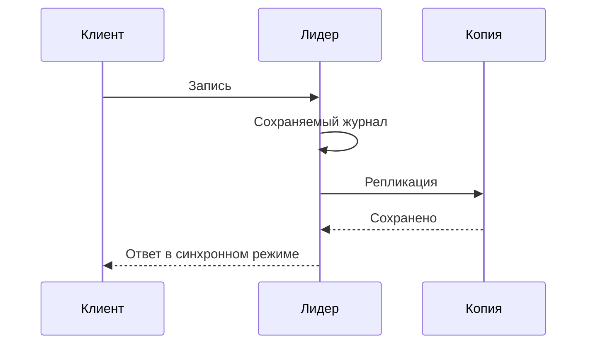

# Репликация: копии данных и задержка между ними

Репликация хранит несколько копий данных для переживания отказов и обслуживания чтений. Копия появляется не мгновенно: изменение нужно передать, сохранить и применить.

## Как это работает

В модели с одним лидером запись принимает основной узел. Последователи получают его журнал. При асинхронной записи клиент получает успех до готовности всех копий; после потери лидера часть подтверждённых клиенту изменений может отсутствовать у выбранного нового владельца. Синхронное ожидание уменьшает этот риск в своей границе, но требует доступности подтверждающих узлов.

Чтение с отстающей копии может вернуть старую цену сразу после изменения. Для чтения своей записи можно обратиться к лидеру или передать требуемую позицию журнала и дождаться её применения.

Реплика не заменяет резервную копию: ошибочное удаление обычно тоже воспроизводится. Отдельно нужны восстановление состояния на прошлый момент и проверка процедуры переключения. Время получения журнала и время его применения следует измерять раздельно.

## Разобранный пример

A ответил клиенту до передачи записи B. A потерян, B стал новым лидером: подтверждённая клиенту запись исчезла. У асинхронной репликации допустимая потеря не обязательно нулевая.

Если ответ ждёт сохраняемой записи на A и B, потеря одного узла не должна терять её в принятой модели. При переключении всё равно нужен владелец с нужной историей и защита от старого лидера. Получение, сохранение и применение журнала — разные этапы: чтение своей записи требует именно применённой позиции. Восстанавливающийся узел потребляет дисковую мощность вместе с обычными запросами, поэтому проверяют и этот режим.

## Проверь себя

1. Почему полученный журнал не гарантирует актуальное чтение?
2. Чем платим за синхронное подтверждение?

Ответы

1. Запись ещё может быть не применена к состоянию, из которого читают.
2. Ожиданием подтверждающих узлов и меньшей доступностью при их отказе.

## Источники

- [Amazon Dynamo paper](https://www.allthingsdistributed.com/files/amazon-dynamo-sosp2007.pdf)
- [Google Spanner paper](https://research.google/pubs/spanner-googles-globally-distributed-database/)
