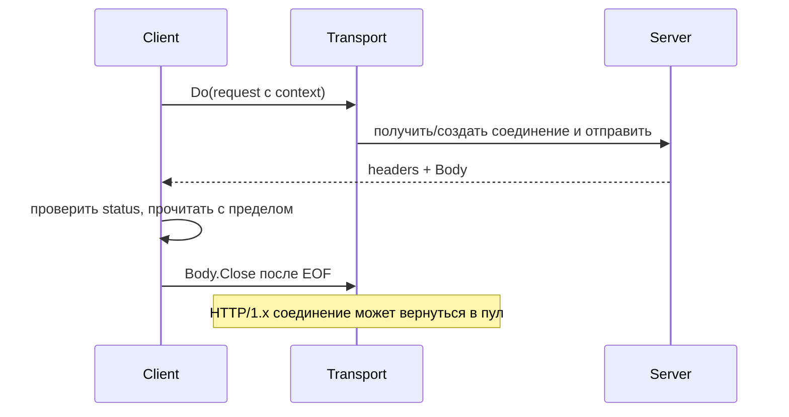

# HTTP client и Transport

HTTP-клиент выбирает соединение, отправляет запрос и получает ответ. Transport владеет пулом соединений; caller владеет полученным response body.

`http.Client` и `http.Transport` безопасны для concurrent use; обычно их создают один раз и переиспользуют. Пул соединений принадлежит Transport. Новый `Client` с `Transport: nil` использует общий `http.DefaultTransport`, поэтому сам по себе не уничтожает pooling. Новый отдельный Transport на каждый request лишает запросы общего пула.

```go
transport := http.DefaultTransport.(*http.Transport).Clone()
transport.MaxIdleConns = 200
transport.MaxIdleConnsPerHost = 50
transport.MaxConnsPerHost = 100
transport.IdleConnTimeout = 90 * time.Second
transport.TLSHandshakeTimeout = 5 * time.Second
transport.ResponseHeaderTimeout = 3 * time.Second

client := &http.Client{
	Transport: transport,
	Timeout:   5 * time.Second,
}
```

Цифры — пример. Настройка должна следовать concurrency, upstream instances, latency SLO (целевой уровень качества, например доля ответов быстрее заданного срока) и ephemeral-port/FD budget.

## Границы timeout

- `Client.Timeout` охватывает redirects, connection, headers и чтение response body.
- Request context позволяет caller задать меньший deadline/cause.
- `Dialer.Timeout` — connection establishment.
- `TLSHandshakeTimeout` — TLS handshake.
- `ResponseHeaderTimeout` — ожидание headers после отправки request.
- `IdleConnTimeout` — lifetime idle pooled connection, не request deadline.

Ноль часто означает отсутствие limit. Budget downstream call должен укладываться в remaining caller deadline и оставлять время на response/cleanup.

## Response body и reuse

Caller обязан закрыть non-nil `resp.Body`. Для HTTP/1.x connection reuse обычно нужно дочитать body до EOF; если payload не нужен, прочитайте ограниченный остаток или закройте и примите потерю reuse. Никогда не читайте unlimited hostile body.

## Pool controls

- `MaxIdleConns` — общий idle pool.
- `MaxIdleConnsPerHost` — idle connections на host; default мал для многих high-concurrency services.
- `MaxConnsPerHost` — dialing + active + idle; при достижении новые dials ждут.

Слишком низкий pool создаёт queueing; слишком высокий — overload upstream и исчерпание FDs/ports. Измеряйте connect rate, reuse, wait duration, active/idle, errors и upstream saturation. `httptrace` помогает разобрать DNS/connect/TLS/first-byte phases.

## Retries

Transport делает только ограниченные transparent retries и не гарантирует повтор любого request. Application retry требует:

- idempotent operation или idempotency (свойство повторной операции давать тот же эффект) key;
- replayable body (`GetBody`);
- общий deadline/attempt budget;
- exponential backoff + jitter (случайный разброс задержек, чтобы клиенты не повторяли одновременно);
- ограничение retry amplification;
- классификацию status/error до чтения unlimited body.

Даже `GET` может иметь плохой server-side implementation; idempotency — контракт системы, а не только HTTP method label.

## DNS, proxy и HTTP/2

Transport использует resolver и proxy configuration (`ProxyFromEnvironment` в default transport). DNS caching в основном зависит от resolver/OS; connection reuse скрывает часть lookups. HTTP/2 multiplexes streams over fewer connections, поэтому connection-count tuning и failure blast radius отличаются от HTTP/1.1.

## Безопасно прочитать небольшой ответ

Определение функции; нужны `context`, `fmt`, `io`, `net/http`:

```go
func fetch(ctx context.Context, client *http.Client, url string) ([]byte, error) {
	req, err := http.NewRequestWithContext(ctx, http.MethodGet, url, nil)
	if err != nil {
		return nil, err
	}
	resp, err := client.Do(req)
	if err != nil {
		return nil, err
	}
	defer resp.Body.Close()
	const limit = 1 << 20
	body, err := io.ReadAll(io.LimitReader(resp.Body, limit+1))
	if err != nil {
		return nil, err
	}
	if len(body) > limit {
		return nil, fmt.Errorf("response too large")
	}
	if resp.StatusCode != http.StatusOK {
		return nil, fmt.Errorf("unexpected HTTP status %d", resp.StatusCode)
	}
	return body, nil
}
```

`Do` не возвращает error только потому, что сервер ответил `500`: статус классифицирует вызывающий. `limit+1` позволяет отличить ровно допустимый размер от превышения. Большой ответ закрывается без бесконечного drain (завершение уже принятой работы после остановки приёма); возможность переиспользования HTTP/1.x соединения здесь менее важна, чем защита памяти.



## Источники

- [`http.Client`](https://pkg.go.dev/net/http#Client)
- [`http.Transport`](https://pkg.go.dev/net/http#Transport)
- [Transport retry source, Go 1.27.1](https://github.com/golang/go/blob/go1.27.1/src/net/http/transport.go)
- [`net/http/httptrace`](https://pkg.go.dev/net/http/httptrace)

## Проверь себя

1. Является ли HTTP 500 ошибкой client.Do?
2. Зачем читать limit+1, а не limit?

<details>
<summary>Ориентиры для ответа</summary>

1. Обычно нет: ответ получен успешно, код статуса проверяет приложение.
2. Чтобы обнаружить превышение; при чтении ровно limit неизвестно, есть ли ещё байты.

</details>
