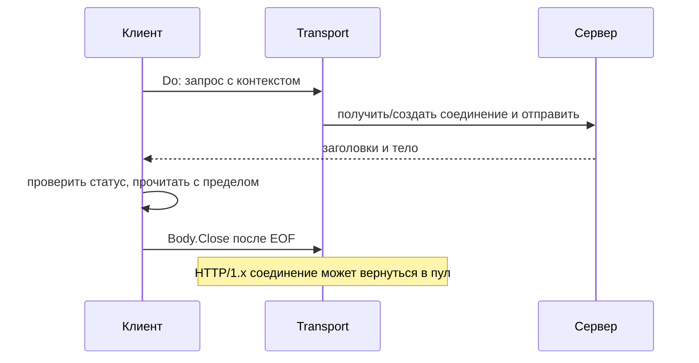

# HTTP-клиент и Transport

HTTP-клиент отправляет запрос и возвращает ответ. Transport управляет установлением и повторным использованием соединений. Получивший ответ код отвечает за его тело: прочитать нужные данные и закрыть `Body`.

`http.Client` и `http.Transport` допускают одновременное использование; обычно их создают один раз. Новый Client с `Transport: nil` использует общий `DefaultTransport` и сам по себе не уничтожает пул. Отдельный новый Transport на каждый запрос уже лишает запросы общего пула.

```go
transport := http.DefaultTransport.(*http.Transport).Clone()
transport.MaxIdleConns = 200
transport.MaxIdleConnsPerHost = 50
transport.MaxConnsPerHost = 100
transport.IdleConnTimeout = 90 * time.Second
transport.TLSHandshakeTimeout = 5 * time.Second
transport.ResponseHeaderTimeout = 3 * time.Second

client := &http.Client{
	Transport: transport,
	Timeout:   5 * time.Second,
}
```

Числа учебные. Выбирайте их по параллельной нагрузке, числу адресатов, допустимой задержке и пределам портов и файловых дескрипторов.

## Границы времени

`Client.Timeout` охватывает соединение, перенаправления, заголовки и чтение тела. Контекст запроса может задать меньший срок. `Dialer.Timeout` ограничивает установление TCP, `TLSHandshakeTimeout` — TLS. `ResponseHeaderTimeout` ждёт заголовки после отправки запроса. `IdleConnTimeout` ограничивает жизнь свободного соединения в пуле, а не время запроса.

Нулевое значение часто означает отсутствие предела. Вызов зависимости должен укладываться в оставшееся время родительского запроса, сохраняя время для ответа и завершения.

## Тело ответа и повторное использование

Закрывайте непустой `resp.Body`. Для HTTP/1.x повторное использование обычно требует чтения до EOF. Если ответ не нужен, допустимо дочитать ограниченный остаток или закрыть и пожертвовать соединением. Бесконечно читать чужое тело ради пула опасно.

## Настройки пула

`MaxIdleConns` ограничивает свободные соединения суммарно, `MaxIdleConnsPerHost` — на адресата. `MaxConnsPerHost` учитывает устанавливаемые, активные и свободные; новые подключения могут ждать лимита.

Малый пул создаёт очередь, чрезмерный перегружает зависимость и исчерпывает FD или порты. Измеряйте ожидание, создание и повторное использование. `httptrace` разделяет DNS, TCP, TLS и первый байт ответа.

## Повторы и протоколы

Transport автоматически повторяет лишь ограниченный набор ситуаций. Прикладной повтор требует безопасного повторяемого эффекта либо ключа защиты от дублирования, повторно читаемого тела (`GetBody`), общего срока и числа попыток, увеличиваемой паузы со случайным разбросом. Даже `GET` безопасен только при соответствующем поведении сервера.

По умолчанию Transport учитывает `ProxyFromEnvironment`. Кеш DNS зависит от механизма разрешения имён и ОС, а открытые соединения скрывают часть новых запросов DNS. HTTP/2 передаёт несколько потоков по меньшему числу соединений: один отказ соединения может затронуть больше работы.

## Безопасно прочитать небольшой ответ

Нужны `context`, `fmt`, `io`, `net/http`:

```go
func fetch(ctx context.Context, client *http.Client, url string) ([]byte, error) {
	req, err := http.NewRequestWithContext(ctx, http.MethodGet, url, nil)
	if err != nil {
		return nil, err
	}
	resp, err := client.Do(req)
	if err != nil {
		return nil, err
	}
	defer resp.Body.Close()
	const limit = 1 << 20
	body, err := io.ReadAll(io.LimitReader(resp.Body, limit+1))
	if err != nil {
		return nil, err
	}
	if len(body) > limit {
		return nil, fmt.Errorf("response too large")
	}
	if resp.StatusCode != http.StatusOK {
		return nil, fmt.Errorf("unexpected HTTP status %d", resp.StatusCode)
	}
	return body, nil
}
```

`Do` не считает код `500` ошибкой передачи: статус проверяет приложение. Чтение `limit+1` отличает разрешённый размер от превышения. После большого ответа соединение закрывается без бесконечного дочитывания; защита памяти важнее его сохранения.



## Источники

- [`http.Client`](https://pkg.go.dev/net/http#Client)
- [`http.Transport`](https://pkg.go.dev/net/http#Transport)
- [Transport retry source, Go 1.27.1](https://github.com/golang/go/blob/go1.27.1/src/net/http/transport.go)
- [`net/http/httptrace`](https://pkg.go.dev/net/http/httptrace)

## Проверь себя

1. Является ли HTTP 500 ошибкой `client.Do`?
2. Зачем читать `limit+1`?

<details>
<summary>Ответы</summary>

1. Обычно нет: получен корректный HTTP-ответ, статус классифицирует приложение.
2. Дополнительный байт позволяет обнаружить превышение.

</details>
