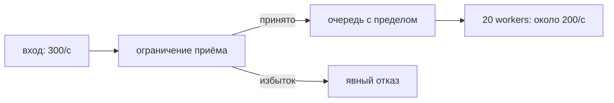

# Backpressure

Когда задачи поступают быстрее обработки, очередь растёт. Backpressure заставляет отправителя ждать или получает явный отказ до исчерпания памяти.

Backpressure не даёт producer бесконечно опережать consumer. Без неё overload превращается в рост goroutines/queue memory и tail latency (задержка самых медленных запросов, например p99), а затем — в timeout storm или OOM.

## Механизмы

- Bounded channel: producer blocks или выбирает явную drop/reject policy.
- Semaphore: ограничивает число concurrent operations.
- Admission control/rate limit: отклоняет работу до дорогих allocations (выделения памяти).
- Pull model: consumer забирает работу по доступной capacity.

```go
select {
case queue <- job:
	return nil
case <-ctx.Done():
	return context.Cause(ctx)
default:
	return ErrOverloaded
}
```

`default` здесь реализует rejection, а не ожидание. Выбор block/drop/reject должен быть частью API: для HTTP это может быть `429`/`503`, для Kafka — пауза consumption с учётом rebalance и processing deadlines.

## Что измерять

Queue depth и age oldest item, admission/rejection rate, active workers, service time, end-to-end latency, timeouts и dependency saturation. Размер buffer подбирают из latency/memory budget, а не чтобы «пережить любой spike».

## Failure modes

- Большой buffer скрывает overload до резкого обвала.
- Semaphore, взятый после allocation/DB connection, слишком поздно ограничивает дорогой ресурс.
- Retry rejected work без jitter (случайный разброс задержек, чтобы клиенты не повторяли одновременно) создаёт feedback loop.
- Общий pool позволяет одному tenant занять всю capacity; нужен fairness/partitioning.

## Посчитаем предел вместо бесконечного буфера

Есть 20 работников, каждый обрабатывает запрос в среднем 100 мс. При независимых задачах ориентировочная пропускная способность — 200 задач/с. При входящих 300 задач/с очередь растёт примерно на 100 задач каждую секунду. Буфер на 1000 задач даст около 10 секунд до заполнения; он не исправит нехватку мощности.

Если задача удерживает 64 КиБ, очередь на 1000 удерживает примерно 62,5 МиБ только полезных данных. Нужно также считать накладные расходы и время ожидания. Для устойчивого потока закон Литтла `L=λW` связывает среднее число задач, интенсивность и время в системе; для перегруженной растущей очереди устойчивого среднего нет.



Если одновременно готовы очередь и отмена, `select` может выбрать отправку. Для строгого запрета приёма после начала shutdown нужен согласованный протокол владельца, а не надежда на приоритет `ctx.Done`.

## Источники

- [Go blog: Pipelines and cancellation](https://go.dev/blog/pipelines)
- [`golang.org/x/sync/semaphore`](https://pkg.go.dev/golang.org/x/sync/semaphore)

## Проверь себя

1. Почему очередь на 1000 не выдержит постоянные 300/с при обработке 200/с?
2. Чем rejection отличается от blocking?

<details>
<summary>Ориентиры для ответа</summary>

1. Каждую секунду остаются ещё 100 задач; буфер только откладывает отказ.
2. Отказ немедленно сообщает перегрузку; blocking переносит ожидание отправителю.

</details>
