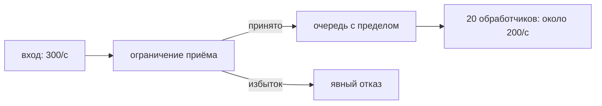

# Backpressure: ограничение входящей работы

Если задачи поступают быстрее обработки, очередь растёт. **Backpressure** передаёт перегрузку отправителю: заставляет ждать либо явно отказывает до исчерпания памяти. Большая очередь лишь откладывает проблему и увеличивает задержку.

## Механизмы

Канал с ограниченным буфером блокирует отправителя после заполнения. Семафор ограничивает одновременно выполняемые операции. Проверка допуска отклоняет работу до дорогого выделения памяти или получения соединения БД. При модели pull обработчик сам берёт работу, когда готов.

```go
select {
case queue <- job:
	return nil
case <-ctx.Done():
	return context.Cause(ctx)
default:
	return ErrOverloaded
}
```

`default` здесь означает немедленный отказ, а не ожидание. Такой договор должен быть понятен клиенту: например, HTTP `429` или `503`. Для брокера можно приостановить получение с учётом сроков обработки и перераспределения владения.

## Расчёт очереди

Двадцать обработчиков со средним временем 100 мс дают ориентировочно 200 задач/с при независимой работе. Если приходит 300/с, каждую секунду остаются лишние 100. Буфер на 1000 заполнится примерно за 10 секунд: мощности от этого больше не стало.

При 64 КиБ на задачу он удержит около 62,5 МиБ только полезных данных. Учитывайте служебную память и допустимое ожидание. Для устойчивой системы закон Литтла `L=λW` связывает среднее число задач, интенсивность и время. У бесконечно растущей перегруженной очереди такого устойчивого среднего нет.



Если отмена и очередь одновременно готовы, `select` может выбрать отправку. Для строгого запрета новых задач после начала остановки нужен согласованный протокол владельца.

## Что проверить

Измеряйте глубину очереди и возраст старой задачи, число принятых и отклонённых, активных обработчиков и итоговую задержку. Семафор после выделения большого буфера ограничивает ресурс слишком поздно. Повторы отказов без случайного разброса пауз усиливают перегрузку. Общий пул также может полностью занять один клиент: иногда нужны отдельные пределы клиентов.

## Источники

- [Go blog: Pipelines and cancellation](https://go.dev/blog/pipelines)
- [`golang.org/x/sync/semaphore`](https://pkg.go.dev/golang.org/x/sync/semaphore)

## Проверь себя

1. Исправит ли очередь на 1000 постоянный вход 300/с при обработке 200/с?
2. Чем отказ отличается от блокировки отправителя?

<details>
<summary>Ответы</summary>

1. Нет: каждая секунда добавляет 100 задач.
2. Отказ сразу сообщает перегрузку; блокировка переносит ожидание отправителю.

</details>
