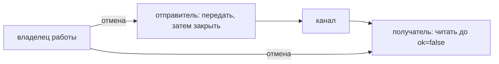

# Каналы

Канал передаёт значения между горутинами и задаёт порядок определённых действий. Небуферизованный канал требует встречи отправителя и получателя. Буфер позволяет ограниченное опережение; он не превращает канал в бесконечную или долговечную очередь.

## Таблица поведения

| Состояние | Получение | Отправка | Закрытие |
|---|---|---|---|
| `nil` | Блокируется | Блокируется | Паника |
| Открыт без буфера | Ждёт отправителя | Ждёт получателя | Успех |
| Открыт с буфером | Берёт значение или ждёт | Добавляет значение или ждёт места | Успех |
| Закрыт | Берёт остаток, затем ноль с `ok=false` | Паника | Паника |

Операция на `nil` сама не станет готовой, но внешний `select` может выбрать другую ветку.

## Отправка, получение и закрытие

```go
ch := make(chan int, 2)
ch <- 10
close(ch)

value, ok := <-ch // 10, true
value, ok = <-ch  // 0, false
```

Закрытие означает «новых значений больше не будет». Канал закрывает отправитель или владелец, доказавший завершение всех отправок. Получатель обычно не может знать этого: закрытие при чужой отправке вызывает панику.

`range ch` читает до закрытия и опустошения. Если отправитель не закрыл канал и нет отмены, цикл может навсегда остаться ждать.

## Каналы без буфера и с буфером

Буфер позволяет отправителю уйти вперёд до заполнения. Малый буфер увеличивает ожидание, большой скрывает перегрузку и удерживает память. Размер выбирают по допустимой очереди и задержке; он не заменяет контроль допуска и наблюдение.

## `select`

```go
select {
case result := <-results:
	return result, nil
case <-ctx.Done():
	return Result{}, context.Cause(ctx)
}
```

Выбирается одна готовая операция. При нескольких готовых выбор псевдослучайный: приоритета отмены или строгой справедливости между горутинами нет. `default` не ждёт и может создать пустой цикл с высокой загрузкой CPU.

Ветка с `nil`-каналом выключена. Закрытый канал готов к чтению постоянно; без проверки `ok` можно бесконечно получать нули. Выражение отправляемого значения вычисляется при входе в `select`: `expensive()` в ветке отправки может выполниться, даже если выбрана отмена.

## Оповещение всех через закрытие

```go
done := make(chan struct{})
close(done)
```

Закрытие `done` пробуждает всех наблюдающих получателей. Записи до закрытия видимы после чтения, которое обнаружило закрытие. Для отмены запроса обычно удобнее контекст: он переносит также срок и причину.

## Взаимная блокировка и завершение main

```go
func main() {
	ch := make(chan int)
	go func() { ch <- 1 }()
}
```

`main` может закончить процесс, пока другая горутина ждёт. Поэтому это не обязательная взаимная блокировка всей программы. Минимальный случай, где продолжить некому:

```go
func main() {
	ch := make(chan int)
	ch <- 1 // main blocks; matching receiver нет
}
```

Диагностика runtime не заменяет проектирование завершения работы.

## Конвейер и утечка

```go
select {
case out <- value:
case <-ctx.Done():
	return
}
```

Отмена нужна и при ожидании входа, и при отправке результата. Если получатель ушёл, отправитель иначе останется заблокирован.



Канал копирует значение, но не данные под срезом или указателем. После передачи согласуйте право изменения: отправитель больше не трогает буфер, получатель имеет независимую копию либо доступ защищён. См. [модель памяти](memory-model.md), [ограничение приёма](backpressure.md) и [утечки](goroutine-leaks.md).

## Источники

- [Go specification: Channel types](https://go.dev/ref/spec#Channel_types)
- [Go specification: Select statements](https://go.dev/ref/spec#Select_statements)
- [The Go Memory Model: Channel communication](https://go.dev/ref/mem#hdr-Channel_communication)
- [Go blog: Pipelines and cancellation](https://go.dev/blog/pipelines)

## Проверь себя

1. Что получает читатель после закрытия буферизованного канала?
2. Безопасно ли закрыть канал, пока другая горутина отправляет?

<details>
<summary>Ответы</summary>

1. Оставшиеся значения с `ok=true`, затем нулевое значение с `ok=false`.
2. Нет: возможна паника. Для остановки используйте отдельную отмену.

</details>
