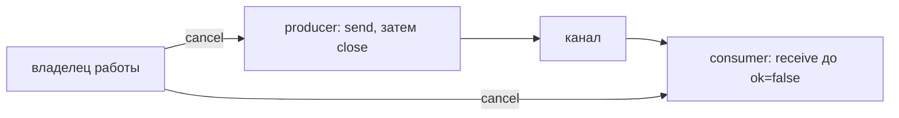

# Channels

Канал передаёт значения между goroutines. Небуферизованный канал требует встречи отправителя и получателя; буфер разрешает ограниченное опережение.

Channel передаёт typed values и одновременно может создавать happens-before relation. Buffer capacity меняет момент блокировки, но не превращает channel в надёжную бесконечную queue.

## Таблица поведения

| State | Receive | Send | Close |
|---|---|---|---|
| `nil` | blocks forever | blocks forever | panic |
| open, unbuffered | ждёт matching send | ждёт matching receive | success |
| open, buffered | читает queued value или blocks, если пуст | помещает value или blocks, если full | success |
| closed | drain (завершение уже принятой работы после остановки приёма) buffered values, затем zero value и `ok=false` | panic | panic |

«Blocks forever» означает, что сама операция не может стать ready; окружающий `select` может выбрать другую ready case.

## Send, receive и close

```go
ch := make(chan int, 2)
ch <- 10
close(ch)

value, ok := <-ch // 10, true
value, ok = <-ch  // 0, false
```

Close сообщает, что новых values больше не будет; это не уничтожение channel. Только sender/owner, который знает, что sends закончились, должен закрывать channel. Receiver обычно не закрывает channel.

`for value := range ch` читает до closed-and-drained state. Если producer никогда не закрывает channel и cancellation отсутствует, range может leak.

## Unbuffered и buffered

Unbuffered send/receive rendezvous: обе стороны синхронизируются. Buffered channel разделяет producer и consumer до заполнения buffer. Capacity — часть backpressure (замедление приёма, когда обработчик не успевает) policy:

- слишком малая увеличивает блокировки;
- слишком большая маскирует overload, увеличивает memory/queueing latency;
- buffer не заменяет bounded (с явным пределом времени, количества или размера) admission и observability.

## `select`

`select` выбирает одну ready communication case. Если ready несколько, выбор pseudo-random; спецификация не гарантирует priority или fairness между goroutines. `default` делает операцию non-blocking и может создать busy loop.

```go
select {
case result := <-results:
	return result, nil
case <-ctx.Done():
	return Result{}, context.Cause(ctx)
}
```

Nil channel case никогда не ready, поэтому присваивание `nil` удобно для динамического отключения branch. Receive из closed channel всегда ready и без comma-ok может крутить loop на zero values.

## Broadcast через close

Close synchronized-before receives, которые наблюдают closed state. Поэтому closing `done` может разбудить любое число receivers и безопасно опубликовать writes, sequenced-before close.

```go
done := make(chan struct{})
close(done)
```

Для request cancellation обычно предпочтительнее `context.Context`: он переносит deadline/cause и поддерживается I/O APIs.

## Deadlock и завершение `main`

```go
func main() {
	ch := make(chan int)
	go func() { ch <- 1 }()
}
```

Это не обязательный runtime deadlock: `main` может завершить process, пока sender blocked. Реальный минимальный deadlock:

```go
func main() {
	ch := make(chan int)
	ch <- 1 // main blocks; matching receiver нет
}
```

Deadlock detection runtime — диагностическая implementation behavior, а не substitute для lifecycle (жизненный цикл от запуска до завершения) design.

## Pipeline и leak

Каждый pipeline stage должен прекратить и receive, и send при cancellation. Если downstream ушёл после первого результата, upstream sender иначе останется blocked.

```go
select {
case out <- value:
case <-ctx.Done():
	return
}
```

## См. также

- [Модель памяти](memory-model.md)
- [Backpressure](backpressure.md)
- [Goroutine leaks](goroutine-leaks.md)

## Кто владеет закрытием и отменой



Канал данных закрывает тот, кто доказал завершение всех отправок. Отменой управляет владелец всей работы. Закрывать канал данных для остановки конкурирующего sender опасно: он может получить panic.

Канал копирует значение, но не объект под указателем и не массив под slice. После отправки buffer договоритесь, кто его меняет: «отправил и больше не трогаю», независимая копия или общая синхронизация. `select` вычисляет канал и выражение отправляемого значения при входе: тяжёлая `case ch <- expensive():` выполнит `expensive`, даже если выберется отмена.

## Источники

- [Go specification: Channel types](https://go.dev/ref/spec#Channel_types)
- [Go specification: Select statements](https://go.dev/ref/spec#Select_statements)
- [The Go Memory Model: Channel communication](https://go.dev/ref/mem#hdr-Channel_communication)
- [Go blog: Pipelines and cancellation](https://go.dev/blog/pipelines)

## Проверь себя

1. Что придёт после close buffered channel?
2. Можно ли consumer закрыть канал, пока producer отправляет?

<details>
<summary>Ориентиры для ответа</summary>

1. Сначала все уже помещённые значения с ok=true, затем ноль с ok=false.
2. Это нарушает протокол; возможен panic при send. Для остановки используйте отмену.

</details>
