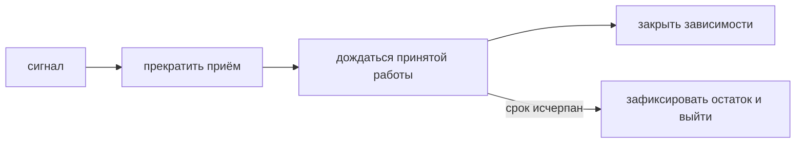

# Корректная остановка

Остановка сначала запрещает новую работу, затем даёт принятой завершиться за ограниченный срок. Это протокол, а не бесконечное ожидание всех горутин.

## Порядок

Получите сигнал и снимите готовность. Остановите приём на слушателях и в потребителях очереди. Дайте активным операциям срок завершения или отмените их по выбранному договору. Дождитесь принадлежащих компоненту горутин, затем закройте используемые зависимости. При исчерпании срока зафиксируйте незавершённую работу и завершайте принудительно.

```go
ctx, stop := signal.NotifyContext(context.Background(), os.Interrupt, syscall.SIGTERM)
defer stop()

<-ctx.Done()

shutdownCtx, cancel := context.WithTimeout(context.Background(), 20*time.Second)
defer cancel()
if err := server.Shutdown(shutdownCtx); err != nil {
	return fmt.Errorf("shutdown HTTP server: %w", err)
}
```

`http.Server.Shutdown` закрывает слушатели и свободные соединения, ждёт активные обработчики. Произвольные фоновые задачи и захваченные соединения он не знает: ими управляйте отдельно.

## Почему нужен новый контекст

Контекст `signal.NotifyContext` уже отменён, когда началась остановка. Если дать его `Shutdown`, ожидание закончится сразу. Поэтому пример создаёт новый контекст от `Background` с отдельным сроком.

Если платформа даёт 30 секунд, конкретный сервис может отвести 5 на распространение готовности, 20 на запросы и 3 на работников и критичные данные, оставив 2 запаса. Эти числа — пример расчёта. Закрытие БД раньше использующих её обработчиков сломает активную работу.



## Границы отказа

Общий срок платформы должен превышать внутренний с запасом. `SIGKILL` не перехватывается. Исключение из готовых адресатов распространяется с задержкой, поэтому старые соединения и некоторые новые запросы ещё возможны.

Потребитель Kafka согласует прекращение получения, завершение сообщений и подтверждение позиции. Таймаут остановки записи не доказывает отсутствие эффекта: повторять её можно только с защитой от дублирования.

## Источники

- [`os/signal.NotifyContext`](https://pkg.go.dev/os/signal#NotifyContext)
- [`http.Server.Shutdown`](https://pkg.go.dev/net/http#Server.Shutdown)

## Проверь себя

1. Почему нельзя использовать отменённый контекст сигнала для ожидания?
2. Когда закрывать БД относительно HTTP-обработчиков?

<details>
<summary>Ответы</summary>

1. Он сразу прервёт ожидание; нужен отдельный ограниченный срок.
2. После завершения обработчиков, которые ещё используют БД.

</details>
