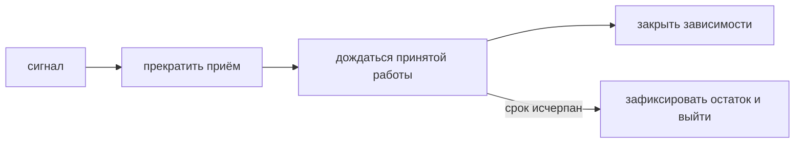

# Graceful shutdown

Плавная остановка сначала прекращает приём новых задач, затем даёт уже принятым закончить за ограниченное время. Бесконечное ожидание не является плавной остановкой.

Graceful shutdown — bounded (с явным пределом времени, количества или размера) protocol, а не бесконечное ожидание всех goroutines.

## Порядок

1. Получить shutdown signal и прекратить readiness/admission новой работы.
2. Остановить listeners/consumers так, чтобы новые tasks не появлялись.
3. Отменить background context или дать in-flight work отдельное drain (завершение уже принятой работы после остановки приёма) window.
4. Дождаться owned goroutines и закрыть producers/connections в dependency order.
5. При исчерпании deadline завершить принудительно и зафиксировать незавершённую работу.

```go
ctx, stop := signal.NotifyContext(context.Background(), os.Interrupt, syscall.SIGTERM)
defer stop()

<-ctx.Done()

shutdownCtx, cancel := context.WithTimeout(context.Background(), 20*time.Second)
defer cancel()
if err := server.Shutdown(shutdownCtx); err != nil {
	return fmt.Errorf("shutdown HTTP server: %w", err)
}
```

`http.Server.Shutdown` закрывает listeners и idle connections и ждёт active handlers, но не знает о произвольных hijacked/background resources; их lifecycle (жизненный цикл от запуска до завершения) нужно зарегистрировать отдельно.

## Production-нюансы

Orchestrator grace period должен быть длиннее внутреннего drain deadline с запасом. SIGKILL перехватить нельзя. Readiness следует выключить до закрытия listener с учётом propagation delay load balancer/service discovery.

Для Kafka consumer нужно координировать прекращение poll, завершение in-flight messages и commit policy. Для non-idempotent work timeout shutdown не должен автоматически означать безопасный retry.

## Почему shutdown context создают отдельно

Context от `signal.NotifyContext` уже отменён в момент начала остановки. Если передать его в `Shutdown`, ожидание завершится немедленно. Поэтому в примере создаётся новый context от `Background` с отдельным сроком.

Например, Kubernetes даёт процессу 30 секунд. Можно отвести 5 секунд на распространение readiness (готовность принимать новую работу)=false, 20 на HTTP drain и 3 на остановку workers/flush, оставив 2 секунды запаса. Это расчёт для конкретного сервиса, а не обязательные константы. Сбросить cache или закрыть DB до завершения handlers значит сломать ещё обслуживаемые запросы.



## Источники

- [`os/signal.NotifyContext`](https://pkg.go.dev/os/signal#NotifyContext)
- [`http.Server.Shutdown`](https://pkg.go.dev/net/http#Server.Shutdown)

## Проверь себя

1. Почему нельзя использовать отменённый signal context для drain?
2. В каком порядке закрывать DB и HTTP handlers?

<details>
<summary>Ориентиры для ответа</summary>

1. Он немедленно завершит ожидание; нужен новый bounded context.
2. Сначала завершить использующие DB handlers, затем закрыть DB.

</details>
