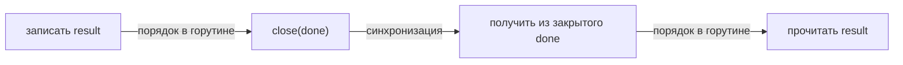

# Модель памяти Go

Когда одна горутина записала данные, другой нужно основание безопасно их прочитать. То, что прошло время или «запись, наверное, уже закончилась», не создаёт гарантии. Модель памяти определяет, какие действия устанавливают такой порядок.

## Основные отношения

**Sequenced-before** — порядок внутри одной горутины по правилам языка. **Synchronized-before** — порядок, созданный операцией синхронизации. **Happens-before** — объединение этих отношений с транзитивностью: если A до B, а B до C, то A до C.

Обычное чтение должно наблюдать видимую ему по этому порядку запись, если она не перекрыта более поздней видимой записью.

## Гонка и DRF-SC

Конкурентные обращения к одному месту без нужного порядка, хотя бы одно записывающее и неатомарные, образуют гонку данных. Без гонок результат можно объяснить некоторым последовательным чередованием действий горутин — DRF-SC. Это не делает порядок единственным.

Гонка не даёт безопасного правила «последняя запись побеждает». Описания среза, строки или интерфейса занимают несколько машинных слов. При гонке их поля могут оказаться из разных состояний: например, указатель из одной записи, а длина из другой. Это может привести к повреждению памяти.

## Создание и завершение

Записи до `go f()` видимы в начале `f`. Но простое завершение горутины не синхронизирует результат с другой:

```go
var result string

go func() { result = "ready" }()
fmt.Println(result) // data race; нет гарантии наблюдения
```

Нужен канал, WaitGroup, мьютекс или другая документированная связь.

## Каналы

Отправка предшествует завершению соответствующего получения. Закрытие предшествует получению, которое обнаружило закрытый канал и вернуло ноль. Для небуферизованного канала получение также предшествует завершению соответствующей отправки. При ёмкости C получение номер k предшествует завершению отправки номер k+C.

Эти правила относятся к соответствующим событиям. Наличие общего канала где-то в программе не упорядочивает все остальные обращения.

## Блокировки и атомарные операции

`Unlock` предшествует более позднему успешному `Lock` того же мьютекса. Завершение функции `Once.Do` видно вернувшимся вызовам того же `Once`. `Done` или возврат работы `WaitGroup.Go` предшествует разблокированному ими `Wait`. Атомарные операции Go имеют единый последовательный порядок; наблюдение их эффекта создаёт связь синхронизации. Детали каждого типа читайте в его контракте.

## Публикация данных

```go
type Config struct{ Timeout time.Duration }

var current atomic.Pointer[Config]

func publish(c *Config) { current.Store(c) }
func load() *Config     { return current.Load() }
```

Сначала объект полностью создаётся, затем публикуется атомарный указатель. Последующие изменения объекта не защищены самим `Store`. Для ленивой инициализации обычная проверка указателя вне блокировки остаётся гонкой, даже если потом проверяется ещё раз под ней. Используйте `Once`, `OnceValue` или корректный атомарный протокол.

## Видимость через закрытие канала

```go
package main

import "fmt"

func main() {
	var result string
	done := make(chan struct{})
	go func() {
		result = "ready"
		close(done)
	}()
	<-done
	fmt.Println(result) // ready
}
```



Запись до закрытия гарантированно видна после обнаружившего закрытие чтения. Новая запись после `close` уже не защищена этой связью. У буфера получение опубликованного значения не означает завершение всех последующих действий отправителя.

## Источники

- [The Go Memory Model](https://go.dev/ref/mem)
- [`sync` package](https://pkg.go.dev/sync)
- [`sync/atomic` package](https://pkg.go.dev/sync/atomic)

## Проверь себя

1. Почему `Sleep` не заменяет получение из `done`?
2. Можно ли менять снимок после `atomic.Store` без другой защиты?

<details>
<summary>Ответы</summary>

1. Время не устанавливает отношение синхронизации.
2. Нет: опубликовано предшествующее состояние, а будущие изменения не защищены.

</details>
