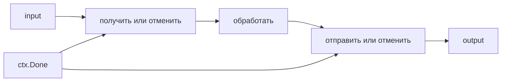

# Паттерны конкурентности

Pipeline передаёт результаты по этапам; worker pool ограничивает число одновременно работающих исполнителей. В каждом ожидании должен быть путь отмены.

Concurrency pattern полезен, когда явно задаёт ownership (ответственность за изменение данных и завершение работы), bounds, cancellation и error propagation. Схема channels без этих свойств лишь переносит leak/deadlock в production.

## Pipeline

Stage читает input, преобразует values и закрывает свой output после завершения. Downstream early exit обязан отменить upstream, иначе producer навсегда блокируется на send.

```go
func mapStage(ctx context.Context, in <-chan int) <-chan int {
	out := make(chan int)
	go func() {
		defer close(out)
		for {
			var v int
			select {
			case <-ctx.Done():
				return
			case value, ok := <-in:
				if !ok {
					return
				}
				v = value
			}
			select {
			case out <- v * v:
			case <-ctx.Done():
				return
			}
		}
	}()
	return out
}
```

Буфер сглаживает ограниченный burst, но не исправляет устойчивое превышение arrival rate. Размер выбирают из memory/latency budget и измерений.

## Fan-out и fan-in

Fan-out даёт нескольким workers общий input для параллельной независимой обработки. Это меняет completion order; если order важен, переносите sequence number и делайте bounded (с явным пределом времени, количества или размера) reorder или не распараллеливайте.

Fan-in объединяет outputs. Общий channel закрывается только после завершения всех forwarders:

```go
func merge[T any](ctx context.Context, inputs ...<-chan T) <-chan T {
	out := make(chan T)
	var wg sync.WaitGroup
	for _, input := range inputs {
		input := input
		wg.Go(func() {
			for {
				var v T
				select {
				case <-ctx.Done():
					return
				case value, ok := <-input:
					if !ok {
						return
					}
					v = value
				}
				select {
				case out <- v:
				case <-ctx.Done():
					return
				}
			}
		})
	}
	go func() {
		wg.Wait()
		close(out)
	}()
	return out
}
```

`WaitGroup.Go` доступен в Go 1.25+. Для более старого toolchain используйте `Add` до запуска goroutine и `defer Done`.

## Worker pool

Worker pool ограничивает concurrent expensive operations. Queue тоже bounded; при заполнении policy должна быть явной: backpressure (замедление приёма, когда обработчик не успевает), reject/load shed или spill в durable broker. Бесконечная in-memory queue отменяет защиту pool-а.

Количество workers выбирают по bottleneck. Для CPU-bound (ограниченный скоростью вычисления) стартуют около доступного parallelism и измеряют; для I/O-bound (ограниченный ожиданием ввода-вывода) учитывают latency, rate, dependency pool/limits и Little's Law. Больше workers может увеличить contention (конкуренция за один ресурс, например lock) и tail latency (задержка самых медленных запросов, например p99).

## Singleflight и semaphore

Singleflight объединяет concurrent одинаковую работу, но не cache-ит результат после завершения и делает callers зависимыми от одного execution. Key должен быть bounded/correctly scoped.

Buffered channel иногда используется как semaphore, но `x/sync/semaphore` поддерживает weighted acquisition/context. Release выполняют на всех paths. Локальный semaphore не ограничивает весь fleet — нужен distributed admission или downstream quota.

## Periodic/background work

Ticker/consumer/sweeper принадлежит process component-у: owner хранит cancel, goroutine вызывает `Stop`/закрывает resources и входит в shutdown wait. Не создавайте ticker на каждый request. Jitter schedules, чтобы replicas не образовали herd.

## Failure checklist

- кто закрывает каждый channel и может ли быть double close;
- что происходит при early consumer exit;
- куда возвращается первая/несколько errors;
- кто отменяет siblings;
- ограничены ли goroutines, queue и result buffering;
- сохраняется ли нужный order/idempotency;
- завершится ли shutdown при зависшем dependency;
- какие metrics/profile покажут saturation или leak.

См. [backpressure](backpressure.md), [graceful shutdown](graceful-shutdown.md), [singleflight](../../backend-patterns/singleflight.md) и [production goroutine leak](../../production/goroutine-leak.md).

## Где была скрытая утечка

`for v := range in` ждёт input без проверки context. Если input пуст и не закрыт, отмена не дойдёт до следующего `select` отправки. Поэтому в `mapStage` и `merge` выше отменяемы **оба** ожидания: получение и отправка. После выхода goroutine закрывает принадлежащий ей output; общий output merge закрывают только после всех forwarders.



Вызов `mapStage` с уже отменённым context и пустым незакрытым input должен закрыть output без поступления значения. Вызов `merge[int](ctx)` без входов закрывает output сразу после пустого `Wait`. Если обработка одного элемента сама блокируется, ей тоже нужен context; отменяемые каналы не прерывают произвольный вычислитель.

Одновременно готовые send и cancel не имеют приоритета: некоторое количество результатов может пройти после отмены. Если контракт запрещает это строго, согласуйте состояние приёма и завершения у одного владельца.

## Источники

- [Go blog: Pipelines and cancellation](https://go.dev/blog/pipelines)
- [`sync.WaitGroup`](https://pkg.go.dev/sync#WaitGroup)
- [`golang.org/x/sync/semaphore`](https://pkg.go.dev/golang.org/x/sync/semaphore)

## Проверь себя

1. Почему select только на отправке недостаточно?
2. Кто закрывает output merge?

<details>
<summary>Ориентиры для ответа</summary>

1. Функция может застрять до него на чтении пустого незакрытого input.
2. Отдельная goroutine после завершения всех отправителей, а не каждый worker.

</details>
