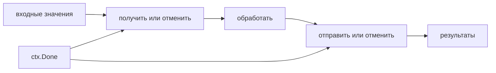

# Паттерны конкурентности

Конвейер передаёт результат через этапы. Пул работников ограничивает одновременно исполняемые задачи. Полезная схема должна также определять владельца, пределы, отмену и возврат ошибки, иначе каналы лишь спрячут утечку.

## Конвейер

Этап читает вход, преобразует значения и закрывает свой выход после завершения. Если следующий этап ушёл раньше, он отменяет предыдущие:

```go
func mapStage(ctx context.Context, in <-chan int) <-chan int {
	out := make(chan int)
	go func() {
		defer close(out)
		for {
			var v int
			select {
			case <-ctx.Done():
				return
			case value, ok := <-in:
				if !ok {
					return
				}
				v = value
			}
			select {
			case out <- v * v:
			case <-ctx.Done():
				return
			}
		}
	}()
	return out
}
```

Отменяемы и получение, и отправка. `for v := range in` без проверки отмены может навсегда ждать пустой незакрытый вход ещё до ветки отправки. Если вычисление одного элемента само блокируется, ему тоже нужен контекст.

## Разделение и объединение потоков

Несколько работников могут читать общий вход и независимо обрабатывать задачи — fan-out. Порядок завершения изменится. Если он важен, нужны номера и ограниченный буфер перестановки либо последовательная обработка.

Объединение выходов — fan-in. Общий выход закрывается только после всех пересылающих горутин:

```go
func merge[T any](ctx context.Context, inputs ...<-chan T) <-chan T {
	out := make(chan T)
	var wg sync.WaitGroup
	for _, input := range inputs {
		input := input
		wg.Go(func() {
			for {
				var v T
				select {
				case <-ctx.Done():
					return
				case value, ok := <-input:
					if !ok {
						return
					}
					v = value
				}
				select {
				case out <- v:
				case <-ctx.Done():
					return
				}
			}
		})
	}
	go func() {
		wg.Wait()
		close(out)
	}()
	return out
}
```

`WaitGroup.Go` доступен с Go 1.25. Раньше применяют `Add` до запуска и `defer Done`. Каждый работник не должен закрывать общий выход: другие ещё могут отправлять.

## Пул работников

Пул ограничивает дорогие операции, но очередь тоже требует предела. При заполнении нужно ждать, отказать или перенести работу в долговечный брокер. Бесконечная очередь в памяти отменяет защиту.

Для вычислений число работников связывают с доступным параллелизмом; для ввода-вывода — с временем, частотой и пределами зависимостей. Избыточные работники могут увеличить ожидание блокировок и медленные ответы. Буфер сглаживает всплеск, но не исправляет постоянный избыток входа.

## Объединение работы и семафор

Singleflight объединяет одновременную одинаковую работу, но не хранит результат как кеш после завершения. Ключ должен правильно отделять независимые запросы. Семафор ограничивает активные операции; `x/sync/semaphore` поддерживает вес и контекст. Освобождение нужно на всех путях. Локальный предел не защищает всю группу экземпляров сервиса.

## Фоновая работа

У таймера или потребителя есть компонент-владелец: он отменяет, останавливает ресурсы и ждёт завершение. Не создавайте постоянный таймер на каждый запрос. Случайный сдвиг расписания помогает экземплярам не начинать одинаковую работу одновременно.



При уже отменённом контексте и пустом открытом входе `mapStage` должен завершиться. `merge[int](ctx)` без входов тоже закрывает выход. Если отправка и отмена готовы вместе, отправка может победить: для строгого запрета нужен отдельный согласованный протокол.

Проверьте, кто закрывает каждый канал, куда приходит ошибка, кто отменяет соседние задачи и что ограничивает буфер результата. См. [backpressure](backpressure.md), [остановку](graceful-shutdown.md), [singleflight](../../backend-patterns/singleflight.md) и [утечки в сервисе](../../production/goroutine-leak.md).

## Источники

- [Go blog: Pipelines and cancellation](https://go.dev/blog/pipelines)
- [`sync.WaitGroup`](https://pkg.go.dev/sync#WaitGroup)
- [`golang.org/x/sync/semaphore`](https://pkg.go.dev/golang.org/x/sync/semaphore)

## Проверь себя

1. Почему отмена только отправки недостаточна?
2. Кто закрывает общий выход `merge`?

<details>
<summary>Ответы</summary>

1. Код может ещё до неё ждать вход.
2. Отдельный владелец после завершения всех отправителей.

</details>
