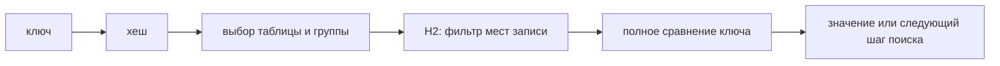

# Карты в Go

Карта (**map**) хранит значения по ключам, как словарь — определения по словам. При чтении отсутствующего ключа получается нулевое значение. Второй результат `ok` отличает отсутствие от действительно сохранённого нуля.

## Создание и чтение

```go
var nilMap map[string]int
ready := make(map[string]int)
withHint := make(map[string]int, 1_000)
literal := map[string]int{"ok": 1}
```

Число при создании помогает выбрать начальный размер, но не ограничивает карту и не задаёт гарантированную ёмкость. Ключи должны допускать сравнение `==`. Присваивание карты не копирует записи: оба значения могут работать с одними данными.

```go
fmt.Println(nilMap["missing"]) // 0
nilMap["key"] = 1              // panic
```

Из `nil`-карты можно читать; `len`, `range`, `delete` и `clear` безопасны. Запись в неё вызывает панику.

```go
value := m[key]     // zero value, если key отсутствует
value, ok := m[key] // ok различает missing и stored zero value
m[key] = value
```

Элемент карты не адресуем: `&m[key]` запрещено. При росте реализация может перемещать записи. Для изменения структуры прочитайте значение, измените копию и запишите обратно:

```go
item := m[key]
item.Count++
m[key] = item
```

## Удаление и порядок

`delete` безопасен для отсутствующего ключа. `clear` удаляет все записи, но момент освобождения или повторного использования внутренней памяти не гарантирован.

Порядок `range` не определён. Удалённая до посещения запись не будет выдана; добавленная во время обхода может попасть или не попасть в результат. Для стабильного порядка соберите ключи и отсортируйте их.

## Какие ключи подходят

Числа, строки, логические значения, указатели и каналы сравнимы. Массивы и структуры подходят, если сравнимы все части. Срезы, карты и функции ключами быть не могут. У ключа-интерфейса конкретное значение тоже должно быть сравнимым, иначе возможна паника.

Для чисел с плавающей точкой учитывайте `NaN != NaN`: такой ключ нельзя надёжно найти тем же значением. Прикладной идентификатор часто проще выразить структурой из нормализованных строк и целых чисел.

## Одновременный доступ

Параллельные чтения безопасны, пока никто не пишет. Чтение с записью или две записи без синхронизации — гонка. Иногда runtime дополнительно аварийно завершает программу, но это не способ обнаруживать все гонки. Используйте единственную горутину-владельца, обычную карту с мьютексом или `sync.Map` для её подходящих сценариев.

## Современная реализация: Swiss Tables

Начиная с Go 1.24 встроенная карта использует Swiss Tables. Здесь описан стандартный Go 1.27.1. Старые схемы `hmap`, основных и переполненных корзин, `oldbuckets` и эвакуации не описывают текущую реализацию.

Записи сгруппированы. Компактные служебные байты группы содержат часть хеша ключа либо признак пустого или удалённого места. При поиске сначала быстро проверяются эти байты; полные ключи сравниваются только у подходящих кандидатов. Так уменьшается число дорогих сравнений и обращений к разрозненной памяти.

Часть хеша H1 выбирает начальную группу и таблицу, H2 помогает отфильтровать кандидатов внутри группы. При столкновении хешей поиск идёт по последовательности других групп. Пустое место может закончить поиск, а отметка удаления не всегда может: нужная запись могла оказаться дальше.

Большая карта состоит из нескольких таблиц, выбираемых через каталог. При заполнении небольшая таблица может вырасти, а крупная — разделиться на две с перераспределением записей. Это ограничивает отдельную порцию работы по сравнению с обязательным переносом всей карты сразу. Маленькие карты имеют упрощённое представление.



Схема упрощена. Точные размеры групп и пороги роста могут меняться и не должны определять прикладную логику.

## Цена операций

Средняя стоимость поиска и записи обычно близка к O(1), но язык не обещает конкретную сложность или число проверок. Влияют цена хеша, размер ключа, распределение попаданий, столкновения, рост и работа GC. Измеряйте характерную смесь чтений и изменений; начальный размер полезен только при разумной оценке объёма.

## Присутствие и копия значения

Фрагмент внутри `main`; нужен `fmt`:

```go
type Item struct{ Count int }
m := map[string]Item{"a": {Count: 0}}
v, ok := m["a"]
fmt.Println(v.Count, ok) // 0 true
v.Count++
fmt.Println(m["a"].Count) // 0
m["a"] = v
fmt.Println(m["a"].Count) // 1
```

Для `map[string]*Item` копируется указатель, поэтому изменение поля будет общим. Безопасная карта или `sync.Map` защищает собственные операции, но не автоматически поля сохранённого объекта.

## Источники

- [Go specification: Map types](https://go.dev/ref/spec#Map_types)
- [Go blog: Faster Go maps with Swiss Tables](https://go.dev/blog/swisstable)
- [Go 1.24 Release Notes: map implementation](https://go.dev/doc/go1.24#runtime)
- [Go 1.27.1 map source](https://github.com/golang/go/blob/go1.27.1/src/internal/runtime/maps/map.go)

## Проверь себя

1. Почему `m[key].Count++` нельзя для значения-структуры?
2. Защищает ли `sync.Map` поля объекта под сохранённым указателем?

<details>
<summary>Ответы</summary>

1. Элемент карты не адресуем: надо изменить прочитанную копию и записать её обратно.
2. Нет. Изменение самого объекта требует своего порядка или синхронизации.

</details>
