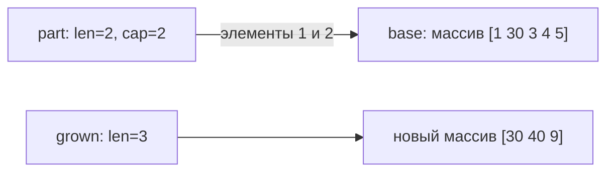

# Срезы в Go

Срез (**slice**) — окно в массив: у него есть начало, длина и доступная ёмкость. Копирование среза копирует описание окна, а не элементы. Поэтому два среза могут менять одни и те же данные.

## `len`, `cap` и создание

```go
var nilSlice []int          // len=0, cap=0, nil
empty := []int{}            // len=0, cap=0, non-nil
values := make([]int, 3, 8) // len=3, cap=8; элементы равны zero value
```

`len` — число доступных элементов, `cap` — сколько элементов можно охватить от начала среза до конца его массива. `make([]T, n)` создаёт `n` элементов. Для пустого результата с запасом под добавление нужен `make([]T, 0, n)`.

Пустой и `nil`-срез одинаково работают с `len`, `range` и `append`. Во внешнем формате разница возможна: `encoding/json` обычно выдаёт `[]` для пустого и `null` для `nil`. Это часть контракта ответа.

## Изменение окна и ограничение ёмкости

```go
base := []int{1, 2, 3, 4}
part := base[1:3]   // len=2, capacity extends into base
safe := base[1:3:3] // max bound limits capacity to 2
```

`a[low:high:max]` ограничивает ёмкость значением `max-low`. При `max=high` добавление хотя бы одного элемента требует нового массива: соседние данные за `high` не будут перезаписаны. Но существующие элементы остаются общими:

```go
package main

import "fmt"

func main() {
	base := [5]int{1, 2, 3, 4, 5}
	part := base[1:3:3] // len=2, cap=2
	part[0] = 30
	grown := append(part, 9) // capacity недостаточно: новый массив
	grown[1] = 40
	fmt.Println(base)  // [1 30 3 4 5]
	fmt.Println(part)  // [30 3]
	fmt.Println(grown) // [30 40 9]
}
```



Схема показывает связь с массивом, а не расположение машинных слов описания среза.

## `append`

```go
s = append(s, value) // результат обязательно сохранить
```

Результат `append` нужно сохранить. Если ёмкости хватает, используется прежний массив; иначе создаётся новый с копированием элементов. Это правило языка. Точный рост новой ёмкости не гарантирован: он не обязан всегда удваиваться. Разумный начальный запас уменьшает повторные выделения, а чрезмерный удерживает память.

### Неожиданное изменение общего массива

```go
func addFooter(payload []byte) []byte {
	return append(payload, '\n')
}
```

Одна функция может менять массив вызывающего при достаточной ёмкости, а при недостаточной — получить независимый массив. Если независимость нужна всегда, копируйте явно:

```go
owned := append([]byte(nil), payload...)
owned = append(owned, '\n')
```

## Копирование перекрывающихся участков

```go
values := []int{1, 2, 3, 4}
copy(values[1:], values[:3]) // [1 1 2 3]
```

`copy` переносит минимум из длин источника и приёмника; перекрывающиеся участки разрешены. Для удаления, вставки и копирования также есть пакет `slices`, который часто яснее ручного сочетания операций.

## `clear`

```go
clear(values)
values = values[:0]
```

`clear` обнуляет элементы текущей длины, но не меняет длину и ёмкость. Для указателей это убирает ссылки на объекты. Сам массив остаётся, пока до него можно добраться.

## Удержание памяти

```go
func prefix(data []byte) []byte {
	return data[:16] // может удерживать многомегабайтный data
}
```

Маленький префикс сохраняет достижимым весь большой массив. Если он живёт долго, `bytes.Clone` или `slices.Clone` отделит нужные данные. Копирование среза указателей остаётся поверхностным: указатели будут вести к тем же объектам.

## Передача между горутинами

Передача копии среза не синхронизирует доступ к массиву. Одновременное чтение и запись без нужного порядка — гонка данных. Передайте право изменения одной горутине, создайте независимые данные или защитите общий доступ.

Индекс должен находиться в пределах `len`, иначе будет паника. Срезы сравниваются только с `nil`, а не друг с другом. Внутреннее представление и алгоритм роста не являются API.

## Удаление ссылки и удаление элемента — разные операции

В `[]*Item` сдвиг `copy(items[i:], items[i+1:])` оставляет прежний последний указатель в массиве. Обнулите его перед уменьшением длины или используйте `slices.Delete`, который в современных Go очищает удалённый хвост. Иначе ненужный объект может оставаться живым.

См. [управление памятью](../runtime/memory-management.md) и [гонки](../concurrency/data-races.md).

## Источники

- [Go specification: Slice types](https://go.dev/ref/spec#Slice_types)
- [Go specification: Appending to and copying slices](https://go.dev/ref/spec#Appending_and_copying_slices)
- [Go blog: Go Slices: usage and internals](https://go.dev/blog/slices-intro)
- [`slices` package](https://pkg.go.dev/slices)

## Проверь себя

1. Почему ограничение `cap` не изолирует запись в `items[0]`?
2. Копирует ли `slices.Clone` объекты под указателями?

<details>
<summary>Ответы</summary>

1. Оно ограничивает последующее расширение, а существующие элементы остаются общими.
2. Нет: копируются сами указатели.

</details>
