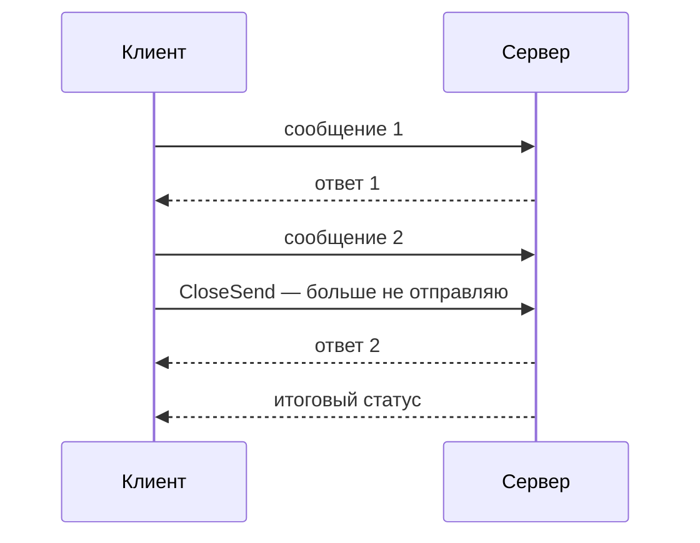

# Потоковые вызовы gRPC

Потоковый RPC передаёт несколько сообщений. Серверный вариант принимает один запрос и отправляет поток ответов; клиентский — наоборот. Двунаправленный содержит два независимых упорядоченных потока. Завершение отправки не означает завершение получения.

## Порядок и пределы

Порядок сохраняется в одном направлении одного потока, но не между RPC. Управление потоком ограничивает байты в передаче; приложение всё ещё ограничивает размер сообщения, буфер работы и число потоков. `Send` и `Recv` могут ждать, поэтому нужны общий контекст и владельцы.

## Завершение двунаправленного потока



У одного stream grpc-go допускает один Send и один Recv одновременно. Несколько Send или несколько Recv одновременно требуют последовательного доступа. `CloseSend` завершает отправку клиента, оставляя получение и итоговый статус.

## Получение сообщений

Фрагмент со сгенерированным API; `client`, `req`, `consume` определены приложением, нужен `io`:

```go
stream, err := client.ListAds(ctx, req)
if err != nil {
	return err
}
for {
	msg, err := stream.Recv()
	if err == io.EOF {
		return nil
	} // успешное завершение receive
	if err != nil {
		return err
	} // non-OK status
	if err := consume(msg); err != nil {
		return err
	}
}
```

EOF завершает получение; итоговый код RPC отличается от просто наблюдённых сообщений. Если получатель уходит раньше, владелец отменяет контекст.

Успешный Send означает передачу сообщения транспорту, а не подтверждённую бизнес-обработку сервером. Для значимой доставки нужны номера и подтверждения. Повторить весь поток после разрыва безусловно нельзя: часть сообщений уже могла быть обработана. Для продолжения нужны прикладные позиции возобновления и защита повторов.

## Источники

- [gRPC Core concepts: streaming](https://grpc.io/docs/what-is-grpc/core-concepts/)
- [grpc-go concurrency rules](https://github.com/grpc/grpc-go/blob/master/Documentation/concurrency.md)
- [gRPC flow control](https://grpc.io/docs/guides/flow-control/)

## Проверь себя

1. Что завершает `CloseSend` у двунаправленного потока?
2. Можно ли два `Send` вызвать одновременно на одном stream?

<details>
<summary>Ответы</summary>

1. Только отправку клиента; чтение ответов продолжается.
2. Нет без сериализации: нужен один отправитель.

</details>
