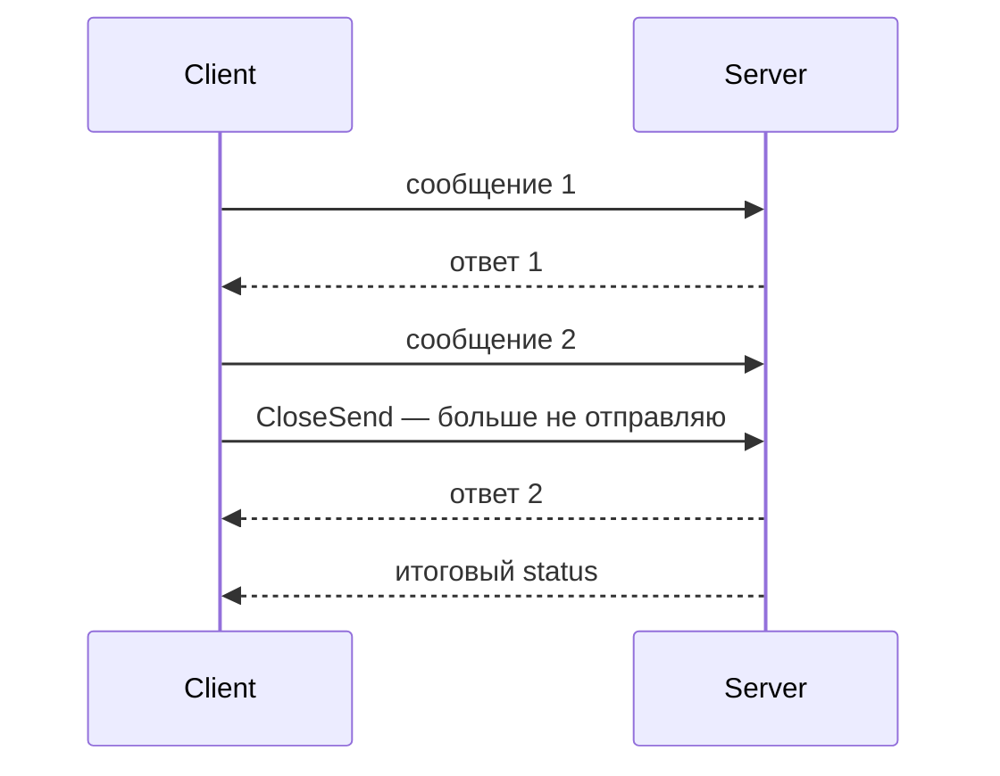

# gRPC streaming

Streaming позволяет обмениваться несколькими сообщениями в одном RPC. Направления обмена независимы: закончить отправку ещё не значит закончить получение.

- Server streaming: один request, поток responses.
- Client streaming: поток requests, один response.
- Bidirectional: два независимых ordered streams внутри RPC.

Message order сохраняется внутри отдельного stream в направлении отправки. Порядок между разными streams/RPC не гарантируется.

Flow control ограничивает bytes in flight, но application всё равно должна ограничивать message size, buffered work и concurrent streams. `Send`/`Recv` могут блокироваться; проверяйте context и не запускайте goroutine без owner.

EOF при завершении receive-side отличается от non-OK final status. Для client-streaming/bidi итоговый status может стать известен только после завершения protocol. Half-close означает, что одна сторона закончила sending, но ещё может receive.

Retries streaming RPC сложнее: уже наблюдённые/отправленные messages нельзя безусловно replay. Проектируйте resume token/sequence/idempotency на application level, если stream должен переживать reconnect.

## Завершение двунаправленного потока



Для одного stream grpc-go разрешает один Send и один Recv одновременно; несколько параллельных Send или несколько Recv требуют сериализации. Один владелец читает, другой пишет; оба используют общий context и завершаются согласованно.

Фрагмент клиента server-streaming со сгенерированным API:

```go
stream, err := client.ListAds(ctx, req)
if err != nil {
	return err
}
for {
	msg, err := stream.Recv()
	if err == io.EOF {
		return nil
	} // успешное завершение receive
	if err != nil {
		return err
	} // non-OK status
	if err := consume(msg); err != nil {
		return err
	}
}
```

`client`, `req`, `consume` зависят от вашего `.proto`; нужен `io`. Если consumer уходит раньше EOF, владелец должен вызвать cancel у context RPC. `Send` успешно завершился — сообщение принято транспортом для отправки, но не обязательно обработано сервером. Для значимой доставки нужны подтверждения с sequence number.

## Источники

- [gRPC Core concepts: streaming](https://grpc.io/docs/what-is-grpc/core-concepts/)
- [grpc-go concurrency rules](https://github.com/grpc/grpc-go/blob/master/Documentation/concurrency.md)
- [gRPC flow control](https://grpc.io/docs/guides/flow-control/)

## Проверь себя

1. Что означает CloseSend у bidi stream?
2. Можно ли одновременно вызвать два Send?

<details>
<summary>Ориентиры для ответа</summary>

1. Завершение отправки клиента; получение ответов и итогового status продолжается.
2. Для одного stream grpc-go это небезопасно; нужен один отправитель или сериализация.

</details>
