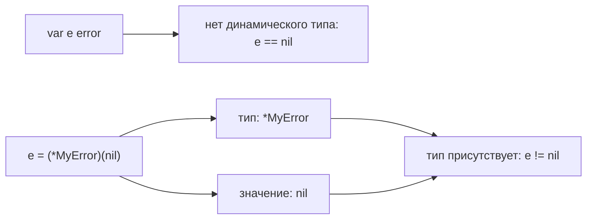

# Интерфейсы в Go

Интерфейс задаёт нужное поведение через методы. Например, читателю файла и читателю сетевого ответа достаточно общего метода `Read`: вызывающему коду не нужно знать, откуда приходят байты. Тип реализует интерфейс неявно — отдельного `implements` нет.

```go
type Reader interface {
	Read([]byte) (int, error)
}

type Buffer struct{}

func (*Buffer) Read(p []byte) (int, error) { return 0, io.EOF }

var _ Reader = (*Buffer)(nil) // compile-time assertion
```

Последняя строка проверяется компилятором: `*Buffer` должен иметь все методы `Reader`.

## Наборы методов

Набор методов `T` содержит методы с получателем `T`. Набор `*T` содержит методы с получателями `T` и `*T`. Поэтому указатель `*Buffer` реализует `Reader`, а значение `Buffer` из примера — нет. Автоматическое взятие адреса при обычном вызове метода не расширяет набор методов при присваивании интерфейсу.

## Тип и значение внутри интерфейса

У переменной есть объявленный тип интерфейса. Во время работы внутри неё либо нет конкретного значения (`nil`-интерфейс), либо хранится конкретный тип вместе со значением этого типа.

```go
var r Reader // nil interface: нет dynamic type и value
var b *Buffer = nil
r = b // dynamic type *Buffer, dynamic value nil

fmt.Println(r == nil) // false
```

`r != nil`, потому что тип `*Buffer` присутствует, хотя его значение — пустой указатель. Это часто приводит к ложной ошибке при возврате `*CustomError` как `error`: если ошибки нет, возвращайте именно `nil`.

## Присваивание, проверка и преобразование

`var r Reader = b` присваивает значение интерфейсу; наличие методов проверяет компилятор. `v, ok := x.(T)` проверяет конкретный тип внутри интерфейса во время работы. Без `ok` несовпадение вызовет панику. Проверка `x.(J)` для другого интерфейса успешна, если конкретный тип реализует `J`. Преобразование `T(x)` подчиняется правилам преобразования типов и не заменяет эти операции.

```go
switch v := x.(type) {
case string:
	fmt.Println(len(v))
case fmt.Stringer:
	fmt.Println(v.String())
default:
	fmt.Println("unsupported")
}
```

Здесь первая ветка обрабатывает строку, вторая — любой конкретный тип, умеющий возвращать строку методом `String`. Остальные значения попадают в `default`.

## Встраивание

Встраивание интерфейсов объединяет требования:

```go
type ReadWriter interface {
	io.Reader
	io.Writer
}
```

`ReadWriter` требует одновременно `Read` и `Write`. Интерфейсы с выражениями типов вроде `~int` или объединений используются как ограничения обобщённых функций. Такие небазовые интерфейсы нельзя сделать типом обычной переменной.

## Интерфейсы или generics

Интерфейс выбирают, когда нужны способности объекта: читать, сохранять, получать время. Параметр типа нужен, когда алгоритм должен сохранить конкретный тип результата или применять разрешённые операции к семейству типов.

Объявляйте небольшой интерфейс рядом с кодом, который его использует. Не создавайте интерфейс для каждой структуры заранее. Возвращайте конкретный тип, если отдельная граница между реализациями не нужна. `any` убирает полезную проверку типов, поэтому не заменяет продуманный контракт.

## Реализация и производительность

Вызов через интерфейс иногда мешает встраиванию функции компилятором или заставляет разместить объект в куче. Это не обязательное свойство каждого вызова. Проверяйте решение через `-gcflags=-m`, а стоимость — через измерения и профили. Устройство машинных слов интерфейса не является контрактом языка.

Сравнение двух интерфейсов может паниковать, если внутри лежат значения одинакового несравнимого типа, например `[]int`. Интерфейс не добавляет срезу операцию сравнения.

## Почему nil внутри интерфейса не равен nil



Схема показывает смысл значений, а не расположение памяти. Метод можно вызвать и с пустым указателем внутри интерфейса, но реализация должна уметь обработать такой получатель. Обращение к его полям вызовет панику.

## Источники

- [Go specification: Interface types](https://go.dev/ref/spec#Interface_types)
- [Go specification: Method sets](https://go.dev/ref/spec#Method_sets)
- [Go specification: Type assertions](https://go.dev/ref/spec#Type_assertions)
- [Go Wiki: CodeReviewComments — Interfaces](https://go.dev/wiki/CodeReviewComments#interfaces)

## Проверь себя

1. Почему `var e error = (*MyError)(nil)` обычно не равен `nil`?
2. Почему `T` не реализует интерфейс с методом, объявленным только для `*T`?

<details>
<summary>Ответы</summary>

1. В интерфейсе присутствует конкретный тип `*MyError`; пустое значение этого типа не убирает тип.
2. Набор методов `T` не включает методы с получателем `*T`.

</details>
