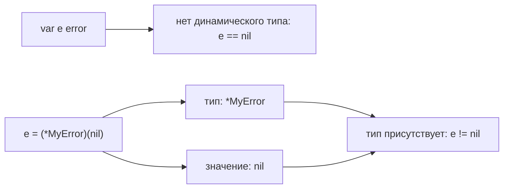

# Интерфейсы в Go

Интерфейс описывает, что объект умеет делать. Для вызова через интерфейс достаточно нужных методов; отдельное объявление implements в Go не требуется.

Interface type задаёт type set. Обычный runtime interface перечисляет методы; тип удовлетворяет ему неявно, если его method set содержит эти методы.

```go
type Reader interface {
	Read([]byte) (int, error)
}

type Buffer struct{}

func (*Buffer) Read(p []byte) (int, error) { return 0, io.EOF }

var _ Reader = (*Buffer)(nil) // compile-time assertion
```

## Method sets

- Method set определённого типа `T` содержит методы с receiver `T`.
- Method set `*T` содержит методы с receiver `T` и `*T`.

Поэтому `*Buffer` реализует `Reader`, а `Buffer` — нет. Автоматическое взятие адреса в вызове `value.PointerMethod()` не меняет правила interface assignment.

## Static type, dynamic type и dynamic value

У interface variable есть static interface type. В runtime она либо nil, либо содержит пару dynamic type + dynamic value.

```go
var r Reader // nil interface: нет dynamic type и value
var b *Buffer = nil
r = b // dynamic type *Buffer, dynamic value nil

fmt.Println(r == nil) // false
```

Typed nil часто появляется при возврате `*CustomError` как `error`. Возвращайте `nil` явно, если ошибки нет.

## Assignment, assertion и conversion

Это разные операции:

- `var r Reader = b` — interface assignment; compiler проверяет satisfaction.
- `v, ok := x.(T)` — type assertion; проверяется dynamic type interface value.
- `T(x)` — type conversion; применяется по правилам convertibility и не является runtime-проверкой interface satisfaction.

```go
switch v := x.(type) {
case string:
	fmt.Println(len(v))
case fmt.Stringer:
	fmt.Println(v.String())
default:
	fmt.Println("unsupported")
}
```

Assertion без `ok` паникует при несовпадении. Assertion к interface `x.(J)` успешна, если dynamic type `x` реализует `J`.

## Embedding

Embedding interface объединяет требования:

```go
type ReadWriter interface {
	io.Reader
	io.Writer
}
```

Non-basic interfaces с type terms (`~int`, unions) предназначены для constraints и не могут использоваться как тип обычной runtime variable.

## Интерфейсы или generics

Используйте interface, когда вызывающему важна capability (`Read`, `Store`, `Now`) и реализации могут иметь разные concrete types. Используйте type parameter, когда алгоритм должен сохранять concrete type или применять операции из constraint к набору типов.

Полезные правила дизайна:

- объявляйте маленький interface рядом с consumer;
- не создавайте interface «на будущее» для каждого struct;
- возвращайте concrete type, если abstraction boundary (граница ответственности между слоями) не нужна;
- не принимайте `any`, когда допустимые формы данных можно выразить типом.

## Реализация и производительность

Точное представление interface и dispatch (выбор и вызов реализации метода) — implementation detail. Interface call может мешать inlining или приводить к escape (выход срока жизни объекта за пределы локального stack (стек вызовов goroutine) frame), но не обязан создавать heap (куча, область хранения объектов с управляемым временем жизни) allocation (выделение памяти). Решение принимают compiler и контекст вызова; проверяйте `-gcflags=-m`, benchmarks и profiles.

## Типичные ошибки

- Typed nil внутри non-nil interface.
- Ожидание, что `T` реализует interface с pointer-receiver methods.
- Смешение conversion и assertion.
- Сравнение interface values с non-comparable dynamic type.
- «Interface pollution»: abstraction объявлена producer-слоем и содержит лишние методы.

## Почему nil внутри интерфейса не равен nil



Это схема семантики, а не описание расположения машинных слов. Вызов метода через такой интерфейс допустим, но метод с nil-получателем должен сам уметь его обработать; обращение к полю nil-указателя паникует.

## Источники

- [Go specification: Interface types](https://go.dev/ref/spec#Interface_types)
- [Go specification: Method sets](https://go.dev/ref/spec#Method_sets)
- [Go specification: Type assertions](https://go.dev/ref/spec#Type_assertions)
- [Go Wiki: CodeReviewComments — Interfaces](https://go.dev/wiki/CodeReviewComments#interfaces)

## Проверь себя

1. Что отличает nil interface от typed nil?
2. Почему сравнение any со slice может паниковать?

<details>
<summary>Ориентиры для ответа</summary>

1. У первого нет динамического типа; у второго есть тип и nil-значение.
2. Динамический тип []T не поддерживает сравнение; интерфейс не добавляет эту операцию.

</details>
