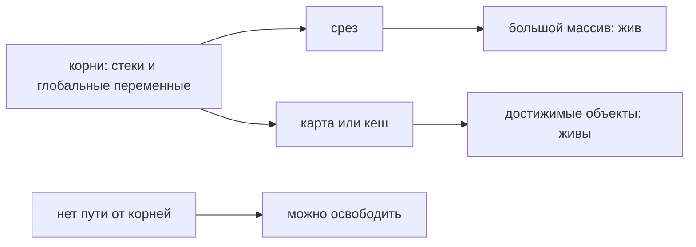

# Сборщик мусора Go

Память объекта можно освободить, когда программа больше не может до него добраться. **Сборщик мусора** (GC) находит такие объекты автоматически. Если маленький срез всё ещё указывает на большой массив, массив остаётся живым: желание «больше его не использовать» само по себе ничего не меняет.

Ниже описан стандартный Go 1.27; спецификация не требует именно такой реализации GC.

## Как находятся живые объекты

Сборщик начинает с **корней достижимости** — например, стеков горутин и глобальных переменных — и следует по указателям. Достижимые объекты помечаются; память остальных освобождается для повторного использования. Это подход mark-and-sweep: пометить и очистить.

Основная пометка выполняется параллельно программе. На отдельных переходах нужны короткие остановки всех горутин (stop-the-world, STW). Когда приложение меняет указатели, **барьер записи** добавляет учёт для сборщика, чтобы тот не потерял ещё живой объект.

Живые объекты кучи не перемещаются для уплотнения. Поэтому частично занятые области могут мешать возврату памяти ОС. Это не означает неподвижность любого адреса: стек горутины может перемещаться при увеличении.

## Green Tea

С Go 1.26 Green Tea стала сборщиком по умолчанию и используется в Go 1.27. Она по-прежнему помечает и освобождает объекты, но группирует обход вокруг страниц кучи. Близкие данные обрабатываются вместе, что может уменьшать промахи процессорного кеша. Фиксированного ускорения для любой программы это не обещает.

## Темп сборки и помощь со стороны горутин

**Pacer** рассчитывает темп сборки, чтобы пометка закончилась около целевого размера кучи. Если приложение выделяет память быстрее, чем сборщик успевает её просматривать, выделяющие память горутины могут помогать пометке (mark assists). Поэтому короткие STW-паузы ещё не означают дешёвый GC: процессор и время запроса расходуются также на параллельную работу и помощь сборщику.

## `GOGC`

`GOGC` управляет допустимым ростом кучи относительно живых объектов и корней. Более высокое значение обычно уменьшает частоту сборок, но увеличивает память; низкое меняет компромисс в обратную сторону. Это ориентир, а не жёсткий потолок.

Например, при живой куче 100 МиБ, корнях 10 МиБ и `GOGC=100` грубая цель — 210 МиБ: `live + (live+roots)*GOGC/100`. Реальное решение учитывает дополнительные условия и лимит памяти. Это не прогноз всего RSS процесса.

## `GOMEMLIMIT`

`GOMEMLIMIT` и `debug.SetMemoryLimit` задают мягкий ориентир памяти, управляемой Go. Он не равен жёсткому лимиту контейнера: за его пределами остаются, например, отображения бинарного файла, многие выделения C и память ядра. Нужен измеренный запас до лимита контейнера.

Слишком низкое значение вызывает частые сборки; среда выполнения может превысить его, чтобы программа продолжала двигаться. Он не исправляет удерживаемые ненужные объекты и не заменяет расчёт ресурсов.

## Диагностика

Команды предполагают ваш собранный `./service`. Для HTTP-профиля приложение должно включить защищённый административный слушатель pprof на 6060; запрос профиля выполняйте из другого терминала. Настройка и чтение результата — в [pprof](../performance/pprof.md).

```bash
GODEBUG=gctrace=1 ./service
go tool pprof http://localhost:6060/debug/pprof/heap
go tool pprof http://localhost:6060/debug/pprof/allocs
```

Первая команда включает журнал сборок. Профиль `heap` помогает увидеть текущую занятую память, `allocs` — накопленные выделения. В `pprof` режим `inuse_space` показывает удерживаемые байты, `alloc_space` — выделенные за время наблюдения. Профили выборочные: сравнивайте одинаковую нагрузку и несколько моментов времени.

Сопоставляйте живую кучу, целевой размер, скорость выделений, CPU сборщика, паузы, помощь сборщику и задержки медленных запросов. RSS — находящиеся в RAM страницы процесса — включает больше, чем Go-куча.

## Откуда берётся достижимость



Кеш с `payload[:16]` может удерживать исходный массив на 10 МиБ. Копирование нужных 16 байт и удаление прежней ссылки разрывает связь. `runtime.GC()` без этого не поможет: массив всё ещё нужен по графу ссылок.

После измерения уменьшайте ненужные выделения в часто исполняемом коде, ограничивайте кеши и очереди, убирайте утечки горутин. Переиспользуемые буферы тоже должны иметь предел размера. Потоковая обработка помогает не хранить весь ответ одновременно.

## Источники

- [A Guide to the Go Garbage Collector](https://go.dev/doc/gc-guide)
- [Go 1.26 Release Notes: Green Tea](https://go.dev/doc/go1.26#runtime)
- [The Green Tea Garbage Collector](https://go.dev/blog/greenteagc)
- [Go diagnostics](https://go.dev/doc/diagnostics)
- [GC algorithm, Go 1.27.1](https://github.com/golang/go/blob/go1.27.1/src/runtime/mgc.go)
- [Stack copying, Go 1.27.1](https://github.com/golang/go/blob/go1.27.1/src/runtime/stack.go)

## Проверь себя

1. Почему короткие STW-паузы не доказывают низкую стоимость GC?
2. Почему повышение `GOGC` не исправляет утечку?

<details>
<summary>Ответы</summary>

1. Пометка и помощь сборщику расходуют CPU вне этих пауз.
2. Меняется частота сборки, но достижимые ненужные объекты остаются живыми.

</details>
