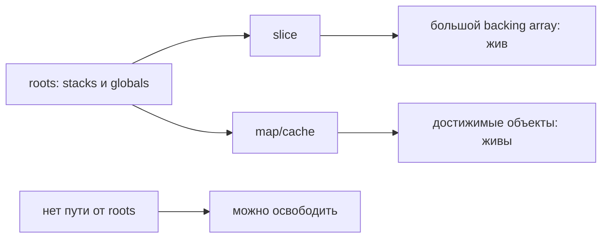

# Garbage collector Go

GC находит объекты, до которых ещё можно добраться, и освобождает остальные. Если маленькая ссылка держит большой объект, он остаётся живым независимо от желания программиста.

> Go specification не требует конкретный garbage collector. Ниже описан standard Go runtime 1.27.

Runtime использует concurrent tracing mark-and-sweep collector. Roots включают stacks и globals; mark следует по pointers и определяет reachable objects, sweep делает unreachable storage доступным allocator. Короткие stop-the-world phases нужны для transitions/root coordination, основная mark work выполняется concurrently с application.

Write barrier сохраняет корректность marking, пока application меняет pointers. Collector не перемещает живые heap (куча, область хранения объектов с управляемым временем жизни) objects и не compact-ит их, поэтому fragmentation и span occupancy важны для RSS. Это не обещание неподвижности всех адресов: runtime может перемещать goroutine stack (стек вызовов goroutine) при изменении его размера.

## Green Tea

Green Tea стала default GC в Go 1.26 и используется в Go 1.27. Она сохраняет mark-sweep semantics, но организует scanning work вокруг heap pages, чтобы улучшить locality и CPU scalability, особенно для small pointer-rich objects. Это не новая гарантия языка и не фиксированное обещание ускорения для каждого workload.

## Pacer и mutator assists

Pacer пытается завершить marking около heap goal. Если allocation (выделение памяти) rate опережает GC work, allocating goroutines могут выполнять mark assists. Это проявляется как рост GC CPU и application latency даже при коротких STW pauses.

## `GOGC`

`GOGC` задаёт trade-off CPU vs heap headroom относительно live heap и GC roots. Большее значение обычно уменьшает частоту GC и увеличивает memory; меньшее — наоборот. Это target, не жёсткий предел.

Не тюньте `GOGC` по одному pause metric. Измеряйте live heap, allocation rate, GC CPU, assist time, tail latency (задержка самых медленных запросов, например p99) и container memory.

## `GOMEMLIMIT`

`GOMEMLIMIT`/`debug.SetMemoryLimit` задаёт soft limit для памяти, управляемой runtime. Он не равен cgroup hard limit и не включает, например, binary mappings, многие cgo allocations (выделения памяти) и kernel memory. Оставляйте headroom.

Слишком низкий limit вызывает frequent GC/thrashing; runtime может превысить soft limit, чтобы application сохраняла progress. Это защита от spikes, а не замена capacity planning или исправления leak.

## Диагностика

```bash
GODEBUG=gctrace=1 ./service
go tool pprof http://localhost:6060/debug/pprof/heap
go tool pprof http://localhost:6060/debug/pprof/allocs
```

Смотрите:

- live heap и heap goal;
- allocation bytes/objects rate;
- GC CPU и pauses;
- goroutine stacks/root size;
- RSS относительно Go-managed memory;
- top allocators (`alloc_space`) и current retainers (`inuse_space`).

Heap profile — sampled. Один snapshot (снимок состояния) не доказывает leak; сравнивайте одинаковые traffic phases и profiles во времени.

## Что уменьшает pressure

- Устранение ненужных allocations на hot path после profile.
- Bounded caches/queues и устранение goroutine leaks.
- Reuse только для реально повторяющихся buffers с ограничением размера.
- Более компактные structures и меньше pointers, если измерения показывают scan cost.
- Streaming вместо удержания целого payload.

## Откуда берётся достижимость



Пример retention (удержание достижимых данных в памяти): cache хранит `payload[:16]`, но slice продолжает вести к исходным 10 МиБ. GC корректно сохраняет массив. Копирование нужных 16 байт и удаление прежней ссылки меняют достижимость; принудительный `runtime.GC()` без этого ничего не исправляет.

При live heap 100 МиБ, roots 10 МиБ и GOGC=100 грубая цель следующего цикла — 210 МиБ по модели `live + (live+roots)*GOGC/100`. Реальный pacer учитывает дополнительные условия и memory limit. Не путайте этот расчёт с гарантированным RSS: OS, stacks, metadata и внешняя память имеют собственную стоимость.

## Источники

- [A Guide to the Go Garbage Collector](https://go.dev/doc/gc-guide)
- [Go 1.26 Release Notes: Green Tea](https://go.dev/doc/go1.26#runtime)
- [The Green Tea Garbage Collector](https://go.dev/blog/greenteagc)
- [Go diagnostics](https://go.dev/doc/diagnostics)
- [GC algorithm, Go 1.27.1](https://github.com/golang/go/blob/go1.27.1/src/runtime/mgc.go)
- [Stack copying, Go 1.27.1](https://github.com/golang/go/blob/go1.27.1/src/runtime/stack.go)

## Проверь себя

1. Почему короткие STW pauses не доказывают дешёвый GC?
2. Почему увеличение GOGC не исправляет утечку?

<details>
<summary>Ориентиры для ответа</summary>

1. Concurrent marking и assists потребляют CPU и могут задерживать приложение вне STW.
2. Оно меняет частоту сборок, но достижимые ненужные объекты остаются живыми.

</details>
