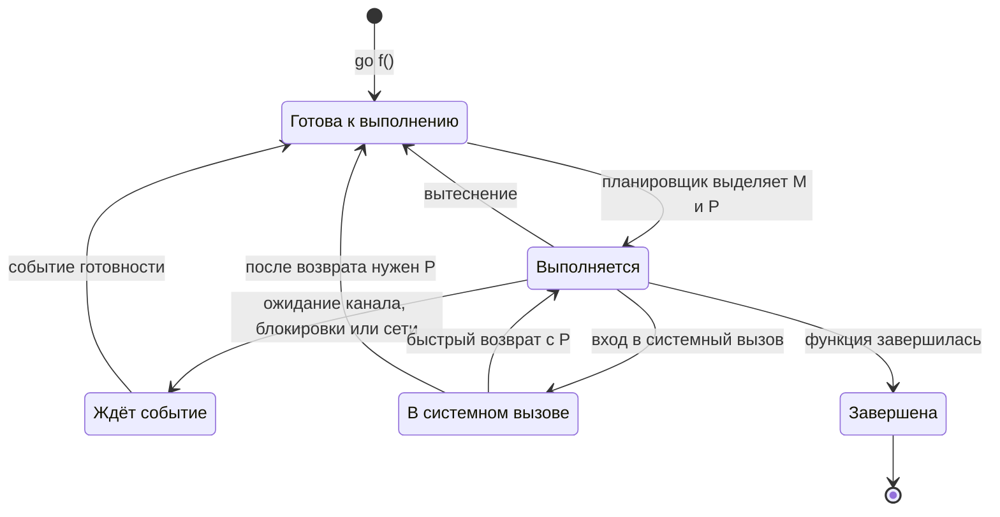

# Планировщик Go

В программе могут быть тысячи горутин, но процессор одновременно выполняет ограниченное число действий. **Планировщик** выбирает, какая готовая горутина получит время выполнения. Горутина, которая ждёт ответ сети, обычно уступает место другой.

Ниже описан стандартный Go 1.27. Устройство планировщика — деталь реализации, а не гарантия языка.

## G, M и P

**G** хранит состояние одной горутины: стек вызовов, место продолжения и служебные данные. **M** — поток операционной системы, который действительно исполняет инструкции. **P** — ресурс среды выполнения с локальными очередями и состоянием распределения памяти. Обычно для выполнения Go-кода потоку M нужен P.

`GOMAXPROCS` определяет число P, то есть сколько потоков может одновременно исполнять Go-код. Это не ограничение числа горутин или потоков ОС: другие потоки могут ждать системный вызов.

## Очереди и перераспределение работы

Готовые горутины находятся в локальных очередях P и общей очереди. Когда своей работы мало, планировщик может взять её из общей очереди или очереди другого P. Это называют **кражей работы** (work stealing): цель — не оставлять ресурс исполнения без дела.

Горутина с долгими вычислениями занимает P. Горутина, ожидающая сеть, приостанавливается и освобождает ресурс для другой. Возврат из ожидания означает «готова к выполнению», но не «уже выполняется»:



Схема упрощена: она не показывает внутренние переходы при сборке мусора. Порядок выбора и размеры очередей могут меняться; строгой очереди «кто раньше пришёл, тот раньше запущен» язык не обещает.

## Системные вызовы и ожидание сети

Если поток заблокировался в системном вызове, среда выполнения может передать его P другому потоку. Вызовы C через cgo и библиотеки, требующие конкретный поток, могут вести себя иначе и требуют отдельной диагностики.

Для сети используются механизмы ОС, которые сообщают о возможности продолжить операцию. На Linux это обычно неблокирующие сокеты и epoll. Горутина ждёт события без активного занятия P. Подробнее — [Netpoller](netpoller.md).

## Вытеснение и sysmon

**Вытеснение** (preemption) позволяет остановить долго выполняющуюся горутину и дать время другим горутинам и сборщику мусора. Служебный механизм `sysmon` помогает следить за длительными системными вызовами, таймерами и необходимостью вытеснения. Его точные интервалы и внутренние счётчики не являются контрактом приложения.

## `GOMAXPROCS` в контейнерах

Контейнеру может быть разрешено только одно CPU-секундное время за секунду, хотя узел имеет десятки ядер. Если программа без учёта лимита запустит много вычислений одновременно, она быстро израсходует квоту и будет принудительно ждать. Это **CPU throttling**, а не нехватка свободных ядер узла.

С Go 1.25 значение по умолчанию учитывает логические процессоры, разрешённые ядра и на Linux лимит CPU в cgroup; оно может периодически обновляться. Для версии языка 1.24 и ниже по умолчанию включены `GODEBUG=containermaxprocs=0,updatemaxprocs=0`: новая установленная версия Go сама по себе не меняет настройки старого модуля. Проверяйте строку `go` в главном модуле и `GODEBUG`. Kubernetes CPU request в этот расчёт не входит.

В проверенной реализации Go 1.27.1 дробная квота округляется вверх; при наличии двух доступных процессоров значение обычно не выбирается ниже 2. Поэтому `GOMAXPROCS` не обязан совпадать с CPU limit.

Положительная переменная окружения `GOMAXPROCS` или `runtime.GOMAXPROCS(n)` при `n > 0` задаёт ручное значение и отключает автоматические обновления. При `n <= 0` вызов только читает настройку. `runtime.SetDefaultGOMAXPROCS()` восстанавливает выбор по умолчанию с учётом `GODEBUG`.

## Диагностика

CPU-профиль показывает, какие функции занимали процессор. Трасса выполнения показывает готовые и ожидающие горутины, задержку запуска, системные вызовы и сборку мусора. Профиль горутин показывает, где они остановились. Метрики ОС дополняют картину квотами, потоками и переключениями контекста.


Это схема связи G, M и P, а не весь алгоритм. Для диагностического вывода:

```bash
GODEBUG=schedtrace=1000,scheddetail=1 ./service
```

Команда рассчитана на Linux/macOS; в PowerShell задайте `$env:GODEBUG` отдельно. Вывод появляется раз в секунду; его формат может меняться, а подробная запись сама создаёт нагрузку.

Большая очередь готовых горутин при занятом CPU означает ожидание выполнения. Тысячи горутин, ждущих сеть или блокировку, требуют другого расследования. `GOMAXPROCS=4` в контейнере с квотой 1 CPU не создаёт четыре доступных CPU: ограничение ОС остаётся. Сопоставляйте очередь, паузы по квоте и задержки запроса; см. [cgroups](../../linux/cgroups.md) и [ресурсы Kubernetes](../../containers/kubernetes/resources.md).

## Источники

- [Go blog: Container-aware GOMAXPROCS](https://go.dev/blog/container-aware-gomaxprocs)
- [Go 1.25 Release Notes: runtime](https://go.dev/doc/go1.25#runtime)
- [`runtime.GOMAXPROCS`, Go 1.27.1](https://pkg.go.dev/runtime@go1.27.1#GOMAXPROCS)
- [Go 1.27.1 scheduler source](https://github.com/golang/go/blob/go1.27.1/src/runtime/proc.go)
- [Go diagnostics](https://go.dev/doc/diagnostics)

## Проверь себя

1. Почему `GOMAXPROCS` не ограничивает число потоков ОС?
2. Чем готовая горутина отличается от выполняющейся?

<details>
<summary>Ответы</summary>

1. Поток может ждать системный вызов без P; P ограничивает именно одновременное исполнение Go-кода.
2. Готовая может ждать очереди. Выполняющаяся уже получила ресурс исполнения.

</details>
