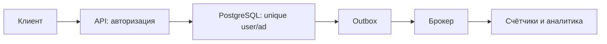

# Секция проектирования

Проектирование проверяет, связываете ли вы требования с устройством системы. Перечисление Kafka, Redis и Kubernetes не объясняет, что увидит пользователь после отказа. Каждое звено должно иметь понятную роль.

В присланном [документе для кандидатов](https://docs.google.com/document/d/1sHCn1giSMQmMoBlmOyfF8mcPo2yXZmJveGhmjVeTyd4/edit), прочитанном 26 октября 2026, секция длится **1 час**. Для продуктовых команд она опциональна: необходимость определяют по результатам программирования и платформы. Для платформенных команд она обязательна. Тип команды — существенное уточнение к краткому сообщению «проектирование опционально».

Интервьюер играет роль заказчика: даёт задачу и отвечает на вопросы о требованиях, условиях и ограничениях. В документе выделены сбор требований, High-Level Design (общая схема системы) и Deep Dive (подробный разбор основного компонента). Нужны онлайн-доска и демонстрация экрана; предложен Excalidraw, допускается привычный инструмент кандидата. По сообщению рекрутера камера включена и эта секция проходит в отдельный день.

## Критерии из присланного документа

Документ перечисляет направления оценки, но не баллы и проходной порог. Вопросы справа помогают проверить свою схему по этим направлениям.

| Направление оценки | Что проверить в своём решении |
| --- | --- |
| Сбор и дальнейшее использование требований | Можно ли связать выбранное решение с уточнённой нагрузкой, задержкой и допустимой потерей данных? |
| Высокоуровневый дизайн | Понятны ли компоненты и связи по самой схеме, без постоянных устных дополнений? |
| Глубина и полнота решения | Раскрыты ли основной компонент, API, масштабирование и географическое распределение? Объяснена ли работа конкретного балансировщика для компонентов без состояния и отказоустойчивость компонентов с состоянием? Рассмотрены ли микросервисные паттерны и мониторинг с бизнес-метриками? |
| Самостоятельность | Кандидат сам развивает решение и рассматривает граничные случаи или ждёт каждого уточнения интервьюера? |
| Принятие решений | Сопоставлены ли альтернативы, их плюсы, минусы и долгосрочные риски? |

Это ориентиры обсуждения; выбор компонентов обосновывается требованиями задачи. Одна только отрисовка схемы без объяснения отказов и альтернатив не покрывает перечисленные критерии.

## Как развить решение

Начните с действий пользователя и правил данных. Например, добавление в избранное не должно создавать два одинаковых отношения. Уточните объём, допустимую задержку, потерю данных и поведение недоступного сервиса.

Нарисуйте один полный путь: запрос → проверка → запись → ответ. Покажите, когда операция считается сохранённой. Посчитайте запросы в секунду и объём хранения с явными предположениями. Затем выберите два главных риска и разберите их глубже: горячий пользователь, потерянный ответ, отказ базы, повтор события.

Если добавляете кэш, назовите допустимое устаревание и способ обновления. Если очередь — сохранность события и повтор эффекта. Если копии — что происходит с чтением после записи. Такое объяснение позволяет оценить решение по требованиям.

Подробный [разбор процесса проектирования](../../system-design/system-design-process.md) содержит ориентиры, а [кейсы](../../system-design/README.md) — примеры разных ограничений. Это набор инструментов, не обязательный список технологий.

Источник формата: [AvitoTech о подготовке к System Design](https://habr.com/ru/companies/avito/articles/753248/).

## Один кейс: избранное

Уточните: добавить/удалить объявление, получить список, нужен ли точный счётчик, допустима ли задержка, сколько users и действий. Пусть 10 миллионов users, в среднем20 сохранений: 200 миллионов связей. Оцените размер row+indexes и пиковый QPS отдельно от среднего.

Повтор `PUT /favorites/{ad_id}` не создаёт вторую связь благодаря уникальной паре `(user_id,ad_id)` в PostgreSQL. Повтор удаления также безопасен по эффекту. Для списка курсор `(saved_at,id)` позволяет продолжить относительно последней записи. Аналитический счётчик допустимо обновлять через outbox с задержкой, а пользовательский список остаётся достоверным в базе.

Первый отказ: база сохранила добавление, ответ потерялся — повтор PUT не создаёт дубль. Второй: обработчик увеличил счётчик и упал — inbox или проверка версии защищает повтор. Для удалённого объявления нужно правило продукта: скрыть связь, показать недоступность или очистить. Кэш оправдан только измеренной пользой и допустимым устареванием.

Публичный playbook называет проектирование важным отличием уровня E5. Это исторический контекст; условия участия по типу команды выше взяты из присланного документа. Сценарий выше авторский, не закрытая задача Avito.

- [Avito recruitment playbook](https://github.com/avito-tech/playbook/blob/master/recruitment-and-office.md)

## Проверь себя

1. **Почему название Kafka не является началом решения?**

   

   
Ответ

   Сначала нужны действия и требования. Компонент оправдывается конкретным потоком и гарантией.

   

2. **Что показать при потере ответа после сохранения операции?**

   

   
Ответ

   Безопасный повтор и способ получить прежний результат по стабильному ключу.

   

