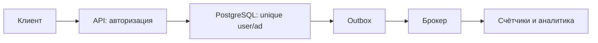

# System Design interview

Проектирование проверяет, связываете ли вы требования с решениями. Называние Kafka, Redis и Kubernetes не объясняет, как сохранится операция после падения.

AvitoTech публично описывает три части: понять задачу/границы, построить high-level design, затем углубиться в выбранные детали. У задачи нет единственного ответа; оцениваются работоспособность, trade-offs и управление долгосрочными рисками. В отчёте 2025 проектирование было дополнительной секцией для senior candidates.

## Рабочий порядок

Используйте [15-step process](../../system-design/system-design-process.md): actors/use cases → functional/non-functional requirements → estimates → API/data model → components/data flow → bottlenecks/failures → scaling/consistency/security/observability → trade-offs/evolution.

В начале возьмите инициативу: уточните аудиторию, scope, latency/availability/durability, volume и out-of-scope. Нарисуйте critical path. Углубляйтесь не во всё, а в 2–3 главных риска после согласования с интервьюером.

## Карта тем

[System Design fundamentals](../../system-design/fundamentals/README.md) · [PostgreSQL](../../databases/postgresql/README.md) · [Redis](../../databases/redis/README.md) · [Kafka](../../messaging/kafka/README.md) · [distributed systems](../../distributed-systems/README.md) · [observability](../../observability/README.md) · [security](../../security/README.md)

Практикуйте cases с разными dominant constraints: view counter, notifications, chat, favorites, classifieds. Не начинайте с microservices/Kafka; каждое звено должно отвечать конкретному требованию и иметь failure behavior.

## Источник

- [AvitoTech: подготовка к System Design](https://habr.com/ru/companies/avito/articles/753248/)

## Один кейс: избранное

Уточните: добавить/удалить объявление, получить список, нужен ли точный счётчик, допустима ли задержка, сколько users и действий. Пусть 10 миллионов users, в среднем20 сохранений: 200 миллионов связей. Оцените размер row+indexes и пиковый QPS отдельно от среднего.

Контракт PUT /favorites/{ad_id} идемпотентен; уникальная пара(user_id,ad_id) в PostgreSQL исключает duplicates. DELETE повторяем. Для списка keyset по(saved_at,id) даёт стабильную относительную навигацию. Счётчик для аналитики можно обновлять через outbox с задержкой; пользовательский список остаётся достоверным в БД.

Разберите два отказа: commit прошёл, ответ потерялся — повтор PUT не создаёт второй row; consumer упал после increment — inbox/version защищает счётчик. Удалённое объявление требует продуктового правила: скрывать, показывать unavailable или чистить связи. Кэш добавляется только при измеренной пользе и допустимой stale semantics.

Публичный playbook называет проектирование важным отличием уровня E5; конкретный набор секций подтверждается вакансией. Сценарий выше авторский, не закрытая задача Avito.

- [Avito recruitment playbook](https://github.com/avito-tech/playbook/blob/master/recruitment-and-office.md)

## Проверь себя

1. **Почему нельзя начинать с Kafka?**

   

   
Ответ

   Сначала нужны требования; каждое звено оправдывается конкретным потоком и гарантиями.

   

2. **Что ответить на crash после commit до response?**

   

   
Ответ

   Показать idempotency операции и способ повторно получить сохранённый результат.

   

