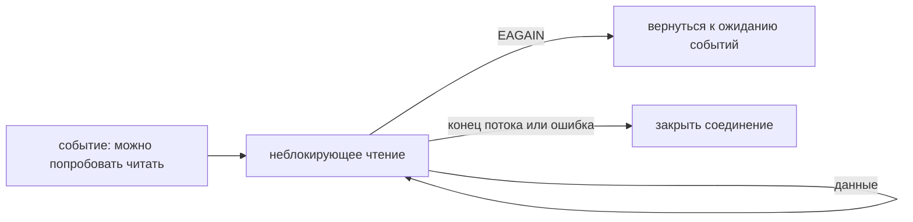

# epoll

Сервер с тысячами сокетов не должен постоянно обходить их и спрашивать: «есть ли данные?». Linux `epoll` позволяет зарегистрировать интерес к операциям и дождаться событий готовности. **Готовность** означает, что стоит попробовать чтение или запись, а не что целое сообщение уже получено.

## API

`epoll_create1(EPOLL_CLOEXEC)` создаёт дескриптор механизма ожидания. `epoll_ctl` добавляет, меняет или удаляет наблюдение за дескриптором. `epoll_wait` и `epoll_pwait` возвращают список событий без обязательного линейного обхода всего набора при каждом ожидании.

После события операция всё ещё может вернуть `EAGAIN`: например, другой обработчик уже прочитал доступные данные. Неблокирующий режим позволяет получить этот результат, а не зависнуть в ожидании.

## Два режима уведомления

**Level-triggered**, режим по умолчанию, повторяет событие, пока условие готовности сохраняется. **Edge-triggered** (`EPOLLET`) сообщает о переходе к готовности. Поэтому после события нужно повторять неблокирующие `accept`, чтение или запись до `EAGAIN`, конца данных или ошибки.

Допустим, пришло 8 КиБ, а обработчик прочитал 1 КиБ. В первом режиме событие продолжится, пока есть оставшиеся 7 КиБ. Во втором нового перехода может не быть, и данные останутся непрочитанными.

## Цикл обработки

```text
wait events
for listener readable: accept until EAGAIN
for connection readable: read until EAGAIN/EOF/error
buffer writes; enable EPOLLOUT only while pending
```

В псевдокоде `EAGAIN` означает «сейчас продолжать нечем», `EOF` — конец входного потока. Интерес к `EPOLLOUT` включают, когда действительно есть ожидающие отправки данные. Постоянно готовый к записи сокет иначе может создавать пустой цикл, расходующий CPU.



Для одного сокета назначьте владельца. `EPOLLONESHOT` отключает уведомление после события до повторного включения и помогает передать работу без двух одновременных обработчиков. Закрытие другой стороны (`EPOLLRDHUP`), ошибки и разрыв нужно обрабатывать отдельно.

## Границы механизма

`epoll` не ограничивает память выходной очереди. Медленный клиент требует предела буфера и ограничения приёма новой работы. Go использует механизмы ОС через netpoller, поэтому одна горутина на соединение не означает один поток ОС. Сроки ожидания и пределы ресурсов всё равно задаёт приложение.

## Источники

- [epoll(7)](https://man7.org/linux/man-pages/man7/epoll.7.html)

## Проверь себя

1. Чем готовность отличается от завершения операции?
2. Почему постоянный `EPOLLOUT` может нагрузить CPU?

<details>
<summary>Ответы</summary>

1. Операция ещё должна выполниться и может получить часть данных или `EAGAIN`.
2. Готовый сокет постоянно даёт событие, хотя отправлять нечего.

</details>
