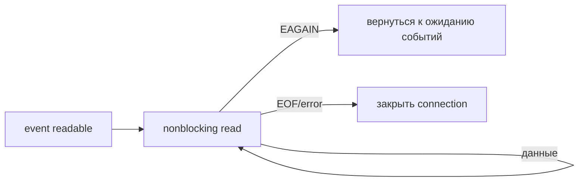

# epoll

epoll сообщает, что файловый дескриптор готов к операции. Это приглашение попробовать read/write, а не обещание, что целое сообщение уже получено.

`epoll` следит за interest set file descriptors и возвращает ready events без линейного сканирования всего набора при каждом wait. Это readiness (готовность к операции или к приёму новой работы в указанном контексте), не завершение I/O: после event операция всё ещё может дать `EAGAIN` из-за race/другого consumer.

## API

- `epoll_create1(EPOLL_CLOEXEC)` создаёт instance FD;
- `epoll_ctl` добавляет/изменяет/удаляет interest;
- `epoll_wait`/`epoll_pwait` ждёт ready list.

Level-triggered (default) повторяет event, пока condition остаётся. Edge-triggered (`EPOLLET`) сообщает изменение readiness; FD должен быть nonblocking (операция возвращает отсутствие готовности вместо ожидания), а handler обязан accept/read/write до `EAGAIN`, иначе данные могут остаться без нового edge.

`EPOLLONESHOT` отключает FD после event до rearm и помогает передавать connection worker-у без concurrent handling. `EPOLLRDHUP`, errors и hangup всё равно нужно корректно обработать и закрыть FD.

## Common loop

```text
wait events
for listener readable: accept until EAGAIN
for connection readable: read until EAGAIN/EOF/error
buffer writes; enable EPOLLOUT only while pending
```

Постоянный `EPOLLOUT` на writable socket создаёт busy loop. Slow client требует bounded output buffer/backpressure; readiness не ограничивает memory.

Go runtime netpoller использует OS readiness mechanisms, поэтому goroutine-per-connection не означает thread-per-connection. Implementation details могут меняться; application всё равно задаёт deadlines и limits.

## Почему ET требует читать до EAGAIN

Допустим, в socket пришло 8 КиБ, а обработчик прочитал только 1 КиБ. В level-triggered режиме готовность сохранится, и событие придёт снова. В edge-triggered режиме нового перехода может не быть: оставшиеся 7 КиБ будут лежать непрочитанными. Поэтому nonblocking read повторяют до `EAGAIN`/EOF/error.



Уже полученный event может устареть, если другой consumer забрал данные. Для одного socket выберите одного владельца или ONESHOT с корректным rearm. Защитите выходной buffer от медленного клиента: epoll сам не ограничивает размер очереди.

## Источники

- [epoll(7)](https://man7.org/linux/man-pages/man7/epoll.7.html)

## Проверь себя

1. Чем readiness отличается от завершения операции?
2. Что случится при постоянном EPOLLOUT?

<details>
<summary>Ориентиры для ответа</summary>

1. После readiness read всё ещё может дать EAGAIN или только часть данных.
2. Writable socket будет постоянно готов, возможен busy loop.

</details>
